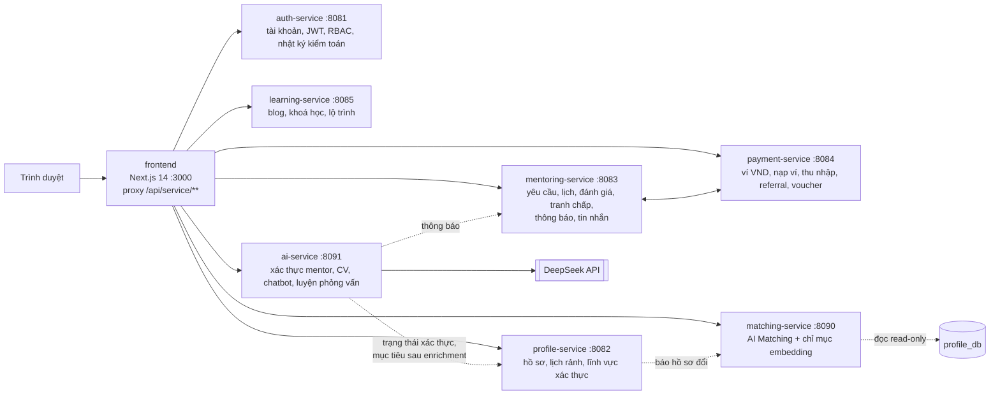

# MentorHub — Mentor-Mentee Learning Platform

Đồ án tốt nghiệp: nền tảng học tập và kết nối mentor–mentee trong lĩnh vực lập trình, kiến trúc microservices.

| | |
|---|---|
| Nhóm | Phạm Ngọc Quang · Đinh Quyết Thắng · Phạm Ninh Phương Thảo (E22CNPM03) |
| GVHD | Đào Ngọc Phong |

## Tính năng

| Vai trò | Chức năng |
|---|---|
| **Mentee** | Hồ sơ + tải CV (AI phân tích, chatbot làm rõ mục tiêu) · gợi ý mentor bằng AI Matching · gửi yêu cầu, đặt lịch, trả học phí bằng ví · phòng học video · đánh giá · tranh chấp · blog · nhắn tin · thông báo · mã giới thiệu và voucher · theo dõi tiến độ · luyện phỏng vấn với AI |
| **Mentor** | Hồ sơ nhiều lĩnh vực, lịch rảnh · **xác thực từng lĩnh vực bằng phỏng vấn AI trực tiếp** · nhận yêu cầu, xác nhận từng buổi · thu nhập và rút tiền · blog · nhắn tin |
| **Admin** | Xử lý ca xác thực chưa rõ ràng · quản lý người dùng và mentor · tranh chấp · báo cáo tin nhắn và vi phạm liên hệ · kiểm duyệt blog · giao dịch và rút tiền · nhật ký kiểm toán |

### Ba tính năng AI

1. **AI Matching** (matching-service): hồ sơ mentee và mentor được chuyển thành vector (model `paraphrase-multilingual-MiniLM-L12-v2`, pgvector). Pipeline: lọc
   cứng (đã xác thực, còn chỗ, đúng lĩnh vực...) → tìm top-K theo độ giống → xếp hạng lại (độ giống, đánh giá, kinh nghiệm, lịch rảnh, tốc độ phản hồi) → giải thích lý do.
2. **Xác thực mentor bằng phỏng vấn AI trực tiếp** (ai-service): mỗi lĩnh vực một buổi tối đa 30 phút, 5 chủ đề. Trình duyệt đọc câu hỏi, nhận dạng giọng mentor
   thành văn bản (Web Speech API) và quay video; AI chấm từng câu theo rubric 4 tiêu chí (kiến thức 40%, chiều sâu 30%, giao tiếp 15%, hướng dẫn 15%),
   tổng hợp thang 5. Từ 3,5 là đạt tự động, dưới 2,5 là không đạt (phỏng vấn lại sau 7 ngày); ở giữa hoặc có cờ (câu không có văn bản, cố tác động người chấm)
   thì chuyển admin xem video và quyết định. Mất kết nối thì tiếp tục được trong 24 giờ. Video lưu 60 ngày, chỉ admin xem được.
3. **CV Parsing + Chatbot enrichment** (ai-service): trích xuất kỹ năng, dự án, học vấn từ PDF; chatbot hỏi tối đa 4 lượt để chuẩn hoá mục tiêu nghề nghiệp, mentee duyệt rồi mới ghi vào hồ sơ.

Engine AI: **DeepSeek** (khi có `DEEPSEEK_API_KEY`) hoặc **rule-based** chạy offline; lời gọi DeepSeek lỗi thì lượt đó tự dùng rule-based.
`OPENAI_API_KEY` chỉ cần cho tính năng luyện phỏng vấn giọng nói của mentee, không cần cho xác thực mentor.

## Kiến trúc



- Mỗi service Java (Spring Boot 3.3, Java 21) hoặc Python (FastAPI 3.11) có **CSDL PostgreSQL 16 riêng** (7 CSDL; `matching_db` dùng pgvector). Không service nào ghi vào CSDL của service khác; liên kết chéo chỉ là UUID.
- Frontend không gọi thẳng service: Next.js proxy `/api/<service>/**` tới service tương ứng (không có API Gateway riêng). `/internal/**` chỉ giữa các service, xác thực bằng header `X-Internal-Token`.
- Xác thực bằng JWT HS256 (`JWT_SECRET` dùng chung), phân quyền `MENTEE` / `MENTOR` / `ADMIN`. Lỗi trả thống nhất `{ "error": { "code", "message" } }`.
- Hạ tầng: Docker Compose, Redis, MinIO (object storage S3), Mailpit (email dev), Jitsi tự host (profile `jitsi`) cho phòng học video, GitHub Actions.
- Contract-first: mọi endpoint được khai báo trong `contracts/<service>.yaml` (OpenAPI 3) trước khi code.

### Luồng chính

- **Xác thực mentor:** mentor chọn lĩnh vực → phỏng vấn AI → đạt thì ai-service cập nhật trạng thái lĩnh vực sang profile-service → mentor xuất hiện trong gợi ý và đặt lịch được.
- **Kết nối và học:** mentee gửi yêu cầu → mentor chấp nhận → mentee đặt lịch, học phí được tạm giữ từ ví → mentor xác nhận buổi → vào phòng học → hệ thống kết luận tham dự → tiền chuyển cho mentor sau thời gian khiếu nại → hai bên đánh giá. Huỷ, đổi lịch và tranh chấp có chính sách riêng (mentoring-service + payment-service).
- **Matching:** profile-service lưu hồ sơ rồi báo matching-service lập lại chỉ mục (bắn rồi quên, job đồng bộ 60 giây bù khi mất thông báo) → kết quả nhất quán cuối cùng.

## Chạy nhanh

Yêu cầu: Docker Compose.

```bash
cp .env.example .env               # tuỳ chọn: điền DEEPSEEK_API_KEY để chấm bằng DeepSeek
docker compose up -d --build       # lần đầu 5–15 phút
python3 scripts/seed_demo.py       # mentor + mentee mẫu
python3 scripts/seed_content.py    # ảnh đại diện, khoá học, lộ trình, bài blog (chạy lại an toàn)
python3 scripts/seed_verification_demo.py   # 5 mentor ở các bước xác thực khác nhau
```

Mở <http://localhost:3000> (hoặc cổng `FRONTEND_PORT` trong `.env`). Health check:

```bash
for p in 8081 8082 8083 8084 8085 8090 8091; do curl -s localhost:$p/health; echo; done
```

Tài khoản demo (mật khẩu `Demo@123`): mentee `mentee@demo.local`, `mentee.frontend@demo.local`; mentor đã duyệt `mentor.java@demo.local`, `mentor.node@demo.local`,
`mentor.python@demo.local`, `mentor.react@demo.local`, `mentor.devops@demo.local`, `mentor.data@demo.local`; mentor ở các bước xác thực `verify.ready|progress|unclear|passed|failed@demo.local`.
Admin: `admin@mmp.local` / `Admin@123`.

Phòng học Jitsi (tuỳ chọn): `docker compose --profile jitsi up -d`, mở https://localhost:8443 một lần để chấp nhận chứng chỉ tự ký; media cần UDP 10000.

## Kiểm thử

```bash
python3 scripts/smoke_frontend_api.py      # smoke test các endpoint frontend gọi (qua proxy, cần đã seed)
python3 scripts/e2e_acceptance.py          # kiểm thử chấp nhận theo Definition of Done
python3 scripts/benchmark_matching.py      # hiệu năng AI Matching
(cd mentoring-service && mvn test)         # tương tự các service Java khác
(cd matching-service && pip install -r requirements-dev.txt && pytest -q tests)
(cd ai-service && pip install -r requirements-dev.txt && pytest -q tests)   # cần Postgres ở AI_DB_URL, không có thì test CSDL tự skip
```

Các script e2e cần `INTERNAL_API_KEY` trong môi trường. `db/init/*.sql` chỉ chạy khi volume CSDL mới được tạo; muốn áp lại từ đầu phải `docker compose down -v` (**xoá toàn bộ dữ liệu**).

## Cấu trúc repo

```
CONVENTIONS.md            quy ước nhóm: sở hữu service, Git workflow, contract-first, bảo mật, UI/UX
docker-compose.yml        toàn bộ hệ thống
.env.example              mẫu biến môi trường (không chứa khoá thật)
contracts/                OpenAPI từng service
db/init/                  schema SQL + dữ liệu seed Learning Hub
scripts/                  seed_*.py, smoke_frontend_api.py, e2e_*.py, benchmark_matching.py
auth-service/ learning-service/ profile-service/ mentoring-service/ payment-service/   Java 21, Spring Boot 3.3
matching-service/         FastAPI, sentence-transformers, pgvector (matching_db)
ai-service/               FastAPI, DeepSeek (httpx), pypdf, asyncpg (ai_db)
frontend/                 Next.js 14 + TypeScript (src/app = trang, src/features = API client và thành phần theo tính năng)
```

## Hạn chế đã biết

- AI Matching nhất quán cuối cùng: hồ sơ mới hoặc sửa có thể chưa có trong kết quả tới ~60 giây (`INDEX_SYNC_INTERVAL`).
- Thanh toán là sandbox (MoMo test, VNPay sandbox), chưa thử cổng thật; học phí chỉ trả từ ví.
- Nhận dạng giọng nói trong xác thực mentor phụ thuộc trình duyệt (Chrome, Edge ổn); thiếu văn bản thì câu đó chuyển admin xem video.
- File (CV, video xác thực, ảnh đại diện, ảnh bìa blog, file đính kèm) lưu ở MinIO (API chuẩn S3) trong docker compose; muốn dùng AWS S3 / Cloudflare R2 chỉ đổi biến `S3_*`. Tin nhắn vẫn nằm trong Postgres. Chưa mã hoá phía server và chưa có dọn dẹp file mồ côi khi xoá hội thoại.
- Không có API Gateway riêng; `.env.example` và code có bí mật mặc định cho dev (`JWT_SECRET`, `INTERNAL_API_KEY`, mật khẩu CSDL) — bắt buộc thay khi triển khai thật.
- CV xoá được nhưng chưa có thời hạn lưu tự động và mã hoá khi lưu.
