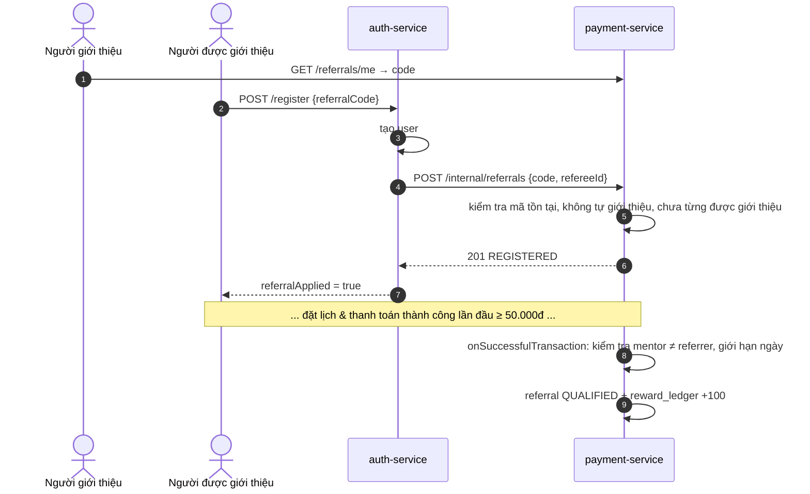
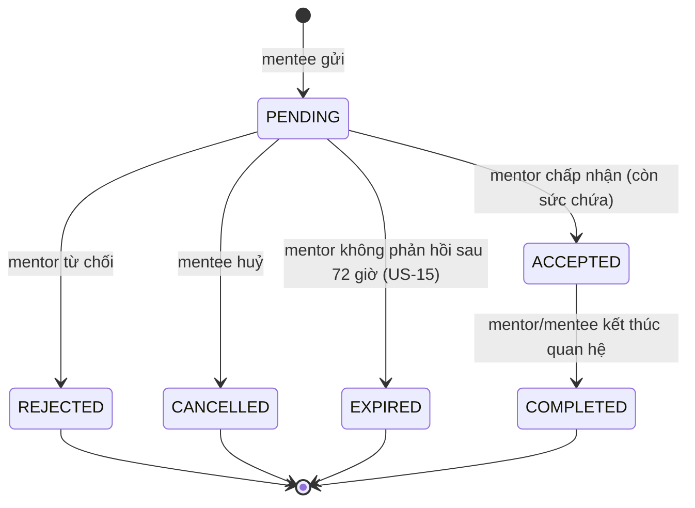
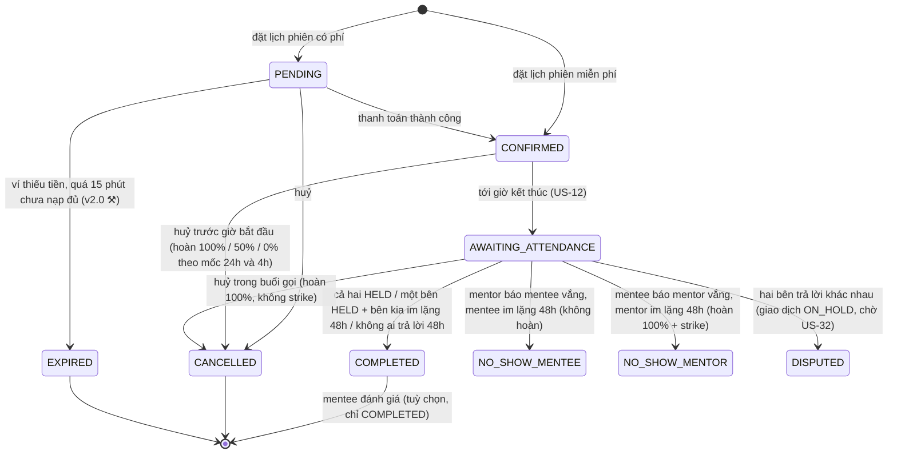
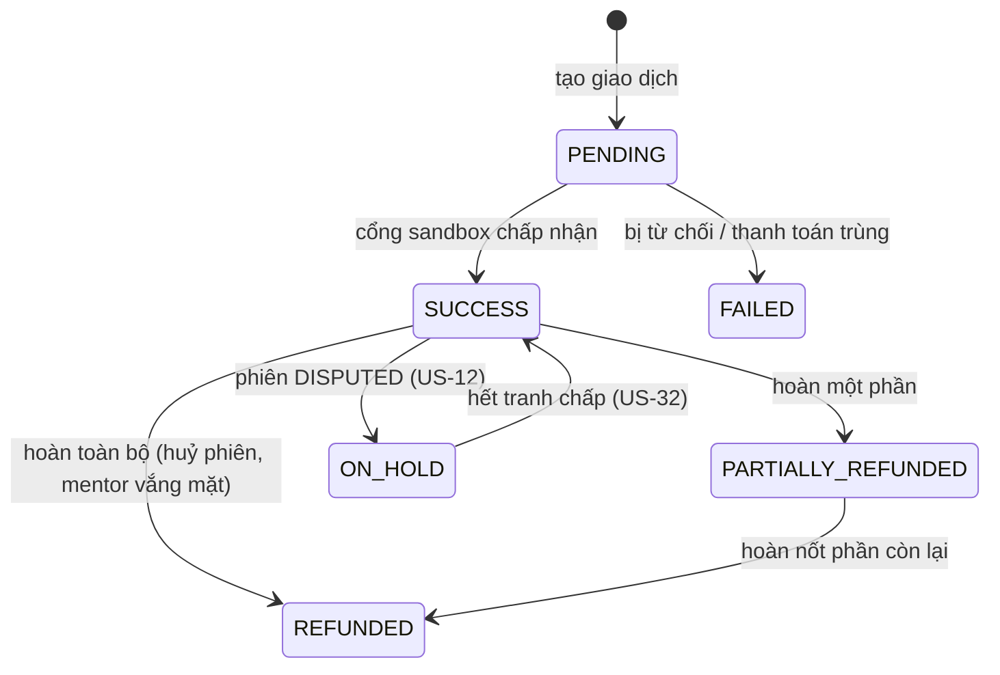
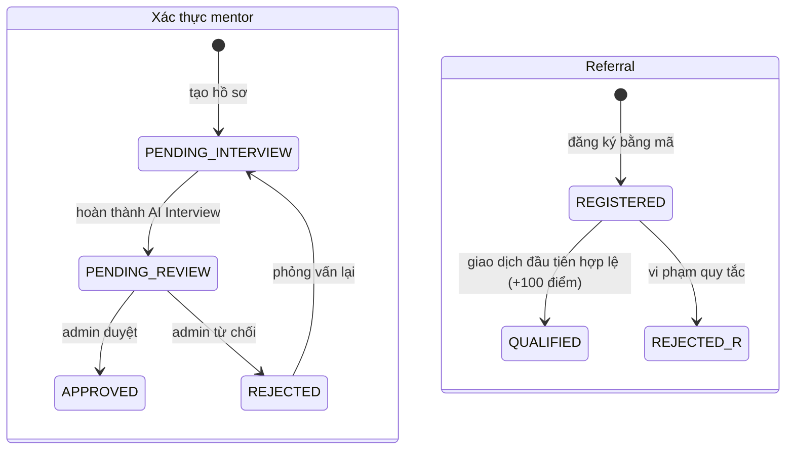

# Quy trình nghiệp vụ — MentorHub

> **v2.0 (21/10/2026)** — nội dung đánh dấu ⚒ là **mục tiêu theo bản chốt** [ban-chot-nghiep-vu.md](ban-chot-nghiep-vu.md), chưa hiện thực; phần không đánh dấu mô tả hệ thống hiện tại.


Tài liệu mô tả nghiệp vụ theo 3 góc nhìn, dùng cho chương **Phân tích yêu cầu** và **Thiết kế** của báo cáo:
1. Biểu đồ use case theo tác nhân
2. Luồng nghiệp vụ dạng *màn hình → hành động → nhánh rẽ → kết quả* (theo định dạng SRD mục 8)
3. Sơ đồ tuần tự giữa các service và sơ đồ trạng thái của các thực thể chính

---

## 1. Tác nhân & use case

```mermaid
flowchart LR
    Mentee((Mentee))
    Mentor((Mentor))
    Admin((Admin))
    Timer((Bộ lập lịch<br/>hệ thống))

    subgraph Chung
      UC1[Đăng ký / đăng nhập / xác thực email]
      UC2[Quản lý tài khoản, đổi mật khẩu]
      UC3[Học trên Learning Hub, theo dõi tiến độ]
      UC4[Xem thông báo]
      UC5[Giới thiệu bạn bè, xem điểm thưởng]
    end
    subgraph Mentee_UC[Mentee]
      UC10[Tạo/sửa hồ sơ nghề nghiệp]
      UC11[Upload CV & trả lời chatbot enrichment]
      UC12[Xem mentor được AI đề xuất]
      UC13[Gửi / huỷ yêu cầu mentoring]
      UC14[Đặt lịch phiên]
      UC15[Thanh toán sandbox]
      UC16[Huỷ phiên]
      UC17[Đánh giá mentor]
    end
    subgraph Mentor_UC[Mentor]
      UC20[Tạo/sửa hồ sơ mentor, điền nhanh từ CV]
      UC21[Khai báo lịch rảnh]
      UC22[Làm AI Interview]
      UC23[Chấp nhận / từ chối yêu cầu]
      UC24[Đánh dấu phiên hoàn thành]
      UC25[Kết thúc quan hệ mentoring]
    end
    subgraph Admin_UC[Admin]
      UC30[Xem & khoá/mở khoá người dùng]
      UC31[Duyệt kết quả AI Interview]
      UC32[Quản lý khoá học, tài liệu, roadmap]
      UC33[Giám sát giao dịch & referral]
      UC34[Sinh lại embedding<br/>matching-service]
    end
    subgraph System_UC[Tự động]
      UC40[Nhắc lịch trước phiên]
      UC41[Huỷ phiên quá hạn thanh toán]
      UC42[Đồng bộ chỉ mục embedding / đối soát thanh toán]
    end

    Mentee --- UC1 & UC2 & UC3 & UC4 & UC5 & UC10 & UC11 & UC12 & UC13 & UC14 & UC15 & UC16 & UC17
    Mentor --- UC1 & UC2 & UC3 & UC4 & UC5 & UC16 & UC20 & UC21 & UC22 & UC23 & UC24 & UC25
    Admin --- UC1 & UC30 & UC31 & UC32 & UC33 & UC34
    Timer --- UC40 & UC41 & UC42
```



---

## 2. Luồng nghiệp vụ chi tiết

### 2.1 auth-service

**Đăng ký tài khoản** (FR-1.1)

Người dùng mở nền tảng → Trang chủ hiển thị giới thiệu cùng 2 nút *Đăng ký* và *Đăng nhập* → Người
dùng chọn *Đăng ký* (hoặc mở liên kết giới thiệu `/register?ref=MÃ`, ô mã giới thiệu được điền sẵn) →
Giao diện đăng ký hiển thị lựa chọn vai trò (Mentee/Mentor), họ tên, email, mật khẩu, mã giới thiệu →
Người dùng nhập thông tin và bấm *Đăng ký* → Hệ thống kiểm tra dữ liệu (email hợp lệ, mật khẩu ≥ 8 ký
tự) → **Nếu email đã tồn tại**: báo lỗi "Email đã được sử dụng", giữ nguyên form → **Nếu hợp lệ**: tạo
tài khoản (mật khẩu băm BCrypt), sinh liên kết xác thực email, nếu có mã giới thiệu thì ghi nhận
referral bên payment-service (mã sai không chặn đăng ký, chỉ hiển thị cảnh báo), cấp access token +
refresh token → Chuyển tới trang chủ theo vai trò kèm thông báo chào mừng và liên kết xác thực email.

**Đăng nhập** (FR-1.2)

Người dùng chọn *Đăng nhập* → Nhập email, mật khẩu → Hệ thống kiểm tra email có đang bị chặn tạm thời
→ **Nếu đã sai quá 5 lần**: báo "thử lại sau 15 phút" → Kiểm tra thông tin → **Nếu sai**: tăng bộ đếm,
báo "Email hoặc mật khẩu không đúng" → **Nếu tài khoản bị khoá**: báo "Tài khoản đã bị khoá" → **Nếu
đúng**: xoá bộ đếm, cấp token → Chuyển tới trang chủ mentee/mentor hoặc bảng điều khiển admin.

**Duy trì phiên đăng nhập**

Access token hết hạn (30 phút) → Request nhận 401 → Frontend tự gọi *refresh* với refresh token →
**Nếu hợp lệ**: token cũ bị thu hồi, cấp cặp mới, request được gửi lại tự động → **Nếu không hợp lệ**:
xoá phiên, chuyển về trang đăng nhập.

### 2.2 profile-service

**Tạo/chỉnh sửa hồ sơ mentor** (FR-2.4, FR-2.5)

Mentor đăng nhập → Trang chủ mentor hiển thị các bước: hoàn thành hồ sơ, khai báo lịch rảnh, vượt
qua AI Interview → Mentor chọn *Hồ sơ* → Giao diện hồ sơ hiển thị giá trị hiện có (tên hiển thị, lĩnh
vực, số năm kinh nghiệm, kỹ năng, giới thiệu, mức phí/giờ, sức chứa, portfolio, trạng thái nhận
mentee) và ô *Điền nhanh từ CV* → (Tuỳ chọn) Mentor tải CV PDF → hệ thống trích xuất kỹ năng và số năm
kinh nghiệm, điền vào form để mentor kiểm tra → Mentor chỉnh sửa và bấm *Lưu hồ sơ* → Hệ thống lưu hồ sơ,
báo cho matching-service biết hồ sơ vừa đổi (**không chờ kết quả**) → matching-service đọc hồ sơ, chuẩn
hoá thành đoạn văn bản và **nếu nội dung thay đổi** thì sinh embedding mới vào `matching_db` → **Nếu
matching-service lỗi hoặc đang down**: hồ sơ vẫn lưu bình thường, `IndexSyncJob` phát hiện lệch hash ở
vòng quét sau và tự embed lại → Hiển thị thông báo thành công; lần đầu tạo hồ sơ nhắc bước tiếp theo
là AI Interview.

**Khai báo lịch rảnh** (FR-2.4)

Trong trang hồ sơ, mentor thêm các khung *Thứ – giờ bắt đầu – giờ kết thúc* → Bấm *Lưu lịch rảnh* →
Hệ thống kiểm tra giờ kết thúc sau giờ bắt đầu và các khung trong cùng ngày không chồng lấn → **Nếu
sai**: báo lỗi → **Nếu đúng**: thay toàn bộ lịch rảnh cũ bằng lịch mới.

**Tạo/chỉnh sửa hồ sơ mentee** (FR-2.1 → FR-2.3)

Mentee chọn *Hồ sơ* → Nhập tên hiển thị, lĩnh vực muốn học, trình độ, kỹ năng hiện có, mục tiêu học
tập, portfolio → Bấm *Lưu* → Hệ thống lưu và lập chỉ mục embedding như trên → Gợi ý bước tiếp theo: tải CV để
chatbot làm rõ mục tiêu hoặc tìm mentor ngay.

**Xem hồ sơ tóm tắt (nội bộ)**

Một service khác (mentoring-service khi hiển thị danh sách yêu cầu/phiên) yêu cầu tóm tắt hồ sơ của 1
người dùng → profile-service tìm trong hồ sơ mentor rồi mentee → **Nếu không có**: trả 404 (bên gọi
hiển thị "Người dùng") → **Nếu có**: trả tên hiển thị, vai trò, lĩnh vực — không kèm vector embedding.

### 2.3 matching-service

**Tìm mentor phù hợp** (FR-4.x, FR-5.1)

Mentee chọn *Tìm mentor* → Hệ thống lấy hồ sơ (profile_db) và embedding (matching_db) của mentee; nếu
hồ sơ đã có mà chỉ mục chưa kịp cập nhật thì lập chỉ mục ngay trong request → **Nếu vẫn chưa có**:
thông báo "Bạn cần hoàn thành hồ sơ nghề nghiệp trước khi tìm mentor" kèm nút tạo hồ sơ → **Nếu đã
có**: lấy top-K mentor gần nhất theo cosine → loại mentor chưa được duyệt, tạm ngưng nhận mentee, chưa
có lịch rảnh, đã đủ sức chứa, khác lĩnh vực → tính điểm cuối kết hợp độ tương đồng, đánh giá, kinh
nghiệm → sinh lý do đề xuất → Giao diện hiển thị dòng tóm tắt pipeline (bao nhiêu mentor bị loại vì lý
do gì) và các thẻ mentor: tên, lĩnh vực, % phù hợp, kỹ năng (kỹ năng trùng được tô màu), lý do đề xuất,
mức phí → Mentee bấm *Xem hồ sơ* hoặc *Gửi yêu cầu mentoring* → **Nếu không có mentor phù hợp**: gợi ý
bổ sung kỹ năng/mục tiêu.

### 2.4 mentoring-service

**Gửi yêu cầu mentoring & phản hồi** (FR-5.2, FR-5.3)

Mentee bấm *Gửi yêu cầu mentoring* ở thẻ/hồ sơ mentor → Trang `/mentoring/request/{mentorId}` (US-14): nhập mục
tiêu (50–1000 ký tự, điền sẵn từ goal trong hồ sơ), loại phiên, tần suất (hằng tuần / 2 tuần / hằng tháng / một lần),
thời gian dự kiến (1/3/6 tháng), lời nhắn tuỳ chọn → Hệ thống kiểm tra mentor đã được duyệt, đang nhận mentee, chưa
có yêu cầu đang chờ/đang hoạt động giữa hai bên, mentee có ít hơn 3 yêu cầu đang chờ → Tạo yêu cầu, thông
báo mentor → Mentor mở *Yêu cầu* (kèm tóm tắt hồ sơ mentee) → Bấm *Chấp nhận* hoặc *Từ chối* (bắt buộc chọn lý do:
đã đủ mentee / không đúng chuyên môn / lịch không phù hợp / khác, kèm ghi chú tuỳ chọn) → **Chấp nhận khi đã đủ
sức chứa**: báo lỗi "đã nhận đủ số mentee tối đa" → **Chấp nhận hợp lệ**: cập nhật số mentee đang hướng
dẫn sang profile-service → Mentee nhận thông báo; nếu được chấp nhận, nút *Đặt lịch* xuất hiện.

**Đặt lịch phiên mentoring** (FR-5.4) — ⚒ v2.0: trả bằng ví

Mentee đã được chấp nhận mở hồ sơ mentor → Giao diện hiển thị lịch rảnh và form đặt lịch (chủ đề, giá của mentor
đang áp dụng, số dư ví) kèm **bộ chọn khung giờ**: các giờ bắt đầu còn đặt được trong 14 ngày tới (bước 30 phút,
nằm trọn trong lịch rảnh, đã trừ phiên đang giữ chỗ của mentor và của mentee). Buổi thường cố định **60 phút** →
Mentee chọn ngày, giờ rồi bấm *Xác nhận* → Hệ thống kiểm tra: đặt trước **≥ 3 giờ** và trong vòng 60 ngày; phiên
nằm trọn trong một khung rảnh (giờ Việt Nam); không trùng phiên của mentor hoặc của mentee → **Nếu vi phạm**: báo
lỗi, giữ nguyên form và tải lại giờ trống → **Nếu hợp lệ**: chốt giá = giá mentor đang đặt → **Ví đủ tiền**: tạm
giữ học phí (tiền khuyến mãi trước, thiếu thì trừ tiền nạp) và gửi yêu cầu tới mentor → **Ví thiếu tiền**: giữ khung
giờ **15 phút**, chuyển mentee sang *Nạp ví*; nạp xong quay lại xác nhận, quá 15 phút thì nhả khung giờ → Mentor xác nhận
trong **24 giờ** (hoặc trước giờ bắt đầu 1 giờ, lấy mốc sớm hơn); quá hạn hoặc bị từ chối thì huỷ, hoàn 100% khoản tạm giữ
và gợi ý 3 mentor tương tự → Mentor xác nhận: phiên *CONFIRMED*.

**Buổi trải nghiệm 15 phút** (FR-5.8, ⚒)

Mentee mở hồ sơ mentor (đã bật nhận buổi trải nghiệm) → chọn *Đặt buổi trải nghiệm* → chọn khung giờ 15 phút → tạm giữ
**30.000đ** từ ví → mentor xác nhận → hai bên vào phòng học (chờ vắng mặt 5 phút) → sau buổi, mentee chỉ được hỏi
*Bạn có muốn học tiếp với mentor này?* (không chấm sao, không tính vào uy tín) và có nút *Đặt buổi học*. Mỗi cặp mentee–mentor
một lần; mỗi mentee tối đa 3 buổi trải nghiệm chưa diễn ra; huỷ ≥ 2 giờ trước giờ bắt đầu thì hoàn 100%, muộn hơn không hoàn.

**Nhắc lịch** (FR-5.5)

Hệ thống tìm các phiên đã xác nhận sắp bắt đầu → gửi thông báo trong hệ thống (và email, nếu email lỗi vẫn còn thông báo trong hệ thống) cho mentor
và mentee tại mốc **24 giờ** và (⚒) **15 phút** trước giờ bắt đầu → nếu lịch bị dời hoặc huỷ thì nhắc lại theo lịch mới.

**Phòng học, tham dự, hoàn thành & đánh giá** (FR-5.6, FR-5.7, FR-5.9, FR-5.10)

Phòng học (⚒) mở 10 phút trước giờ bắt đầu và đóng 30 phút sau giờ kết thúc; mentoring-service cấp token ngắn hạn cho đúng hai người
tham gia, mất kết nối thì vào lại bằng token đó; hệ thống ghi thời điểm từng bên vào phòng. Sau **10 phút** kể từ giờ bắt đầu
(buổi trải nghiệm: 5 phút) mà bên kia chưa vào, bên có mặt bấm *Bên kia vắng mặt*; hệ thống đối chiếu nhật ký vào phòng. Quy tắc:
hai bên có mặt → hoàn thành; **mentor vắng** → mentee hoàn 100% + mentor nhận 1 lỗi vi phạm; **mentee vắng** → không hoàn, mentor nhận học phí
trừ hoa hồng; cả hai vắng → hoàn 100%, không lỗi; hai bên báo ngược nhau → *DISPUTED*, tiền tạm giữ chờ admin.
Không ai báo gì: sau **24 giờ** kể từ giờ kết thúc phiên tự *COMPLETED*. Phiên hoàn thành → mentee nhận mời đánh giá (buổi thường; 14 ngày; sửa trong 48 giờ)
→ lưu đánh giá, tính lại điểm trung bình, đồng bộ sang profile-service → mentor nhận thông báo. Học phí tất toán: **hoa hồng 15%** cho nền tảng, phần còn lại vào
sổ thu nhập mentor và **khả dụng sau 72 giờ** nếu không có khiếu nại.

**Huỷ phiên** (FR-5.11)

Người tham gia bấm *Huỷ* với phiên chưa bắt đầu → hệ thống áp chính sách huỷ:

| Ai huỷ / thời điểm | Mentee được hoàn | Ghi chú |
|---|---|---|
| Mentee, trước khi mentor xác nhận | 100% | |
| Mentee, ≥ 24 giờ trước giờ bắt đầu | 100% | |
| Mentee, từ 4 đến dưới 24 giờ | 50% | mentor nhận 50% còn lại trừ hoa hồng |
| Mentee, < 4 giờ hoặc vắng mặt | 0% | mentor nhận học phí trừ hoa hồng |
| Mentor, bất kỳ lúc nào (hoặc vắng) | 100% | mentor nhận 1 lỗi vi phạm; 3 lỗi trong 30 ngày → hồ sơ PAUSED và báo admin |
| Hệ thống / admin (khoá tài khoản…) | 100% | |

Hoàn tiền về **đúng nguồn** đã trừ (khuyến mãi / tiền nạp). Hoàn tiền lỗi thì báo lỗi và không huỷ → chuyển phiên *CANCELLED* → thông báo bên còn lại.
Buổi trải nghiệm: huỷ ≥ 2 giờ hoàn 100%, muộn hơn 0%. Không còn điểm xin lỗi khi mentor huỷ và không còn cơ chế chặn huỷ muộn buổi miễn phí.

---

### 2.5 ai-service

**AI Interview** (FR-7.x)

Mentor đã lưu hồ sơ chọn *AI Interview* → Giao diện hướng dẫn trước khi bắt đầu → Mentor bấm *Bắt đầu
phỏng vấn* → **Nếu chưa có hồ sơ**: báo lỗi kèm liên kết tạo hồ sơ → **Nếu đang có buổi dở**: tiếp tục
buổi đó → **Nếu đang chờ duyệt / đã được duyệt**: báo trạng thái tương ứng → Hệ thống sinh câu hỏi đầu
tiên theo lĩnh vực và kỹ năng đã khai → Mentor nhập câu trả lời và bấm *Gửi* → Hệ thống chấm câu trả
lời, sinh câu tiếp theo: **nếu trả lời tốt** và chủ đề chưa đào sâu → hỏi sâu hơn cùng chủ đề; **ngược
lại** → chuyển chủ đề liên quan → Lặp lại đến lượt thứ 5 (trong lúc làm, mentor không thấy điểm) → Sau
lượt cuối hệ thống tổng hợp điểm 0–100, tóm tắt, điểm mạnh/yếu, khuyến nghị → Hiển thị kết quả cho
mentor kèm thông báo "đang chờ quản trị viên xem xét" → Gửi thông báo cho admin.

**Admin duyệt mentor** (FR-7.5)

Admin mở *Duyệt mentor* → Danh sách buổi phỏng vấn chờ duyệt (điểm AI, khuyến nghị) → Admin mở một
buổi → Xem toàn bộ hội thoại, điểm và nhận xét từng câu, đánh giá tổng hợp → Nhập nhận xét, bấm *Duyệt
& kích hoạt* hoặc *Từ chối* → **Duyệt**: hồ sơ mentor chuyển APPROVED, mentor xuất hiện trong kết quả
matching và nhận được yêu cầu → **Từ chối**: hồ sơ chuyển REJECTED, mentor được phép cập nhật hồ sơ và
phỏng vấn lại → Mentor nhận thông báo kết quả.

**Upload CV và chatbot enrichment** (FR-8.x)

Mentee đã có hồ sơ chọn *Tải CV & làm rõ mục tiêu* → Chọn file PDF → Hệ thống kiểm tra file (PDF, ≤
5MB, ≤ 10 trang, có lớp văn bản) → **Nếu không hợp lệ**: báo lỗi cụ thể → **Nếu chưa có hồ sơ**: báo
cần tạo hồ sơ trước → Phân tích CV thành vai trò, kỹ năng, số năm kinh nghiệm, dự án, học vấn → Hiển thị
thẻ "Thông tin trích xuất từ CV" và khung chat với câu hỏi đầu tiên nhắc lại thông tin trong CV →
Mentee trả lời → Hệ thống chọn câu hỏi tiếp theo về thông tin CV chưa có, bỏ qua điều đã được trả lời →
Lặp đến lượt 4 → Tổng hợp đoạn mục tiêu chuẩn hoá → Gửi sang profile-service cập nhật mục tiêu, bổ sung
kỹ năng từ CV; văn bản chuẩn hoá đổi nên matching-service sinh lại embedding → Hiển thị mục tiêu đã làm
rõ và nút *Tìm mentor phù hợp*.

### 2.6 learning-service

**Học khoá học & theo dõi tiến độ** (FR-3.1 → FR-3.3)

Người dùng chọn *Learning Hub* → Tab *Khoá học của tôi* hiển thị các khoá đã đăng ký kèm thanh tiến độ;
tab *Tất cả khoá học* lọc theo lĩnh vực/từ khoá; tab *Roadmap* hiển thị các lộ trình → Người dùng mở một
khoá → Giao diện chi tiết: mô tả, % hoàn thành, danh sách tài liệu (bài viết, video, tài liệu, bài tập)
→ Bấm *Đăng ký học* → Mở tài liệu, tích ô hoàn thành → Hệ thống ghi nhận và tính lại % = số tài liệu đã
hoàn thành / tổng số tài liệu → Với roadmap, người dùng tích từng bước; bước có liên kết khoá học dẫn
sang khoá tương ứng.

**Quản lý nội dung** (FR-3.4)

Admin mở *Nội dung* → Tạo khoá học (tiêu đề, mô tả, lĩnh vực, cấp độ, kỹ năng) → Chọn khoá để thêm/xoá
tài liệu → Tạo roadmap và thêm bước (có thể liên kết khoá học) → Xoá khoá/roadmap kèm xác nhận.

### 2.7 payment-service

> ⚒ v2.0 — mô hình ví. Luồng "trả trực tiếp từng phiên bằng thẻ sandbox" (v1.x) chỉ còn là cách **nạp ví**.

**Nạp ví** (FR-6.1)

Mentee mở *Ví* → chọn số tiền (50.000đ–5.000.000đ; tiền nạp khả dụng tối đa 20.000.000đ) và kênh (sandbox / MoMo test / VNPay sandbox)
→ hệ thống tạo giao dịch nạp *PENDING* và chuyển sang cổng → **Thất bại / huỷ**: giao dịch *FAILED*, số dư không đổi → **Thành công** (xác nhận
qua IPN hoặc truy vấn đối soát; IPN trùng bị bỏ qua nhờ mã giao dịch của cổng): ghi bút toán nạp, số dư tăng.

**Tạm giữ, tất toán và thu nhập mentor** (FR-6.2, FR-6.3, FR-6.9)

Đặt lịch → trừ khả dụng, cộng tạm giữ (khuyến mãi trước; mỗi dòng ghi nguồn) → mentor xác nhận → buổi *COMPLETED* → tất toán: hoa hồng 15%
(làm tròn xuống, phần lẻ thuộc mentor), còn lại ghi vào sổ thu nhập mentor, chờ 72 giờ rồi *khả dụng*; có khiếu nại thì giữ đến khi admin kết luận →
mentor yêu cầu nhận tiền (≥ 200.000đ, đã có tài khoản ngân hàng) → admin đánh dấu đã chuyển.

**Hoàn tiền nạp về nguồn** (FR-6.7)

Trong **7 ngày** kể từ lần nạp gần nhất, mentee gửi yêu cầu hoàn → hệ thống tính mức tối đa = min(tiền nạp khả dụng, tổng tiền nạp trong 7 ngày); tiền đang
tạm giữ và tiền khuyến mãi không được hoàn → hoàn vào các giao dịch nạp mới nhất trước, qua cổng; tối đa 2 yêu cầu/tháng; ngoại lệ do admin xử lý có ghi lý do.

**Thời hạn số dư** (FR-6.8)

Mỗi khoản khuyến mãi hết hạn sau 12 tháng kể từ lúc cấp (dùng khoản sắp hết hạn trước); ví không phát sinh giao dịch 12 tháng → *ngủ* (tiền nạp được giữ,
mentee bấm *Kích hoạt lại*). Nhắc trước 30 ngày và 7 ngày.

**Giới thiệu người học theo mentor** (FR-6.4 → FR-6.6)

Mentee đã hoàn thành ≥ 1 buổi thường đã trả tiền với mentor M → hệ thống cấp mã riêng cho cặp (mentee, M) → chia sẻ cho người học mới → người mới nhập mã khi gửi
yêu cầu đặt buổi thường **đầu tiên** với M (không giảm giá; báo lỗi nếu tự giới thiệu, đã từng học với M hoặc mã sai) → buổi hoàn thành → chờ **7 ngày** không bị hoàn tiền
→ người giới thiệu nhận **30.000đ tiền khuyến mãi** (tối đa 5 lượt/tháng; > 3 lượt dùng mã trong 24 giờ hoặc trùng tài khoản nhận tiền/thiết bị → chuyển admin, thưởng giữ lại)
→ thông báo cho người giới thiệu.

**Khoá tài khoản** (⚒)

Admin khoá mentee: buổi chưa diễn ra bị huỷ, hoàn 100% về ví, ví bị đóng băng (không đặt, không hoàn ra nguồn) đến khi mở khoá. Khoá mentor: buổi chưa diễn ra bị huỷ, hoàn 100%;
thu nhập đang chờ bị đóng băng đến khi admin kết luận.

---

## 3. Sơ đồ tuần tự các luồng liên service

### 3.1 Đặt lịch → thanh toán → xác nhận

> Sơ đồ dưới là luồng **v1.x** (trả thẳng bằng thẻ sandbox). Luồng v2.0 ⚒: bước `POST /api/payment/charge` được thay bằng `POST /internal/wallet/hold` (mentoring → payment) trừ từ ví; thẻ chỉ còn ở bước nạp ví.

```mermaid
sequenceDiagram
    autonumber
    actor Me as Mentee
    participant FE as frontend
    participant MS as mentoring-service
    participant PS as profile-service
    participant PAY as payment-service
    participant GW as SandboxGateway

    Me->>FE: Chọn giờ, thời lượng → Xác nhận
    FE->>MS: POST /api/mentoring/sessions
    MS->>MS: kiểm tra lead time, yêu cầu ACCEPTED
    MS->>PS: GET /internal/mentor/{id} (lịch rảnh, mức phí)
    MS->>MS: BookingRules.fitsAvailability
    MS->>MS: BEGIN; pg_advisory_xact_lock(mentor);<br/>kiểm tra trùng lịch; INSERT session PENDING; COMMIT
    MS-->>FE: 201 Session(PENDING, price)
    FE->>Me: Trang thanh toán
    Me->>FE: Nhập thẻ → Thanh toán
    FE->>PAY: POST /api/payment/charge
    PAY->>MS: GET /internal/sessions/{id}
    MS-->>PAY: menteeId, mentorId, price, status
    PAY->>PAY: INSERT transaction PENDING
    PAY->>GW: charge(card, amount)
    alt Thẻ hợp lệ
        GW-->>PAY: success, providerReference
        PAY->>PAY: UPDATE SUCCESS; xử lý referral (cùng transaction)
        PAY->>MS: POST /internal/sessions/{id}/payment-succeeded
        MS->>MS: session → CONFIRMED; thông báo 2 bên
        PAY-->>FE: Transaction SUCCESS
    else Bị từ chối
        GW-->>PAY: failure CARD_DECLINED
        PAY->>PAY: UPDATE FAILED
        PAY-->>FE: Transaction FAILED (phiên vẫn PENDING)
    end
    Note over PAY,MS: Nếu bước báo xác nhận lỗi: session_synced=false,<br/>PaymentReconciliationJob gửi lại mỗi phút
```

### 3.2 AI Interview → admin duyệt → xuất hiện trong matching

```mermaid
sequenceDiagram
    autonumber
    actor Mt as Mentor
    actor Ad as Admin
    participant AI as ai-service
    participant E as InterviewEngine<br/>(DeepSeek / rule-based)
    participant PS as profile-service
    participant MT as matching-service

    Mt->>AI: POST /api/ai/interviews/voice (PR 1b: luồng chat đã bỏ; sơ đồ dưới là bản chat cũ, xem design-mentor-verification.md)
    AI->>PS: GET /internal/mentor/{id}
    AI->>E: firstQuestion(domain, skills)
    AI-->>Mt: Câu 1
    loop lượt 1..5
        Mt->>AI: POST /api/ai/interviews/{id}/answers
        AI->>E: evaluate(history, current, isLast)
        alt chưa phải lượt cuối
            AI-->>Mt: câu kế tiếp (DEEPEN/PIVOT), ẩn điểm
        else lượt 5
            AI->>E: summarize(turns)
            AI->>PS: PUT /internal/mentor/{id}/verification PENDING_REVIEW
            AI-->>Mt: kết quả + "chờ admin"
        end
    end
    Ad->>AI: POST /api/ai/admin/interviews/{id}/review APPROVE
    AI->>PS: PUT verification APPROVED
    Note over MT,PS: Lần tìm kiếm kế tiếp, hard filter của matching-service<br/>đọc verification_status = APPROVED ⇒ mentor được xếp hạng
```

### 3.3 Đăng ký có mã giới thiệu → cộng điểm

> Luồng **v1.x**. Luồng v2.0 ⚒: mã gắn cặp (người giới thiệu, mentor), dùng ở yêu cầu đặt buổi thường đầu tiên (không phải lúc đăng ký), thưởng **30.000đ tiền khuyến mãi** sau 7 ngày kể từ khi buổi hoàn thành.



---

## 4. Sơ đồ trạng thái

### 4.1 Yêu cầu mentoring



### 4.2 Phiên mentoring



### 4.3 Giao dịch



US-13: phí nền tảng (`app.payment.platform-fee-rate`, mặc định 15%) chốt vào `fee`/`mentor_earning` lúc charge;
mỗi lần hoàn tiền là 1 dòng bảng `refunds` (tổng ≤ `amount`), không ghi đè giao dịch; `POST /api/payment/charge`
bắt buộc header `Idempotency-Key` (cùng người gọi + key trong 24 giờ → trả kết quả lần đầu).

### 4.4 Trạng thái xác thực mentor & referral


