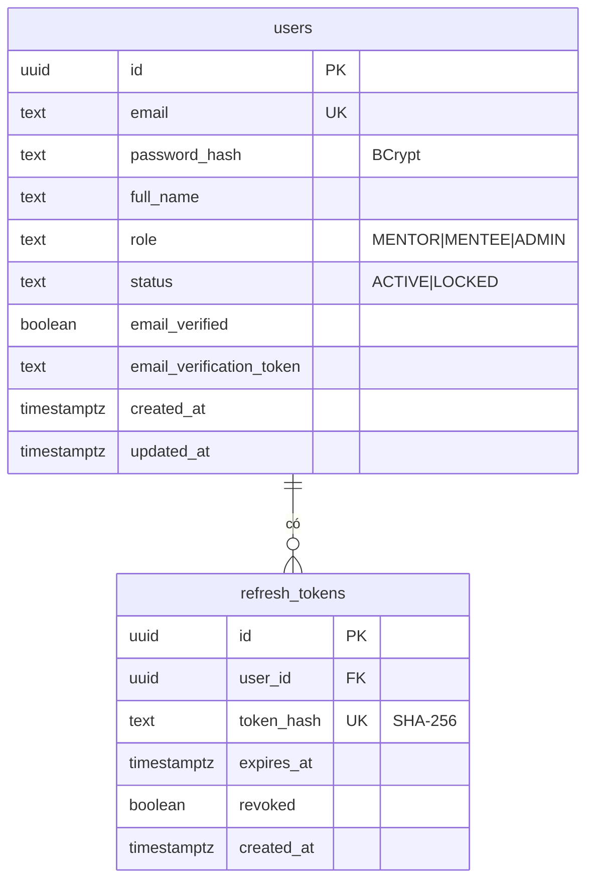
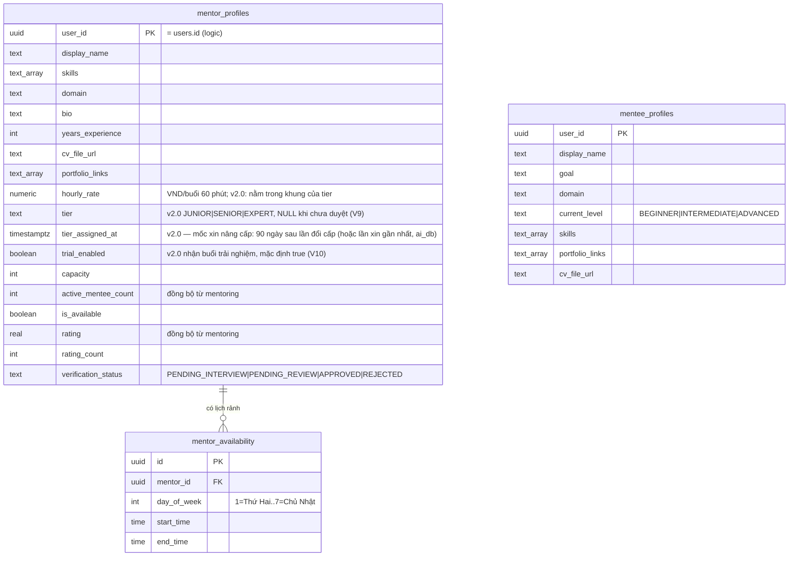
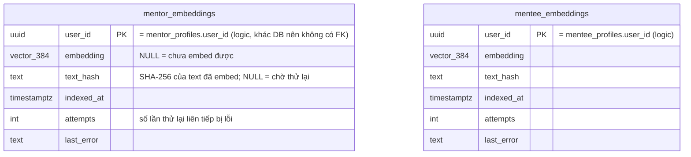
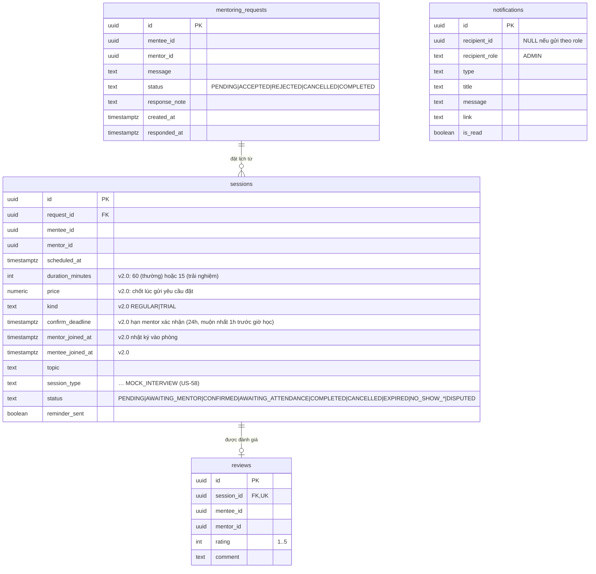
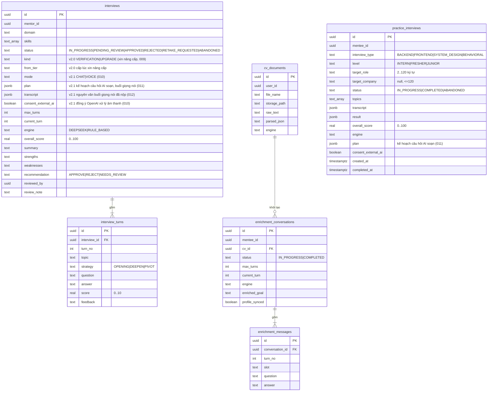
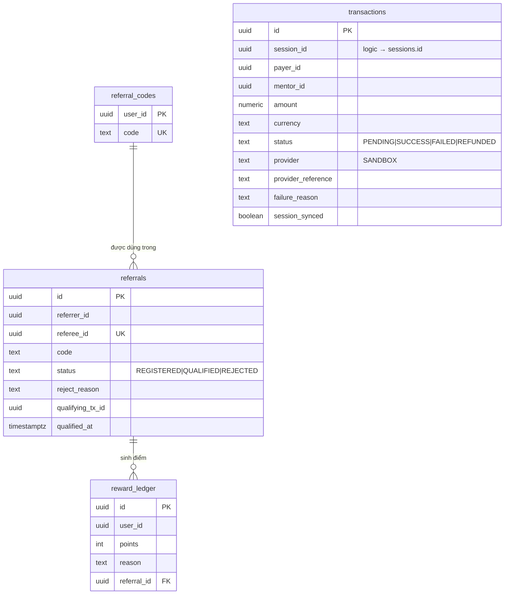
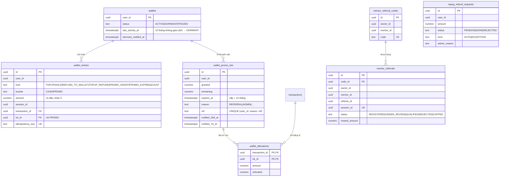
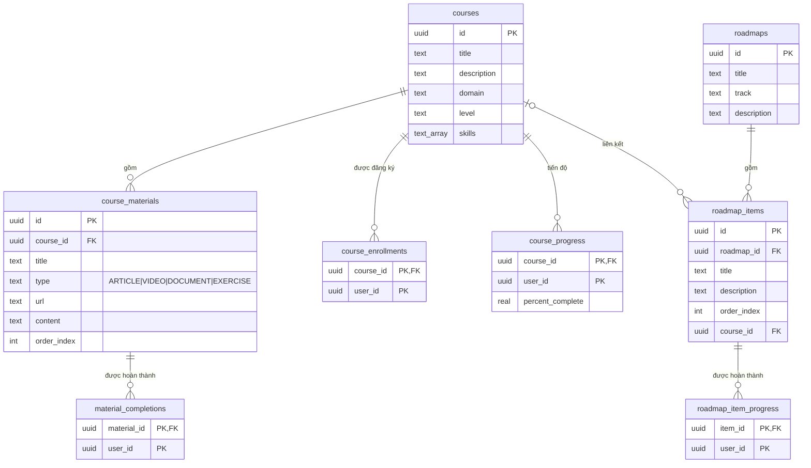

# Thiết kế cơ sở dữ liệu — MentorHub

> **v2.0 (21/10/2026)** — nội dung đánh dấu ⚒ là **mục tiêu theo bản chốt** [ban-chot-nghiep-vu.md](ban-chot-nghiep-vu.md), chưa hiện thực; phần không đánh dấu mô tả hệ thống hiện tại.

Nguyên tắc **database-per-service**: mỗi service sở hữu một CSDL PostgreSQL 16 riêng; không service
nào ghi vào CSDL của service khác. Liên kết giữa các service chỉ là **khoá tham chiếu logic** (UUID
người dùng/phiên) — không có khoá ngoại vật lý xuyên CSDL. Schema nằm tại `db/init/<service>.sql`
và được chạy tự động khi container CSDL khởi tạo lần đầu.

| CSDL | Service sở hữu | Cổng host | Ghi chú |
|---|---|---|---|
| `auth_db` | auth-service | 5433 | |
| `profile_db` | profile-service | 5434 | matching-service đọc read-only qua role `matching_reader` |
| `matching_db` | matching-service | 5439 | Image `pgvector/pgvector:pg16`; chỉ mục embedding (vector + hash text nguồn) |
| `mentoring_db` | mentoring-service | 5435 | |
| `payment_db` | payment-service | 5436 | |
| `learning_db` | learning-service | 5437 | Có dữ liệu seed khoá học/roadmap |
| `ai_db` | ai-service | 5438 | Dữ liệu 3 tính năng AI hội thoại; file CV trên volume `cv-storage` |

Quy ước: tên bảng/cột `snake_case`; khoá chính `UUID DEFAULT gen_random_uuid()`; thời gian
`TIMESTAMPTZ`; trạng thái là `TEXT` + ràng buộc `CHECK` (ánh xạ `enum` trong Java).

---

## 1. auth_db

| Bảng | Mô tả |
|---|---|
| `users` | Tài khoản. Tài khoản ADMIN được tạo tự động khi khởi động (`AdminSeeder`), không đăng ký qua API |
| `refresh_tokens` | Refresh token dạng băm; `revoked = true` khi đã dùng để refresh, đăng xuất, đổi mật khẩu hoặc bị khoá |

Ngoài CSDL: Redis key `auth:login-fail:<email>` (đếm số lần đăng nhập sai, TTL 15 phút).

---

## 2. profile_db

| Đối tượng | Mô tả |
|---|---|
| `mentor_profiles` | Hồ sơ mentor + dữ liệu phục vụ matching (trạng thái xác thực, sức chứa, rating) |
| `mentee_profiles` | Hồ sơ mentee |
| `mentor_profiles.tier` *(v2.0)* | Cấp độ do admin gán lúc duyệt phỏng vấn; khung giá lấy từ cấu hình `pricing.tiers` (JUNIOR 100–200k, SENIOR 200–400k, EXPERT 400–700k, bước 10.000đ); `hourly_rate` bị kẹp về khung khi đổi cấp |
| `mentor_availability` | Khung giờ rảnh lặp lại hằng tuần (giờ Việt Nam); `CHECK (end_time > start_time)` |
| Role `matching_reader` | Chỉ có `SELECT` trên 3 bảng trên — hiện thực hoá ngoại lệ kiến trúc read-only |

`profile_db` **không chứa vector**: embedding thuộc `matching_db` (mục 3). profile-service chỉ lưu nội
dung hồ sơ và báo matching-service khi nội dung đó thay đổi.

---

## 3. matching_db

| Đối tượng | Mô tả |
|---|---|
| `mentor_embeddings` | Vector của mentor — tập ứng viên cho bước top-K retrieval |
| `mentee_embeddings` | Vector của mentee — vector truy vấn, chỉ tra theo khoá chính |
| `idx_mentor_embeddings_vector` | Chỉ mục **HNSW** với `vector_cosine_ops` phục vụ truy vấn láng giềng gần nhất theo cosine |
| `idx_*_embeddings_pending` | Chỉ mục riêng phần (`WHERE embedding IS NULL`) cho `IndexSyncJob` quét dòng chờ thử lại |

Ý nghĩa `text_hash` (NFR-7): SHA-256 của đoạn văn bản chuẩn hoá đã dùng để sinh vector. Khi lập lại chỉ
mục, hash không đổi thì bỏ qua bước gọi model; gọi model lỗi thì đặt `NULL` để `IndexSyncJob` nhận ra
(vector cũ vẫn giữ để matching tiếp tục hoạt động).

Không có khoá ngoại tới `profile_db` vì khác database — `IndexSyncJob` chịu trách nhiệm xoá dòng chỉ
mục của hồ sơ đã bị xoá.

---

## 4. mentoring_db

| Bảng | Mô tả |
|---|---|
| `mentoring_requests` | Yêu cầu mentoring; số yêu cầu `ACCEPTED` phân biệt theo mentee = số mentee đang được hướng dẫn (so với `capacity`) |
| `sessions` | Phiên mentoring. `PENDING` = chờ tạm giữ học phí từ ví (giữ chỗ 15 phút); `AWAITING_MENTOR` = đã tạm giữ, chờ mentor xác nhận trước `confirm_deadline` (quá hạn → `EXPIRED`, hoàn 100%). Chỉ mục `(mentor_id, scheduled_at)` phục vụ kiểm tra trùng lịch. Cột v2.0 thêm ở V20 |
| `reviews` | Đánh giá 1–1 với phiên (`session_id` UNIQUE); v2.0: không có đánh giá cho `kind = TRIAL` |
| `sessions.kind`, `*_joined_at` *(v2.0)* | Loại buổi và nhật ký vào phòng (ghi lần đầu mỗi bên lấy JWT phòng) — căn cứ duy nhất xác định vắng mặt: chỉ một bên vào → bên kia vắng; không ai vào → `CANCELLED` (`BOTH_ABSENT`, hoàn 100%, không strike) |
| `trial_uses` *(v2.0)* | Khoá chính `(mentee_id, mentor_id)` — mỗi cặp một buổi trải nghiệm; xoá dòng để hoàn lại lượt khi mentee không mất tiền |
| `contact_violations` *(v2.0)* | Mỗi tin nhắn bị che thông tin liên hệ: `user_id`, `request_id`, `kinds` (PHONE/EMAIL/LINK/SOCIAL); `flagged_at` khi đạt 3 lần/30 ngày và đã báo admin |
| `mock_intakes` *(US-58)* | Thông tin mentee điền khi đặt phỏng vấn thử (`session_id` PK): dạng phỏng vấn, cấp độ, vị trí, công ty, ngày phỏng vấn, link JD |
| `mock_scorecards` *(US-58)* | Phiếu đánh giá mentor (`session_id` PK): 4 tiêu chí 0–10 + live coding, `overall` theo trọng số, `verdict`, đúng 3 `fixes` (thành việc cần làm của mentee), lời nhắn riêng. Cột `scorecard_reminder_12h_at/36h_at` trên `sessions` cho job nhắc |
| `notifications` | Thông báo trong ứng dụng, gửi cho 1 người hoặc cho cả role ADMIN; ai-service tạo thông báo qua `POST /internal/notifications` |

---

## 5. ai_db

ai-service sở hữu trọn vẹn dữ liệu của AI Interview và CV Parsing + Chatbot enrichment (trước đây các
bảng này nằm trong `mentoring_db` và do mentoring-service điều phối).

| Bảng | Mô tả |
|---|---|
| `interviews` | Buổi AI Interview + kết quả tổng hợp + quyết định admin; `engine` ghi engine đã dùng để các lượt sau nhất quán. Buổi giọng nói: `transcript` = nguyên văn cuộc gọi (`TranscriptItem[]`, migration `012_interview_transcript.sql`) vì `interview_turns` chỉ giữ một lượt gộp mỗi chủ đề |
| `interviews.mode` *(v2.1 ⚒, migration ai `010_voice_interviews.sql`)* | `TEXT NOT NULL DEFAULT 'CHAT' CHECK (mode IN ('CHAT','VOICE'))`. Buổi `VOICE`: `max_turns` = số chủ đề đã lập; bản chép lời được gộp thành mỗi chủ đề một dòng `interview_turns`; quá 30 phút chưa có bản chép lời → `ABANDONED` (job dọn buổi bỏ dở hiện có). Cột `interviews.consent_external_ai BOOLEAN NOT NULL DEFAULT false` (cùng migration) = mentor đã đồng ý cho OpenAI xử lý âm thanh (bắt buộc với `VOICE`) |
| `interview_turns` | Từng lượt hỏi-đáp; `UNIQUE (interview_id, turn_no)` chống ghi trùng; ghi câu trả lời bằng `UPDATE ... WHERE answer IS NULL` |
| `cv_documents` | CV đã upload: văn bản trích xuất + kết quả parse (`JSONB`); file PDF nằm trên volume `cv-storage` |
| `enrichment_conversations` / `enrichment_messages` | Hội thoại chatbot làm rõ mục tiêu và từng lượt hỏi-đáp theo slot; `profile_synced` = đã đẩy goal sang profile-service (job nền thử lại nếu chưa) |
| `practice_interviews` *(v2.1 ⚒, migration ai `010_voice_interviews.sql`)* | Buổi mentee luyện phỏng vấn giọng nói với AI (FR-10.x): `topics` = chủ đề đã lập từ `practice_bank`, `transcript` = bản chép lời (`TranscriptItem[]`), `result` = nhận xét từng câu + 3 điểm mạnh + 3 điểm cần cải thiện + báo cáo nói, `overall_score` 0–100, `consent_external_ai` = đã đồng ý cho OpenAI xử lý âm thanh. Lượt miễn phí bị dùng khi có buổi `COMPLETED` hoặc `ABANDONED`; tối đa một buổi `IN_PROGRESS` mỗi mentee, buổi `IN_PROGRESS` quá 30 phút → `ABANDONED`. `UNIQUE (mentee_id) WHERE status = 'IN_PROGRESS'` chặn bấm bắt đầu hai lần; chỉ mục `(mentee_id, created_at DESC)` cho danh sách. `plan` = kế hoạch câu hỏi AI soạn lúc bắt đầu (migration `011_interview_plans.sql`, mỗi chủ đề kèm nguồn BANK/CV/GOAL/AI). Không lưu âm thanh |

---

## 6. payment_db

| Đối tượng | Mô tả |
|---|---|
| `transactions` | Giao dịch thanh toán; `uq_transactions_session_success` — unique partial index đảm bảo mỗi phiên tối đa 1 giao dịch `SUCCESS` |
| `referral_codes` | Mỗi người dùng 1 mã (tạo lần đầu khi xem trang giới thiệu) |
| `referrals` | Quan hệ người giới thiệu → người được giới thiệu; `CHECK (referrer_id <> referee_id)`, `referee_id` UNIQUE |
| `reward_ledger` | Sổ cái điểm thưởng dạng append-only (v1.x); v2.0 không còn ghi mới (bỏ điểm xin lỗi; thưởng giới thiệu là tiền khuyến mãi trong ví) — giữ lại để truy vết |
| `referral_codes`, `referrals` | v1.x (mã theo người dùng, ghi nhận lúc đăng ký) — v2.0 thay bằng `mentor_referral_codes` / `mentor_referrals` (§6.1) |

### 6.1 Ví VND & giới thiệu theo mentor *(v2.0 — V7, V8)*

| Đối tượng | Mô tả |
|---|---|
| `wallet_entries` | Sổ cái append-only (trigger chặn UPDATE/DELETE); **không có cột số dư** — số dư = `SUM(amount)` theo `bucket`. `idempotency_key` UNIQUE chống ghi trùng (IPN, retry). Tiền đang tạm giữ suy ra từ giao dịch phiên chưa kết luận |
| `wallet_promo_lots` | Mỗi lần cấp khuyến mãi là một lô, hết hạn 12 tháng; trả học phí trừ lô sắp hết hạn trước; `notified_30d_at/7d_at` cho thông báo nhắc trong ứng dụng |
| `wallet_allocations` | Lô khuyến mãi nào đã trả cho giao dịch nào — hoàn tiền buổi học trả lại đúng lô (`refunded`) |
| `transactions` *(cột v2.0)* | `kind` SESSION/TOPUP; `paid_promo` + `paid_cash` (phần trả bằng khuyến mãi / tiền nạp) để hoàn đúng nguồn; `session_kind` REGULAR/TRIAL. Nạp ví dùng lại luồng IPN/đối soát của cổng (US-56) |
| `topup_refund_requests` | Hoàn tiền nạp về nguồn: `AUTO` trong 7 ngày, tối đa = min(tiền nạp khả dụng, tiền nạp 7 ngày), 2 yêu cầu/tháng; ngoài ra `EXCEPTION` chờ admin |
| `wallets.status` | `DORMANT` sau 12 tháng không giao dịch (tự kích hoạt lại); `FROZEN` khi admin khoá tài khoản — chặn trả học phí, hoàn về nguồn và rút thu nhập |
| `mentor_referral_codes` | Mỗi cặp `(owner_id, mentor_id)` một mã 8 ký tự, chỉ cấp khi owner đã hoàn thành ≥ 1 buổi thường đã trả với mentor |
| `mentor_referrals` | Một lượt dùng mã (buổi thường đầu tiên của referee với mentor; `UNIQUE (referee_id, mentor_id)`, `CHECK owner_id <> referee_id`). Job `referral-eval`: buổi COMPLETED qua 7 ngày không hoàn tiền → `QUALIFIED` + lô khuyến mãi 30.000đ; quá 5 lượt/tháng → `CAPPED`; bất thường → `UNDER_REVIEW` chờ admin |
| `mentor_ledger` | Giữ nguyên (US-25); `release-delay` 72 giờ và khiếu nại giữ thu nhập |

---

## 7. learning_db

`course_progress.percent_complete` = số tài liệu đã hoàn thành / tổng số tài liệu × 100 (làm tròn 1
chữ số thập phân), được tính lại mỗi khi người dùng đánh dấu/bỏ đánh dấu một tài liệu. Dữ liệu seed:
5 khoá học, 15 tài liệu, 3 roadmap (Backend, DevOps, Frontend).

---

## 8. Ánh xạ tham chiếu giữa các CSDL

| Giá trị | Nguồn gốc | Được tham chiếu ở |
|---|---|---|
| `users.id` | auth_db | `mentor_profiles.user_id`, `mentee_profiles.user_id`, `mentoring_requests.mentee_id/mentor_id`, `sessions.*_id`, `interviews.mentor_id` (ai_db), `cv_documents.user_id` (ai_db), `transactions.payer_id/mentor_id`, `referral_codes.user_id`, `referrals.*_id`, `course_enrollments.user_id`… |
| `sessions.id` | mentoring_db | `transactions.session_id` |
| `cv_documents.id` | ai_db | `mentee_profiles.cv_file_url`, `mentor_profiles.cv_file_url` (dạng `/api/ai/cv/{id}/file`) — khi CV bị xoá, ai-service gọi `DELETE /internal/profile/{userId}/cv-file` để gỡ giá trị nếu còn khớp (best-effort, không có FK) |
| `mentor_profiles.user_id`, `mentee_profiles.user_id` | profile_db | `mentor_embeddings.user_id`, `mentee_embeddings.user_id` (matching_db) — `IndexSyncJob` dọn dòng mồ côi thay cho khoá ngoại |
