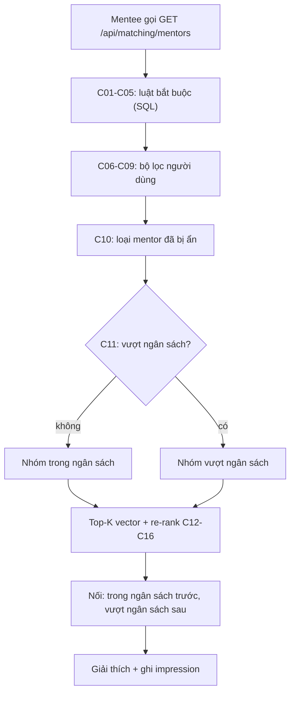

# Đặc tả kỹ thuật: AI Matching

> **Trạng thái: ĐẶC TẢ HIỆN TRẠNG kèm ĐỀ XUẤT (⚒).** Soạn 24/10/2026 trên branch `feature-core/ai-matching`.
> Các mục ghi "hiện trạng" mô tả code đang có, đã đối chiếu với mã nguồn nhưng **chưa chạy lại test, benchmark hay e2e** trong lần soạn này.
> Các mục đánh dấu ⚒ là đề xuất, chưa hiện thực. Giải thích kiến trúc tổng quan nằm ở [ai-features.md](ai-features.md) §1; đặc tả này là chuẩn nghiệm thu cho bộ tiêu chí.

## 1. Mục tiêu và phạm vi

**Mục tiêu.** Với mỗi mentee, trả về danh sách mentor được xếp hạng, đủ điều kiện nhận mentee, kèm lý do. Hệ thống tách rõ ba loại tiêu chí:

- **Loại** (C01–C11): quyết định mentor có được xét hay không, hoặc đứng ở nhóm nào.
- **Chấm điểm** (C12–C16): cộng lại thành `finalScore`, tổng trọng số bằng 1,00.
- **Đánh giá** (M1–M4): đo chất lượng kết quả, không tham gia xếp hạng.

**Trong phạm vi.** 16 tiêu chí lọc và chấm điểm, 4 chỉ số đánh giá, API, cấu hình, dữ liệu liên quan, kiểm thử.

**Ngoài phạm vi.** Điểm `compatibility` từ bảng câu hỏi tự khai (tài liệu thiết kế riêng đã gỡ; làm lại khi cần); luồng đặt lịch và thanh toán ở mentoring-service.

| Hạng mục | Hiện trạng | Đề xuất ⚒ |
|---|---|---|
| 5 luật bắt buộc | Đã hiện thực (SQL CTE) | Không đổi |
| 4 bộ lọc người dùng | Đã hiện thực; `minRating` lọc theo rating thô | G1 |
| Ẩn "Không phù hợp" 30 ngày | Đã hiện thực | Không đổi |
| Ngân sách mềm | Đã hiện thực (chưa commit) | G6 đánh dấu nhóm trong impression |
| 5 tín hiệu chấm điểm | Đã hiện thực, trọng số mặc định tổng 1,00 | G2 kiểm tra tổng khi khởi động |
| Chỉ số đánh giá | Có công cụ offline và endpoint tỉ lệ "Không phù hợp"; nhãn còn nháp | G3, G4, G5 |

## 2. Quyết định đã chốt

| # | Quyết định |
|---|---|
| D1 | Luật bắt buộc (C01–C05) loại hẳn mentor khỏi kết quả |
| D2 | Bộ lọc người dùng (C06–C09) do mentee chọn; mặc định lấy từ hồ sơ mentee, tham số request luôn thắng |
| D3 | "Không phù hợp" ẩn mentor khỏi gợi ý của đúng mentee đó trong 30 ngày (C10); ẩn **trước** khi xếp hạng để vẫn đủ `limit` |
| D4 | Ngân sách (C11) là tầng xếp riêng: vượt ngân sách thì xếp sau nhóm trong ngân sách, **không loại** |
| D5 | `finalScore` chỉ gồm C12–C16, tổng trọng số 1,00 |
| D6 | Mentor chưa đủ 3 đánh giá dùng trung vị rating nền tảng thay rating thật |
| D7 | Thiếu dữ liệu phản hồi thì tín hiệu tốc độ phản hồi là 0,5 (trung tính) |
| D8 | Mỗi lần trả kết quả ghi `match_impressions` để đo tỉ lệ "Không phù hợp" theo hạng |
| D9 | ⚒ `minRating` lọc theo `effective_rating` (cùng khái niệm với C13); mentor mới được so bằng trung vị nền tảng và vẫn mang cờ `newMentor` để giao diện hiện nhãn "Mentor mới" |
| D10 | Ngưỡng M1, M2 đặt theo trần của bộ dữ liệu: P@5 ≥ 80% trần (trần cũ khoảng 0,253, tức khoảng 0,20), NDCG@10 ≥ 0,90, không được thấp hơn bản trước khi đổi trọng số hay thuật toán. Chỉ có hiệu lực sau khi có nhãn từ hai người chấm độc lập; lúc đó tính lại trần |
| D11 | Ngưỡng M3: tỉ lệ "Không phù hợp" ≤ 10% ở hạng 1–3 và ≤ 15% ở hạng 4–5. Chỉ đánh giá hạng có ít nhất 100 lượt hiển thị, ít hơn thì ghi "chưa đủ dữ liệu". Theo dõi riêng nhóm vượt ngân sách |
| D12 | Độ trễ (M4) nghiệm thu bằng benchmark tổng hợp chạy lại được (`benchmark_matching.py --mentors 5000 --requests 50`), ngưỡng p95 < 2.000 ms (NFR-1). Số đo từ log môi trường thật làm sau khi có người dùng thật |
| D13 | ⚒ Embedding dùng model đa ngôn ngữ 384 chiều để mentor và mentee viết hồ sơ bằng tiếng Việt, tiếng Anh hoặc trộn đều được hiểu. Model đề xuất: `paraphrase-multilingual-MiniLM-L12-v2` (giữ `VECTOR(384)`, không đổi schema). Không dùng bước dịch Việt sang Anh: thêm bộ dịch, rủi ro dịch sai thuật ngữ kỹ thuật, và gửi nội dung hồ sơ ra ngoài. Tên model chốt sau khi so sánh bằng bộ eval (G10) |

D10 và D11 là ngưỡng khởi điểm do người soạn đề xuất, không suy ra từ dữ liệu thật; nhóm xem lại khi có nhãn và dữ liệu người dùng.

## 3. Pipeline

Điểm cài đặt (đường dẫn dưới `matching-service/app/`):

| Bước | File |
|---|---|
| Luật bắt buộc, retrieval, re-rank, tách nhóm ngân sách | `services/matching_pipeline.py` (`_CANDIDATES_CTE`, `_retrieve_and_rank`, `_run`) |
| Bộ lọc người dùng, mặc định từ hồ sơ, `over_budget`, `excludedBy` | `services/match_filters.py` |
| Ẩn 30 ngày, impression, thống kê theo hạng | `services/feedback_service.py` |
| Tín hiệu điểm (lịch, phản hồi, rating) | `services/ranking_signals.py` |
| Trọng số, hằng số | `config.py` |

## 4. Đặc tả từng tiêu chí

### 4.1 Luật bắt buộc

Cùng một câu SQL đọc `profile_db` bằng role `matching_reader`; mỗi mentor bị gán **một** lý do loại theo thứ tự dưới đây, số lượng trả về ở `pipeline.excluded`.

| Mã | Tiêu chí | Điều kiện giữ lại | Lý do loại (`excluded`) |
|---|---|---|---|
| C01 | Đã duyệt | `verification_status = 'APPROVED'` | `notVerified` |
| C02 | Đang nhận mentee | `status = 'ACCEPTING'`, hoặc `ON_LEAVE` đã qua `on_leave_until` (tính theo múi giờ mentor) | `unavailable` |
| C03 | Có lịch rảnh | tồn tại dòng trong `mentor_availability` | `noSchedule` |
| C04 | Còn chỗ | `active_mentee_count < capacity` | `fullCapacity` |
| C05 | Cùng lĩnh vực | `lower(trim(domain))` bằng domain mentee | `domainMismatch` |

### 4.2 Bộ lọc người dùng

| Mã | Tiêu chí | Cách lọc | Mặc định từ hồ sơ |
|---|---|---|---|
| C06 | Ngày và buổi | Buổi: MORNING 6–12, AFTERNOON 12–18, EVENING 18–23. Bật cả ngày và buổi thì cần một khung rảnh **vừa đúng ngày vừa giao với buổi** | có (`preferred_days`, `preferred_time_of_day`) |
| C07 | Ngôn ngữ | `languages && $filter`, chỉ nhận `vi`, `en` | có |
| C08 | Loại buổi (`sessionType`) | `$type = ANY(session_types)`, 4 giá trị hợp lệ | không |
| C09 | Rating tối thiểu | Hiện trạng: `rating >= minRating` (rating thô). ⚒ Đích (D9, G1): `effective_rating >= minRating` | không |

Bộ lọc nào trượt, mentor cũng được đếm vào `excludedBy` khi chỉ trượt đúng một bộ lọc; giao diện dùng để gợi ý nút "Nới điều kiện".

### 4.3 Loại theo phản hồi (C10)

- Mentee bấm "Không phù hợp" kèm lý do `WRONG_DOMAIN`, `TOO_EXPENSIVE`, `SCHEDULE`, `OTHER` (ghi chú tối đa 300 ký tự).
- Ẩn khi `revoked_at IS NULL AND hidden_until > now`; `HIDE_DAYS = 30`. Bấm lại thì đóng lượt ẩn cũ, tạo lượt mới.
- Mentee gỡ ẩn sớm bằng `DELETE /api/matching/feedback/{mentorId}`.

### 4.4 Ngân sách mềm (C11)

- `maxRate` lấy từ request, nếu thiếu thì từ `budget_max_per_hour` trong hồ sơ.
- `hourly_rate > maxRate` thì mentor vào nhóm vượt ngân sách, trả thêm `overBudget = true`, `overBudgetBy = hourly_rate - maxRate`.
- Mỗi nhóm lấy top-K và chấm điểm riêng. Danh sách trả về: nhóm trong ngân sách, rồi nhóm vượt ngân sách.
- Nhóm vượt ngân sách hiển thị `max(MATCH_OVER_BUDGET_SHOWN, limit - số mentor trong ngân sách)` mentor (mặc định `MATCH_OVER_BUDGET_SHOWN = 3`).
- `includeOverBudget=false` thì quay về lọc cứng. Endpoint nội bộ `similar-mentors` luôn dùng chế độ này.

### 4.5 Chấm điểm (C12–C16)

`finalScore = Σ (trọng số × tín hiệu)`, mỗi tín hiệu thuộc [0, 1], làm tròn 4 chữ số; `scoreParts` trả phần đóng góp từng tín hiệu.

| Mã | Tín hiệu | Trọng số | Công thức | Khi thiếu dữ liệu |
|---|---|---|---|---|
| C12 | Độ tương đồng nội dung | 0,60 | `1 - cosine distance` giữa embedding mentee và mentor, kẹp [0, 1]. Hiện trạng: model `all-MiniLM-L6-v2` (chủ yếu tiếng Anh), 384 chiều, pgvector HNSW. ⚒ Đích (D13, G10): model đa ngôn ngữ 384 chiều | không áp dụng (mentor chưa có embedding thì chưa được retrieval) |
| C13 | Rating | 0,15 | `effective_rating / 5`. `rating_count >= 3` thì dùng rating thật, ngược lại dùng trung vị rating của các mentor APPROVED có từ 3 đánh giá | chưa có trung vị nền tảng thì dùng 3,5; mentor gắn `newMentor` |
| C14 | Kinh nghiệm | 0,10 | `min(years_experience / 10, 1)` | 0 |
| C15 | Khớp lịch | 0,10 | Tỉ lệ khung giờ mentee muốn trong 14 ngày tới mà mentor rảnh ít nhất 60 phút. Có đổi múi giờ qua UTC, trừ ngoại lệ lịch | mentee không chọn ngày thì xét mọi ngày; không chọn buổi thì xét 06:00–23:00 |
| C16 | Tốc độ phản hồi | 0,05 | Trung vị phản hồi ≤ 24 giờ: 1; ≤ 72 giờ: 0,5; chậm hơn: 0 | 0,5 |

Tổng trọng số = 0,60 + 0,15 + 0,10 + 0,10 + 0,05 = **1,00**. Hằng số: `MIN_REVIEWS = 3`, `FALLBACK_MEDIAN_RATING = 3.5`, `MAX_YEARS_EXPERIENCE_NORM = 10`, `HORIZON_DAYS = 14`, `MIN_OVERLAP = 60` phút.

Retrieval lấy `k = max(DEFAULT_K, 5 × limit)` với `DEFAULT_K = 50`.

## 5. Mô hình dữ liệu

**profile_db** (Flyway, `profile-service`, matching chỉ đọc):

| Bảng/cột | Dùng cho |
|---|---|
| `mentor_profiles`: `verification_status`, `status`, `on_leave_until`, `capacity`, `active_mentee_count`, `domain`, `languages`, `session_types`, `timezone`, `hourly_rate`, `rating`, `rating_count`, `years_experience`, `median_response_hours`, `response_sample_size` | C01–C05, C07–C09, C11, C13, C14, C16 |
| `mentor_availability`, `mentor_availability_exceptions` | C03, C06, C15 |
| `mentee_profiles`: `preferred_days`, `preferred_time_of_day`, `budget_max_per_hour`, `languages` | mặc định bộ lọc, C15 |

**matching_db** (`matching-service/migrations/`):

| Bảng | Nội dung |
|---|---|
| `mentor_embeddings`, `mentee_embeddings` | `VECTOR(384)`, `text_hash`, `attempts`, `last_error`; HNSW cosine |
| `match_feedback` | `reason`, `note`, `impression_id`, `rank`, `hidden_until`, `revoked_at` |
| `match_impressions` | `impression_id`, `rank`, `final_score`, `score_parts`, `filters`, `weights`, `model` |

**Đồng bộ ngoài matching:** `rating`, `rating_count` do mentoring-service đẩy sang `mentor_profiles`; `median_response_hours` đẩy qua `PUT /internal/mentor/{id}/response-time`. Matching không đọc bảng `reviews` (nằm ở mentoring-service), nên điểm rating và phản hồi chậm hơn dữ liệu gốc một chu kỳ đồng bộ.

⚒ **Migration `003`** (G6): thêm `over_budget BOOLEAN NOT NULL DEFAULT false` vào `match_impressions`.

## 6. API

Chi tiết đầy đủ ở [contracts/matching-service.yaml](../contracts/matching-service.yaml).

| Endpoint | Mô tả |
|---|---|
| `GET /api/matching/mentors` | Tham số: `limit`, `maxRate`, `days`, `timeOfDay`, `language`, `sessionType`, `minRating`, `includeOverBudget` (mặc định `true`), `useProfileDefaults`, … Trả `RankedMentor[]` (có `finalScore`, `scoreParts`, `overBudget`, `overBudgetBy`, `newMentor`, `ratingUsed`, `scheduleFit`, `responsiveness`), `effectiveFilters`, `pipeline` (`excluded`, `hidden`, `eligible`, `overBudget`, `k`, `retrieved`, `returned`, `weights`). Giới hạn 20 lượt/phút/user, vượt thì 429 kèm `Retry-After` |
| `POST /api/matching/feedback` | Đánh dấu "Không phù hợp" |
| `GET /api/matching/feedback` | Danh sách mentor đang bị ẩn |
| `DELETE /api/matching/feedback/{mentorId}` | Gỡ ẩn sớm |
| `GET /api/matching/admin/evaluation?days=30` | Chỉ ADMIN. Trả `resultLists`, `byRank` (hạng 1–10: `impressions`, `notRelevant`, `notRelevantRate`), `reasons` |
| `GET /internal/matching/similar-mentors` | Cho mentoring-service; lọc cứng ngân sách |

## 7. Cấu hình

| Biến (`config.py`) | Mặc định | Ý nghĩa |
|---|---|---|
| trọng số similarity / rating / experience / schedule / responsiveness | 0,60 / 0,15 / 0,10 / 0,10 / 0,05 | Trọng số C12–C16; các biến độc lập nhau |
| `MATCH_OVER_BUDGET_SHOWN` | 3 | Số mentor tối thiểu của nhóm vượt ngân sách |
| `DEFAULT_K` | 50 | Cỡ retrieval tối thiểu |
| `MIN_REVIEWS` | 3 | Ngưỡng dùng rating thật |
| `FALLBACK_MEDIAN_RATING` | 3,5 | Trung vị khi nền tảng chưa đủ dữ liệu |
| `HIDE_DAYS` | 30 | Số ngày ẩn (hằng số trong `feedback_service.py`) |

## 8. Đánh giá chất lượng

| # | Chỉ số | Định nghĩa | Ngưỡng | Nguồn / cách chạy | Trạng thái |
|---|---|---|---|---|---|
| M1 | Precision@5 | Tỉ lệ mentor liên quan (nhãn ≥ 1,5 trên thang 0–2) trong 5 hạng đầu | ≥ 80% trần bộ dữ liệu, khoảng 0,20 (D10) | `scripts/eval/matching/metrics.py`, `capture.py`, `--report scripts/eval/matching/out/report.md` | Nhãn nháp, chưa đáng tin |
| M2 | NDCG@10 | gain = 2^nhãn − 1, chiết khấu `log2(hạng + 1)` | ≥ 0,90 và không thoái lui (D10) | như M1 | Nhãn nháp, chưa đáng tin |
| M3 | Tỉ lệ "Không phù hợp" theo hạng | `notRelevant / impressions` mỗi hạng 1–10 | ≤ 10% ở hạng 1–3, ≤ 15% ở hạng 4–5, khi hạng có ≥ 100 lượt hiển thị (D11) | `GET /api/matching/admin/evaluation` | Có sẵn endpoint, chưa có dữ liệu thật |
| M4 | Độ trễ | Thời gian trả kết quả `GET /api/matching/mentors` | p95 < 2.000 ms (NFR-1, D12) | `scripts/benchmark_matching.py --mentors 5000 --requests 15` (xem ghi chú) | **Đạt**, đo lại 24/10/2026 sau khi đổi model đa ngôn ngữ (T2b): trung bình 255,5 ms, p50/p95/max = 237,9 / 377,3 / 521,4 ms, ~5.007 mentor. G5 đã giải quyết (số cũ 93,8 ms không có nguồn xác nhận; số 4,8 ms ở `ai-features.md` §1.9 đã lỗi thời, đo trước khi đổi model) |

Nhãn dùng cho M1, M2: trung bình `rater1`/`rater2`; nếu chưa ai chấm thì dùng `draft_label`. Bộ dữ liệu hiện có 30 mentee, 234 cặp (`scripts/eval/matching/dataset.py`, `seed_eval.py`).

**Ghi chú về số đo M4 (24/10/2026):** `--requests 50` mặc định của script **không chạy được** vì va với giới hạn tần suất NFR-10 (20 lượt/phút/người dùng, `MATCHING_RATE_LIMIT_PER_MINUTE`): script gọi 51 lượt liên tiếp (1 khởi động + 50) trong vài giây, vượt ngưỡng 20 ở khoảng giữa. Đây là một khoảng trống mới phát hiện (chưa có mã G, xem **G11** ở mục 9), không phải lỗi của lần đo này. Đã chạy với `--requests 15` (dưới ngưỡng) để có số thật; 15 mẫu cho p95 kém tin cậy hơn 50 mẫu, và máy đo đang chạy đồng thời nhiều test/docker rebuild khác (không phải máy đo rảnh, chuyên dụng) — hai lý do này khiến số trên chỉ là **sơ bộ**, nên đo lại trên máy rảnh với đủ 50 mẫu sau khi xử lý G11.

## 9. Khoảng trống và đề xuất ⚒

| # | Vấn đề | Đề xuất |
|---|---|---|
| G1 | `minRating` lọc theo `rating` thô, mentor mới (dưới 3 đánh giá, rating 0) bị loại khi bật bộ lọc | Lọc theo `effective_rating` (D9); giao diện hiện nhãn "Mentor mới" |
| G2 | Không kiểm tra tổng trọng số bằng 1,00 | Kiểm tra trong `config.py` lúc khởi động, sai thì dừng |
| G3 | `/admin/evaluation` không trả P@5, NDCG@10, độ trễ | Giữ P@5, NDCG@10 ở chế độ offline và ghi rõ; đo độ trễ bằng log hoặc histogram của service |
| G4 | Báo cáo eval cũ (08/10/2026, đã gỡ khỏi `docs/`) lỗi thời: chưa có tín hiệu phản hồi và khớp lịch như code hiện tại; nhãn còn nháp | Chạy lại với trọng số hiện tại, thu nhãn `rater1`/`rater2`, rồi đặt ngưỡng M1, M2 |
| G5 | ~~Số độ trễ ở §8 (93,8 ms) khác số ở `ai-features.md` §1.9 (4,8 ms)~~ **Đã xử lý (T8, 24/10/2026):** chạy lại `benchmark_matching.py`, số mới ở §8 (trung bình 255,5 ms, p95 377,3 ms, ~5.007 mentor) thay cho cả hai số cũ. Tăng mạnh so với 4,8 ms cũ chủ yếu do model đa ngôn ngữ nặng hơn (G10) và máy đo không rảnh (chỉ 15 mẫu, xem ghi chú ở §8); vẫn đạt NFR-1 (max 521 ms << 2.000 ms). Cần đo lại trên máy rảnh, đủ 50 mẫu, sau khi xử lý G11 | Đo lại sau G11 |
| G6 | `match_impressions` không đánh dấu nhóm vượt ngân sách; hạng của nhóm này là hạng trong danh sách đã nối, làm lệch M3 | Migration `003`, tách M3 theo nhóm |
| G7 | Mentee chưa chọn ngày: C15 tính trên mọi ngày nên điểm thấp đều | Ghi là hạn chế hoặc trung tính hóa khi thiếu dữ liệu |
| G8 | Lọc ngày và buổi so theo giờ địa phương của mentor, chưa quy đổi múi giờ mentee | Ghi là hạn chế đã biết |
| G9 | `rating` và `median_response_hours` là cột đồng bộ | Ghi nguồn; cân nhắc cảnh báo khi dữ liệu quá cũ |
| G10 | ~~Model embedding `all-MiniLM-L6-v2` chủ yếu hiểu tiếng Anh, trong khi C12 chiếm 0,60 điểm.~~ **Đã xử lý (T2b, 24/10/2026):** đổi sang `paraphrase-multilingual-MiniLM-L12-v2` (384 chiều, D13); cột `model` theo dõi embedding, lệch model (kể cả NULL) tự lập chỉ mục lại qua IndexSyncJob. T2c (so sánh định lượng trên bộ eval đầy đủ nhiều cặp có nhãn) còn chờ nhãn thật, xem M1/M2 | Việc còn lại: T2c khi có nhãn (G4) |
| G11 | Mới phát hiện khi đo M4 — `scripts/benchmark_matching.py --requests 50` (mặc định) va với giới hạn tần suất NFR-10 (20 lượt/phút/người dùng): 51 lượt gọi liên tiếp trong vài giây vượt ngưỡng giữa chừng, benchmark không chạy hết được | Script cần tạm nới `MATCHING_RATE_LIMIT_PER_MINUTE` hoặc dùng nhiều tài khoản mentee khác nhau để mỗi tài khoản dưới 20 lượt; hoặc thêm cờ bỏ qua rate limit khi gọi nội bộ cho mục đích đo đạc |

## 10. Kiểm thử

| Phạm vi | File | Ghi chú |
|---|---|---|
| C06–C09, `excludedBy`, ngân sách mềm (`over_budget`) | `tests/test_match_filters.py` | Hàm thuần |
| C01–C05, C10, C11, thứ tự nhóm, bù cho đủ `limit` | `tests/test_matching_db.py` | Cần Postgres thật |
| C12–C16 | `tests/test_ranking_signals.py`, `tests/test_pipeline.py` | |
| API, tham số, 429 | `tests/test_api.py` | |
| End-to-end | `scripts/e2e_s2_profile_matching.py` | Có 3 check ngân sách mềm |
| Công thức P@5, NDCG@10 | `scripts/eval/matching/test_metrics.py` | |

⚒ Cần thêm: kiểm tra tổng trọng số (G2); `minRating` với mentor mới (G1); cột `over_budget` trong impression (G6); test cho từng mã C01–C16 theo bảng ánh xạ, để mỗi tiêu chí có ít nhất một test gọi tên rõ.

## 11. Kế hoạch triển khai và nghiệm thu

Tất cả task làm chung trên branch `feature-core/ai-matching`, mỗi task một commit riêng. Mỗi task có **input** (dữ liệu hoặc lệnh đưa vào) và **output mong đợi** (kết quả để đối chiếu). Task nào đạt đúng output mong đợi thì coi là xong.

Thứ tự: T0 → T1 → T2 → T2b → T3 → T4 → T5 → T6 → T7 → T8; sau đó T2c, T9–T13; T14–T16 tuỳ chọn.

### 11.1 Task code

| # | Task | Nhóm | Phụ thuộc | Input | Output mong đợi |
|---|---|---|---|---|---|
| T0 | Hoàn tất ngân sách mềm (C11) | Ngân sách | | `pytest matching-service/tests` (cần Postgres thật) và `scripts/e2e_s2_profile_matching.py`. Gọi `GET /api/matching/mentors` với `maxRate` thấp hơn giá một số mentor | Mọi test ngân sách mềm pass (`test_match_filters`, `test_matching_db`, `test_api` và 3 check e2e); không test cũ nào hỏng. Mentor vượt ngân sách luôn đứng sau toàn bộ mentor trong ngân sách; `overBudgetBy = hourly_rate - maxRate`; `includeOverBudget=false` thì không có mentor vượt ngân sách |
| T1 | G2: kiểm tra tổng trọng số khi khởi động | Chấm điểm | T0 | Khởi động service với `MATCH_WEIGHT_SIMILARITY=0.7` (giữ 4 biến còn lại mặc định, tổng 1,10) | Service từ chối khởi động, thông báo nêu tổng thực tế và tên các biến. Mặc định 0,60 / 0,15 / 0,10 / 0,10 / 0,05 khởi động bình thường. Lệch do làm tròn số thực (|tổng − 1| ≤ 1e-6) không bị coi là lỗi |
| T2 | G1, D9: `minRating` theo `effective_rating` | Bộ lọc (C09) | T0 | Trung vị nền tảng 3,5. Mentor A: `rating_count = 1`, `rating = 0`. Mentor B: `rating_count = 5`, `rating = 4,5`. Gọi với `minRating = 3,0`, rồi `minRating = 4,0` | `minRating = 3,0`: A và B đều có mặt (A tính là 3,5). `minRating = 4,0`: A bị loại và được đếm vào `excludedBy`, B có mặt. Khi chưa có trung vị nền tảng thì A tính là 3,5. Test khẳng định giá trị trong SQL bằng `signals.effective_rating` trên cùng dữ liệu |
| T2b | G10, D13: đổi sang model đa ngôn ngữ 384 chiều, lập chỉ mục lại khi đổi model | Chấm điểm (C12) | T0 | Đặt `EMBEDDING_MODEL` sang model mới; hồ sơ mentee tiếng Việt "Tôi muốn học backend Java Spring Boot"; hai mentor tiếng Anh: một về backend Spring Boot, một về thiết kế UI | Mọi embedding có đúng 384 chiều. Embedding được lưu kèm tên model; embedding khác model hiện hành được xếp hàng lập chỉ mục lại, và sau khi chạy xong `index-status` báo 0 hồ sơ chờ. Độ tương đồng mentee tiếng Việt với mentor backend **cao hơn** với mentor UI. Không còn vector từ model cũ lẫn trong kết quả |
| T3 | G6: cột `over_budget` trong impression | Đánh giá (M3) | T0 | Gọi `GET /api/matching/mentors` với `maxRate` đủ thấp để có cả hai nhóm, rồi đọc `match_impressions` và `GET /api/matching/admin/evaluation` | Migration `003` chạy đúng một lần (có trong `schema_migrations`); các dòng cũ có `over_budget = false`. Impression mới: mentor vượt ngân sách có `true`, mentor trong ngân sách có `false`. `admin/evaluation` trả thêm số liệu tách theo hai nhóm; các trường cũ không đổi |
| T4 | `tookMs` trong `pipeline` | Đánh giá (M4) | T0 | Mọi lần gọi `GET /api/matching/mentors` | `pipeline.tookMs` là số không âm, không lớn hơn thời gian client đo toàn request |
| T5 | Cờ `enoughData` trong `byRank` (D11) | Đánh giá (M3) | T3 | Impression giả lập: hạng 1 có 150 lượt, hạng 2 có 30 lượt | `byRank[0].enoughData = true`, `byRank[1].enoughData = false`; ngưỡng 100 lượt là hằng số có tên, dễ đổi |
| T6 | Cập nhật hợp đồng và kiểu TypeScript | Hợp đồng | T2–T5 | `contracts/matching-service.yaml`, `frontend/src/types/matching.ts` | Hợp đồng có đủ `tookMs`, `enoughData`, số liệu theo nhóm; kiểm tra kiểu frontend (`tsc`) không lỗi; response thật khớp hợp đồng |

### 11.2 Task kiểm thử

| # | Task | Phụ thuộc | Input | Output mong đợi |
|---|---|---|---|---|
| T7 | Test cho từng tiêu chí C01–C16 | T1–T3 | Bảng ánh xạ ở §10 | Mỗi mã C01–C16 có ít nhất một test có tên hoặc docstring chứa mã đó; xác nhận bằng `grep -rn "C09" matching-service/tests/` (ví dụ) — không dùng `pytest -k`, vì `-k` chỉ khớp TÊN test, không khớp docstring |
| T8 | Chạy toàn bộ test, e2e, benchmark | T1–T7 | `pytest matching-service/tests`; `scripts/e2e_s2_profile_matching.py`; `scripts/benchmark_matching.py --mentors 5000 --requests 50` | Mọi test và e2e pass. Benchmark in trung bình, p50, p95, max; p95 < 2.000 ms (D12). Số đo và cấu hình đo được ghi vào §8, thay số cũ (G5) |
| T2c | So sánh model cũ và mới trên bộ eval | T2b, T8 | Bộ eval có thêm nhãn ngôn ngữ cho từng cặp (vi–vi, vi–en, en–vi, en–en); chạy `capture.py` và `metrics.py` với cả hai model | Bảng P@5 và NDCG@10 theo từng loại cặp, cho cả hai model. Model mới không thấp hơn model cũ ở cặp en–en và cao hơn ở cặp khác ngôn ngữ. Nếu không đạt thì quay lại D13 |

### 11.3 Task dữ liệu và đánh giá (cần người)

| # | Task | Phụ thuộc | Input | Output mong đợi |
|---|---|---|---|---|
| T9 | Chấm nhãn bởi hai người | T8 | Kết quả `capture.py` với trọng số và model hiện hành | Mọi cặp có đủ `rater1` và `rater2`; `metrics.py` báo nguồn nhãn là trung bình hai người chấm, không còn `draft_label` |
| T10 | Xác nhận ngưỡng M1, M2 (D10) | T9 | Nhãn từ T9 | Trần P@5 được tính lại; P@5 ≥ 80% trần và NDCG@10 ≥ 0,90, không thấp hơn bản trước; số ghi vào §8. Không đạt thì ghi rõ kết quả và quay lại bàn trọng số |
| T11 | Theo dõi M3 (D11) | Có người dùng thật | `GET /api/matching/admin/evaluation` khi mỗi hạng có ít nhất 100 lượt hiển thị | Tỉ lệ "Không phù hợp" ≤ 10% ở hạng 1–3, ≤ 15% ở hạng 4–5. Không đạt thì ghi nhận và xem lại ngưỡng hoặc cách xếp hạng |

### 11.4 Task tài liệu

| # | Task | Phụ thuộc | Input | Output mong đợi |
|---|---|---|---|---|
| T12 | Cập nhật số liệu trong spec | T8, T10 | Kết quả T8, T10 | Số ở §8 khớp kết quả chạy; các ghi chú "chưa kiểm chứng" của mục đã chạy được gỡ |
| T13 | Thu gọn `ai-features.md` §1 | T8 | `docs/ai-features.md` | §1 là tóm tắt ngắn trỏ sang spec; tìm trong file không còn trọng số hay mô tả mâu thuẫn với spec (ví dụ 0,7 / 0,2 / 0,1) |

### 11.5 Task tuỳ chọn (G7–G9)

| # | Task | Nhóm | Input | Output mong đợi |
|---|---|---|---|---|
| T14 | G7: điểm khớp lịch khi mentee chưa chọn ngày | Chấm điểm (C15) | Mentee không có `preferred_days` | Điểm khớp lịch không còn thấp đều: mentor rảnh nhiều và mentor rảnh ít vẫn phân biệt được. Giá trị trung hoà cần chốt trước khi làm |
| T15 | G8: quy đổi múi giờ mentee khi lọc ngày và buổi | Bộ lọc (C06) | Mentee và mentor ở hai múi giờ khác nhau, lọc buổi tối | Khung giờ so theo giờ của mentee. Cần xác nhận hồ sơ mentee có lưu múi giờ |
| T16 | G9: cảnh báo dữ liệu đồng bộ cũ | Chấm điểm (C13, C16) | `rating` hoặc `median_response_hours` không cập nhật quá N ngày | Cảnh báo được ghi nhận. N chưa chốt |

## 12. Rủi ro

| Rủi ro | Giảm thiểu |
|---|---|
| Nhãn nháp làm M1, M2 sai lệch | Không dùng làm cam kết cho đến khi có nhãn thật (G4) |
| Trọng số cấu hình lệch khiến điểm không còn nằm trong [0, 1] | G2 |
| Chưa có dữ liệu thật cho M3 nên chưa kiểm chứng được "thấp ở hạng đầu" | Seed dữ liệu giả lập để kiểm thử đường đi, ghi rõ không phải số thật |
| Dữ liệu rating, phản hồi đồng bộ trễ | G9 |
| Đổi model embedding mà quên lập chỉ mục lại, vector cũ và mới bị so sánh lẫn nhau | Lưu tên model cùng embedding, lập chỉ mục lại khi khác (G10) |
| Model đa ngôn ngữ nặng hơn, tăng độ trễ lập chỉ mục và bộ nhớ | Đo lại bằng benchmark trước khi chốt (G10, D12) |
| Nhóm vượt ngân sách làm mentee thấy mentor ngoài tầm giá | Nhãn "Vượt ngân sách +X/giờ" trên giao diện, `includeOverBudget=false` khi cần |

## 13. Câu hỏi mở

Bốn câu hỏi mở trước đây đã được chốt thành D9–D12 (§2). Còn lại hai việc cần dữ liệu thật mới xác nhận được:

- Trần P@5 và ngưỡng M1, M2 phải tính lại sau khi có nhãn từ hai người chấm (D10).
- Ngưỡng M3 xem lại khi có đủ lượt hiển thị từ người dùng thật (D11).

## 14. Câu hỏi hội đồng có thể hỏi

- **Vì sao ngân sách là tầng mềm mà không loại?** Mentee thường đặt ngân sách thấp hơn giá thị trường; loại hẳn khiến danh sách rỗng. Mentee vẫn thấy mentor phù hợp, kèm mức vượt rõ ràng.
- **Vì sao mentor mới dùng trung vị nền tảng?** Rating dưới 3 đánh giá không đáng tin; trung vị tránh phạt mentor mới và tránh thưởng quá mức cho rating 5 từ một đánh giá.
- **Vì sao similarity chiếm 0,60?** Đây là tín hiệu duy nhất đo mức hợp về nội dung hồ sơ; các tín hiệu còn lại bổ trợ. Ảnh hưởng của trọng số được đo bằng bộ đánh giá offline, nhưng nhãn hiện còn nháp (G4).
- **Làm sao biết kết quả tốt?** Bốn chỉ số ở §8; hiện chỉ độ trễ có số đo, hai chỉ số xếp hạng chờ nhãn thật, tỉ lệ "Không phù hợp" chờ dữ liệu người dùng.
