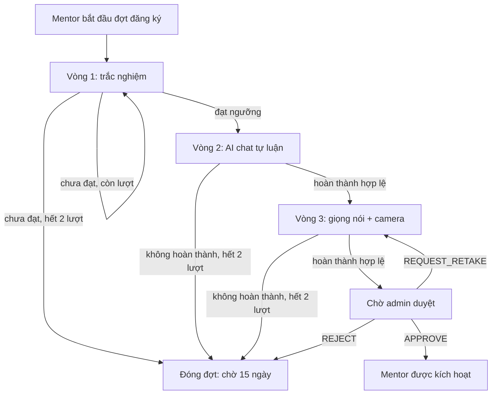
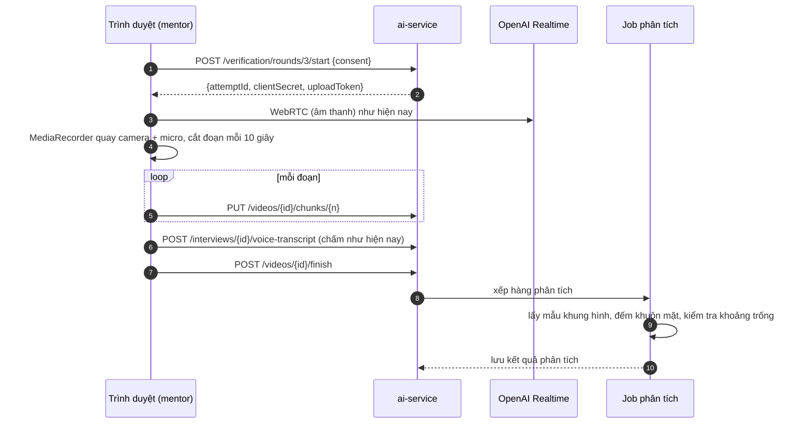
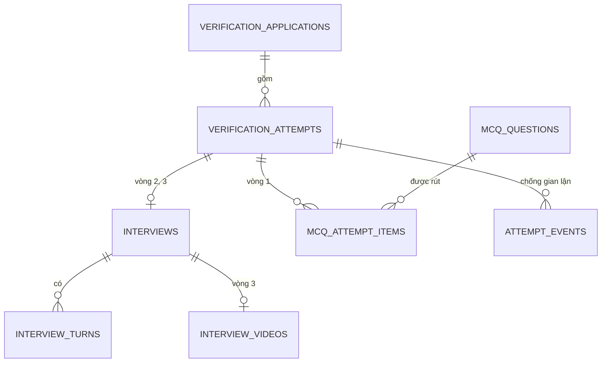

# Thiết kế: xác thực mentor 3 vòng

> **Trạng thái: THIẾT KẾ ĐỀ XUẤT, chưa hiện thực (⚒).** Soạn 24/10/2026 cho scope A (xác thực mentor) của AI Interview.
> Tài liệu này mô tả đích đến. Hiện trạng đang chạy (chat 5 lượt, có cấp độ) được mô tả ở [ai-features.md](ai-features.md) §2.
> Khi hiện thực xong, các quy tắc ở đây thay thế phần tương ứng của [ban-chot-nghiep-vu.md](ban-chot-nghiep-vu.md) §3–4 (cấp độ, khung giá).

## 1. Mục tiêu và phạm vi

**Mục tiêu.** Quyết định một mentor mới có được xuất hiện trong kết quả matching và nhận mentee hay không, bằng quy trình
ba vòng đi từ rẻ đến đắt: trắc nghiệm → chat tự luận với AI → phỏng vấn giọng nói với AI có quay video. Admin quyết định cuối cùng (NFR-8).

**Thay đổi so với hiện trạng.**

| Hạng mục | Hiện trạng | Thiết kế mới |
|---|---|---|
| Cấu trúc | Một buổi phỏng vấn chat (5 lượt), giọng nói là chế độ thay thế | Ba vòng nối tiếp trong một **đợt đăng ký** |
| Cổng chặn | Không có | Vòng 1 là cổng chặn |
| Số lần | Tối đa 3 buổi, chờ 7 ngày sau khi bị từ chối, admin mở khoá | Mỗi vòng tối đa 2 lần, bị từ chối thì chờ 15 ngày, không còn nút mở khoá |
| Video | Không | Vòng 3 bắt buộc bật camera, lưu 60 ngày, AI phân tích sau buổi |
| Cấp độ Junior/Senior/Expert | Có, quyết định khung giá, có luồng xin nâng cấp 90 ngày | **Bỏ hoàn toàn** |
| Giá | Trong khung của cấp | Mentor đặt tự do |

**Ngoài phạm vi.** Luyện phỏng vấn cho mentee và phỏng vấn thử với mentor (scope B). Mức `JUNIOR` của **mentee** trong luyện phỏng vấn giữ nguyên.

## 2. Quyết định đã chốt

| # | Quyết định |
|---|---|
| D1 | Ba vòng: (1) trắc nghiệm có chống gian lận, (2) AI chat tự luận, (3) AI phỏng vấn giọng nói, mentor bật camera |
| D2 | Vòng 3: AI chỉ có giọng nói, màn hình hiện chữ AI nói, không có hình AI. Sau buổi, AI phân tích video |
| D3 | Cổng chặn ở vòng 1 |
| D4 | Mỗi vòng tối đa 2 lần |
| D5 | Không được admin duyệt thì đăng ký lại sau 15 ngày |
| D6 | Vòng 3 AI chấm, admin duyệt cuối cùng |
| D7 | Video lưu 60 ngày, admin xem và xoá được, mentor chỉ xem |
| D8 | Bỏ cấp độ khỏi toàn bộ dự án (cả luồng xin nâng cấp 90 ngày) |
| D9 | Giá mentor đặt tự do, không giới hạn |

Các quyết định D10 trở đi là đề xuất của người soạn, được đánh dấu **(đề xuất)** để nhóm xác nhận.

## 3. Tổng quan quy trình

Một **đợt đăng ký** (application) gom ba vòng. Mentor chỉ có một đợt đang mở tại một thời điểm.

**Quan hệ với trạng thái hồ sơ** (`mentor_profiles.verification_status`, giữ nguyên bốn giá trị hiện có):

| Thời điểm | Giá trị |
|---|---|
| Chưa có đợt, hoặc đang làm vòng 1–3 | `PENDING_INTERVIEW` |
| Vòng 3 xong, chờ admin | `PENDING_REVIEW` |
| Admin duyệt | `APPROVED` (mới vượt qua hard filter của matching) |
| Đợt bị đóng (hết lượt hoặc admin từ chối) | `REJECTED` |
| Hết 15 ngày và bắt đầu đợt mới | quay về `PENDING_INTERVIEW` |

## 4. Luật số lần và 15 ngày

Một **lần** (attempt) là một lượt làm một vòng. Một lần có kết quả là `PASSED`, `FAILED`, `ABANDONED` hoặc `INVALIDATED`.

| Tình huống | Kết quả |
|---|---|
| Vòng 1 chưa đạt, lần 1 | Làm lại vòng 1 ngay, đề mới (trộn lại) |
| Vòng 1 chưa đạt, lần 2 | Đóng đợt, chờ 15 ngày |
| Vòng 2 hoặc 3 không hoàn thành hợp lệ, lần 1 | Làm lại chính vòng đó |
| Vòng 2 hoặc 3 không hoàn thành hợp lệ, lần 2 | Đóng đợt, chờ 15 ngày |
| Đã qua một vòng | Giữ kết quả, không làm lại trong cùng đợt |
| Admin từ chối | Đóng đợt, chờ 15 ngày |
| Admin yêu cầu làm lại | Mở lại vòng 3, **không tính** vào 2 lần |
| Bỏ dở quá hạn | Tính là một lần `ABANDONED` (hiện là 24 giờ, giữ nguyên) |
| Sau 15 ngày | Bắt đầu đợt mới, làm lại từ vòng 1 |

**"Không hoàn thành hợp lệ" (đề xuất).** Vì cổng chặn chỉ ở vòng 1, vòng 2 và 3 không có điểm đạt cố định. Hai vòng này được tính là
một lần thất bại khi: bỏ dở quá hạn, bị vô hiệu hoá (vòng 3: từ chối cấp camera, camera tắt quá mức cho phép), hoặc lỗi từ phía người
dùng. Lỗi do hệ thống (DeepSeek hoặc OpenAI không phản hồi) **không** tính lần. Điểm thấp ở vòng 2 và 3 không loại mentor: nó chảy vào khuyến nghị
cho admin.

**Thời hạn 15 ngày** tính từ lúc đóng đợt (`closed_at`) hoặc lúc admin từ chối (`reviewed_at`). Cấu hình `VERIFICATION_RETRY_DAYS = 15`.

## 5. Vòng 1: trắc nghiệm

### 5.1 Mục đích và hạn chế

Sàng lọc kiến thức nền, chấm tất định, không tốn LLM. Trắc nghiệm **không** đo được năng lực hướng dẫn hay kinh nghiệm thật, nên nó chỉ là cổng chặn, không tham gia vào điểm cuối.

### 5.2 Đề thi (đề xuất)

| Thông số | Giá trị mặc định | Cấu hình |
|---|---|---|
| Số câu | 20 | `MCQ_QUESTION_COUNT` |
| Thời gian làm bài | 30 phút, tính ở server | `MCQ_TIME_LIMIT_MINUTES` |
| Ngưỡng đạt | 70% số câu đúng | `MCQ_PASS_RATIO` |
| Số đáp án mỗi câu | 4, một đáp án đúng | |

- **Chọn đề theo lĩnh vực và kỹ năng** của mentor, giống cách `question_bank` đang chọn chủ đề (ưu tiên chủ đề trùng kỹ năng khai báo, luôn phủ nhiều chủ đề).
- **Trộn ngẫu nhiên** thứ tự câu và thứ tự đáp án cho từng lần làm. Mỗi lần làm rút bộ câu hỏi riêng, và lần làm lại không trùng câu của lần trước nếu ngân hàng đủ lớn.
- **Ngân hàng câu hỏi:** tối thiểu khoảng 60 câu mỗi lĩnh vực (gấp 3 lần số câu trong đề) để hạn chế lộ đề. Câu hỏi do nhóm soạn. Nếu dùng LLM sinh nháp thì **bắt buộc người duyệt đáp án**, vì LLM có thể gán sai đáp án đúng.

### 5.3 Chấm và bảo mật đề

- Server giữ đáp án đúng, **không gửi xuống trình duyệt**. Mỗi câu trả lời được gửi về server ngay khi chọn, kèm thời điểm.
- Hết giờ thì server tự nộp bài. Điểm tính ở server từ các câu đã ghi nhận.
- Mentor không thấy đáp án đúng sau khi làm xong, chỉ thấy đạt hoặc chưa đạt và điểm số.

### 5.4 Chống gian lận

Trình duyệt chỉ cung cấp **tín hiệu**, không phải bằng chứng (người dùng vẫn có thể dùng điện thoại thứ hai). Hệ thống ghi sự kiện, không tự kết tội.

| Tín hiệu | Cách bắt | Ghi nhận |
|---|---|---|
| Rời tab hoặc cửa sổ | `visibilitychange`, `blur` | Số lần và tổng thời gian rời |
| Chọn quá nhanh | Thời gian một câu dưới ngưỡng (mặc định 3 giây) | Số câu quá nhanh |
| Copy, paste, chuột phải | Sự kiện clipboard và `contextmenu` | Số lần |
| Thoát toàn màn hình | Fullscreen API | Số lần |
| Nộp trùng, đổi đáp án bất thường | Phân tích log ở server | Số lần đổi |

**Xử lý (đề xuất).**
- Mọi sự kiện lưu lại và hiển thị cho admin ở phần duyệt, kể cả khi mentor đạt vòng 1.
- Có hai ngưỡng cứng, cấu hình được, vượt thì lần làm bị `INVALIDATED` (tính một lần, điểm 0): rời tab quá **5 lần** hoặc tổng thời gian rời tab quá **60 giây**.
- Các tín hiệu còn lại chỉ gắn cờ, không loại. Lý do: dễ báo nhầm (thông báo hệ thống, bấm nhầm, câu dễ trả lời nhanh).
- Các ngưỡng là giá trị khởi đầu, cần hiệu chỉnh khi có dữ liệu thật. Khi bảo vệ cần nói rõ giới hạn: không thể chống gian lận tuyệt đối trên trình duyệt.

## 6. Vòng 2: AI chat tự luận

Dùng lại luồng chat hiện có ([ai-features.md](ai-features.md) §2.2–2.7): câu hỏi thích ứng (DEEPEN hoặc PIVOT), hai engine DeepSeek và rule-based có fallback, rubric 4 tiêu chí, chống prompt injection, cờ `COPIED_ANSWER`, ẩn điểm khi đang làm.

**Thay đổi:**
- Là vòng thứ hai, chỉ mở sau khi vòng 1 đạt.
- Không còn `kind = UPGRADE`, `from_tier`.
- Kết quả không tự quyết định trạng thái hồ sơ. Nó trở thành đầu vào của khuyến nghị cuối (mục 8).
- Giới hạn 2 lần áp dụng theo mục 4.

## 7. Vòng 3: phỏng vấn giọng nói và camera

### 7.1 Trải nghiệm

- AI chỉ có giọng nói. Màn hình hiện chữ AI nói (phụ đề) và không hiện hình AI. Hạ tầng giọng nói dùng lại OpenAI Realtime qua WebRTC ([ai-features.md](ai-features.md) §2.11).
- Mentor **bắt buộc bật camera và micro**. Trước khi bắt đầu phải đồng ý (mục 7.5). Từ chối cấp camera thì không bắt đầu được, và chưa tính lần.
- Kế hoạch chủ đề do AI soạn từ hồ sơ và CV như hiện nay. **Tuỳ chọn (đề xuất):** thêm một chủ đề kiểm tra tính nhất quán, hỏi lại một ý mentor đã viết ở vòng 2, để phát hiện trường hợp người viết bài khác người nói.

### 7.2 Luồng quay và tải lên

- **Tải lên theo từng đoạn** để không mất dữ liệu khi đóng tab, và để biết camera bị ngắt ở đâu (khoảng trống giữa các đoạn).
- Giới hạn độ phân giải và bitrate khi quay (ví dụ 640×360, khoảng 500 kbps) để buổi 30 phút nặng khoảng 110 MB.
- Camera hoặc micro ngắt giữa buổi: cho phép kết nối lại trong thời gian ngắn (đề xuất 60 giây tổng cộng). Vượt quá thì lần làm bị `INVALIDATED`.

### 7.3 Phân tích video sau buổi

Mục tiêu duy nhất là **tín hiệu cho admin**. Phân tích **không chấm điểm** và không đánh giá nét mặt, cảm xúc hay độ tự tin (độ chính xác thấp, dễ thiên vị, khó bảo vệ).

| Cờ | Điều kiện (đề xuất) |
|---|---|
| `NO_FACE_LONG` | Không thấy mặt liên tục quá 20 giây |
| `MULTIPLE_FACES` | Thấy nhiều hơn một khuôn mặt trong quá 10% số khung hình |
| `CAMERA_OFF` | Có khoảng trống giữa các đoạn video |
| `LOW_PRESENCE` | Dưới 80% khung hình có đúng một khuôn mặt |

- Cách làm: lấy mẫu khoảng một khung hình mỗi 2–5 giây, dùng bộ phát hiện khuôn mặt chạy trên CPU. **Chọn thư viện (OpenCV hoặc MediaPipe) ở giai đoạn hiện thực**, vì ảnh hưởng đến kích thước image của ai-service.
- Không đối chiếu danh tính với giấy tờ (ngoài phạm vi).
- Cờ nghiêm trọng (`MULTIPLE_FACES`, `NO_FACE_LONG`, `CAMERA_OFF`) buộc khuyến nghị của AI là `NEEDS_REVIEW` bất kể điểm, cùng cách `PROMPT_INJECTION` đang xử lý.
- Phân tích chạy bất đồng bộ. Admin có thể mở buổi duyệt khi điểm đã có, giao diện hiển thị "đang phân tích" cho tới khi xong.

### 7.4 Lưu trữ và quyền truy cập video

| Mục | Quy định |
|---|---|
| Thời hạn lưu | **60 ngày** kể từ khi kết thúc buổi (`VIDEO_RETENTION_DAYS`). Job nền xoá file và đánh dấu `deleted_at` |
| Admin | Xem và **xoá** được |
| Mentor | Chỉ **xem** video của chính mình, không xoá |
| Người khác | Không truy cập được |
| Nơi lưu | Docker volume như `cv-storage` (dev). Triển khai thật nên dùng object storage |
| Phát video | Qua endpoint có kiểm quyền, không có đường dẫn file công khai |
| Nhật ký | Ghi audit log mỗi lần admin xem hoặc xoá |

Xoá sớm bởi admin là xoá vĩnh viễn file; bản ghi phân tích và cờ vẫn giữ để admin còn căn cứ.

### 7.5 Đồng ý và quyền riêng tư

Video và âm thanh là dữ liệu cá nhân nhạy cảm. Trước khi bắt đầu vòng 3, mentor phải tick đồng ý, nêu rõ: (a) quay camera và micro, (b) âm thanh được OpenAI xử lý, (c) video lưu 60 ngày, (d) admin xem được và mentor chỉ xem. Giá trị lưu cùng bản ghi (mở rộng `consent_external_ai`). Cần bổ sung một **chính sách dữ liệu video** tương tự [cv-data-policy.md](cv-data-policy.md) khi hiện thực.

## 8. Điểm tổng hợp và duyệt của admin

- **Vòng 1:** chỉ là cổng chặn, điểm hiển thị cho admin nhưng **không** vào điểm cuối.
- **Điểm cuối (đề xuất):** `final = 0.6 × điểm vòng 2 + 0.4 × điểm vòng 3` (thang 0–100). Vòng 2 đo chiều sâu và kinh nghiệm, vòng 3 đo giao tiếp trực tiếp. Trọng số cấu hình được. Mỗi vòng dùng điểm của lần làm hợp lệ gần nhất.
- **Khuyến nghị của AI:** giữ ngưỡng hiện có (≥ 70 `APPROVE`, 50–69.9 `NEEDS_REVIEW`, < 50 `REJECT`). Có cờ gian lận nghiêm trọng (chống gian lận vòng 1, `PROMPT_INJECTION`, `COPIED_ANSWER`, cờ video) thì `NEEDS_REVIEW`.
- **Quyết định của admin** (giữ nguyên): `APPROVE`, `REJECT`, `REQUEST_RETAKE`. Quy tắc ghi chú tối thiểu 10 ký tự khi quyết định ngược khuyến nghị giữ nguyên. **Bỏ** phần chọn cấp độ, nên bỏ `TIER_REQUIRED` và `TIER_NOT_HIGHER`.
- Trang duyệt hiển thị gộp: điểm và cờ vòng 1, hội thoại và rubric vòng 2, hội thoại, rubric và **trình phát video** vòng 3, các cờ phân tích video.
- Audit log và thống kê đồng thuận admin và AI giữ nguyên, bỏ trường `tier`, `fromTier`, `suggestedTier`.

## 9. Bỏ cấp độ và giá tự do

| Phần | Tác động |
|---|---|
| ai-service | Bỏ `kind = UPGRADE`, `from_tier`, `rubric.suggest_tier`, `TIERS`, cấu hình ngưỡng cấp và `INTERVIEW_UPGRADE_AFTER_DAYS`. Xoá test cấp độ và nâng cấp |
| profile-service | Xoá `PricingTiers`, kiểm tra khung giá; migration xoá cột `tier`, `tier_assigned_at`; bỏ trường `tier` ở API |
| Giá | Mentor đặt `hourly_rate` tự do (giữ ràng buộc dữ liệu tối thiểu, ví dụ không âm). Giá hiện có giữ nguyên |
| Matching | Không đổi. Bộ lọc giá `maxRate` của mentee vẫn hoạt động |
| Frontend | Bỏ hiển thị cấp độ ở trang phỏng vấn, trang duyệt, hồ sơ mentor, đặt lịch |
| Tài liệu và script | Cập nhật `ban-chot-nghiep-vu.md` §3–4, `scope-core.md`, contracts, script e2e (bỏ `e2e_v2_tier.py`) |
| Phạm vi cần kiểm | Các điểm trùng từ khoá ở mentoring-service (`MentoringRequest`, `RequestRules`) cần xem lại, có thể không liên quan đến cấp độ |

## 10. Mô hình dữ liệu (ai_db)

Ý tưởng: thêm tầng **đợt** và **lần làm** phía trên các bảng hiện có, tái dùng `interviews` và `interview_turns` cho vòng 2 và 3.

| Bảng | Trạng thái | Nội dung chính |
|---|---|---|
| `verification_applications` | **Mới** | `id`, `mentor_id`, `status` (`IN_PROGRESS`, `PENDING_REVIEW`, `APPROVED`, `REJECTED`, `CLOSED`), `current_round`, `retry_after`, `closed_at`, `recommendation`, `final_score`, `reviewed_by`, `review_note`, `reviewed_at`. Ràng buộc: mỗi mentor tối đa một đợt `IN_PROGRESS` hoặc `PENDING_REVIEW` |
| `verification_attempts` | **Mới** | `id`, `application_id`, `round` (1–3), `attempt_no` (1–2), `status` (`IN_PROGRESS`, `PASSED`, `FAILED`, `ABANDONED`, `INVALIDATED`, `COMPLETED`), `score`, `started_at`, `deadline_at`, `submitted_at`, `interview_id` (vòng 2, 3). Duy nhất theo (`application_id`, `round`, `attempt_no`) |
| `mcq_questions` | **Mới** | `id`, `domain`, `topic`, `stem`, `options` (4), `correct_index`, `explanation`, `status`, `created_at`. Nạp từ file JSON được duyệt |
| `mcq_attempt_items` | **Mới** | `attempt_id`, `position`, `question_id`, `option_order`, `chosen_index`, `answered_at`, `time_ms` |
| `attempt_events` | **Mới** | `attempt_id`, `type` (`TAB_HIDDEN`, `BLUR`, `PASTE`, `FULLSCREEN_EXIT`, `FAST_ANSWER`, `CAMERA_LOST`…), `at`, `meta` |
| `interview_videos` | **Mới** | `id`, `interview_id`, `storage_path`, `size_bytes`, `duration_s`, `chunk_count`, `analysis` (JSON), `analysis_status`, `created_at`, `expires_at`, `deleted_at`, `deleted_by` |
| `interviews` | **Đổi** | Thêm `attempt_id`. Bỏ `kind`, `from_tier`. Trạng thái quyết định chuyển lên đợt, nên các giá trị `APPROVED`, `REJECTED`, `RETAKE_REQUESTED` ở mức buổi không còn dùng |
| `interview_attempt_unlocks` | **Bỏ** | Thay bằng quy tắc 15 ngày |

**Migration.** Dữ liệu phỏng vấn cũ (một buổi, có cấp độ) không ánh xạ trọn vẹn sang mô hình ba vòng. Đề xuất: giữ lại các dòng cũ chỉ để tra cứu lịch sử, mentor đã `APPROVED` giữ nguyên trạng thái, dữ liệu demo seed lại. Xoá cột `tier` không đảo ngược được, nên cần sao lưu trước khi chạy.

## 11. API đề xuất

Tiền tố `/api/ai/verification` cho mentor, `/api/ai/admin/verification` cho admin. Tên là đề xuất.

| Method | Đường dẫn | Mục đích |
|---|---|---|
| GET | `/status` | Đợt hiện tại: vòng đang ở, số lần còn lại, `retry_after`, lý do không bắt đầu được |
| POST | `/applications` | Bắt đầu đợt mới (cần cam kết tự trả lời) |
| POST | `/rounds/1/start` | Bắt đầu một lần vòng 1, trả đề đã trộn (không có đáp án) |
| POST | `/rounds/1/attempts/{id}/answers` | Ghi một đáp án |
| POST | `/rounds/1/attempts/{id}/events` | Gửi sự kiện chống gian lận |
| POST | `/rounds/1/attempts/{id}/submit` | Nộp bài |
| POST | `/rounds/2/start` | Dùng lại logic `POST /interviews` |
| POST | `/interviews/{id}/answers` | Giữ như hiện nay |
| POST | `/rounds/3/start` | Như bắt đầu giọng nói hiện nay, thêm đồng ý camera, trả `uploadToken` |
| PUT | `/videos/{id}/chunks/{n}` | Tải một đoạn video |
| POST | `/videos/{id}/finish` | Kết thúc tải lên, xếp hàng phân tích |
| GET | `/videos/{id}/stream` | Phát video (mentor chỉ xem của mình, admin xem tất cả) |
| GET | `/admin/applications` | Danh sách đợt chờ duyệt |
| GET | `/admin/applications/{id}` | Chi tiết gộp ba vòng |
| POST | `/admin/applications/{id}/review` | Quyết định: APPROVE, REJECT, REQUEST_RETAKE |
| DELETE | `/admin/videos/{id}` | Admin xoá video |

Các endpoint `/interviews/**` và `/admin/interviews/**` hiện có có thể giữ cho vòng 2 và 3 để giảm thay đổi, và gom lại sau.

## 12. Cấu hình đề xuất

| Biến | Mặc định | Ý nghĩa |
|---|---|---|
| `VERIFICATION_MAX_ATTEMPTS_PER_ROUND` | 2 | Số lần mỗi vòng |
| `VERIFICATION_RETRY_DAYS` | 15 | Chờ sau khi bị đóng đợt hoặc từ chối |
| `MCQ_QUESTION_COUNT` | 20 | Số câu mỗi đề |
| `MCQ_TIME_LIMIT_MINUTES` | 30 | Thời gian làm bài |
| `MCQ_PASS_RATIO` | 0.7 | Ngưỡng đạt vòng 1 |
| `MCQ_FAST_ANSWER_SECONDS` | 3 | Ngưỡng "chọn quá nhanh" |
| `MCQ_MAX_TAB_LEAVES` | 5 | Ngưỡng vô hiệu hoá |
| `MCQ_MAX_TAB_AWAY_SECONDS` | 60 | Ngưỡng vô hiệu hoá |
| `FINAL_WEIGHT_ROUND2` / `FINAL_WEIGHT_ROUND3` | 0.6 / 0.4 | Trọng số điểm cuối |
| `VIDEO_RETENTION_DAYS` | 60 | Thời hạn lưu video |
| `VIDEO_RECONNECT_SECONDS` | 60 | Tổng thời gian được phép mất camera |
| `INTERVIEW_RESUME_HOURS` | 24 | Giữ nguyên, thời hạn bỏ dở |

## 13. Bảo mật và quyền riêng tư

- API key thật của OpenAI không tới trình duyệt (giữ nguyên cơ chế client secret ngắn hạn).
- Video chỉ truy cập qua endpoint có kiểm quyền. Mentor chỉ xem video của mình, admin xem và xoá. Mọi lần xem hoặc xoá ghi audit log.
- Đáp án trắc nghiệm không rời server. Ngân hàng câu hỏi không có endpoint công khai.
- Giữ cơ chế chống prompt injection cho vòng 2 và 3. Phân tích video không đưa dữ liệu hình ảnh cho LLM bên ngoài.
- Cần chính sách dữ liệu video và cập nhật phần đồng ý. Mentor cần biết rõ ai xem video và trong bao lâu.

## 14. Kiểm thử đề xuất

| Lớp | Nội dung |
|---|---|
| Unit | Luật số lần và 15 ngày (hàm thuần như `attempts.py`), chấm trắc nghiệm, chọn và trộn đề, ngưỡng vô hiệu hoá, tính điểm cuối, khuyến nghị khi có cờ |
| API | Chặn sang vòng 2 khi chưa đạt vòng 1, hết 2 lần, chờ 15 ngày, bỏ dở quá hạn, gửi trùng đáp án, quyền xem video (mentor, admin, người khác) |
| e2e | Mentor đi qua ba vòng, admin duyệt, mentor xuất hiện trong matching; ca rớt vòng 1 hai lần |
| Video | Tải đoạn và ghép, phát hiện khoảng trống, phân tích trên video mẫu (một mặt, không mặt, hai mặt), job xoá sau 60 ngày |
| Phi chức năng | Dung lượng và thời gian tải video, ảnh hưởng của thư viện phân tích lên image |

Rule-based và DeepSeek tiếp tục được đánh giá theo [eval-interview.md](eval-interview.md). Bộ nhãn vòng 2 và 3 cần hai người chấm độc lập để số liệu hết ở trạng thái tạm thời.

## 15. Kế hoạch triển khai

| Giai đoạn | Nội dung | Phụ thuộc |
|---|---|---|
| 1 | Bỏ cấp độ, giá tự do (mục 9) | Không |
| 2 | Mô hình đợt và lần làm, luật số lần và 15 ngày | 1 |
| 3 | Vòng 1: ngân hàng câu hỏi, đề, chấm, chống gian lận, giao diện | 2 |
| 4 | Nối vòng 2 vào quy trình, điểm tổng hợp, trang duyệt gộp | 2, 3 |
| 5 | Vòng 3: camera, tải đoạn, phân tích, lưu trữ 60 ngày, trình phát, đồng ý | 4 |

Mỗi giai đoạn chạy được và kiểm thử được độc lập. Vòng 3 làm sau cùng vì có nhiều rủi ro nhất.

## 16. Rủi ro

| Rủi ro | Giảm thiểu |
|---|---|
| Ngân hàng câu hỏi bị lộ | Ngân hàng lớn, trộn ngẫu nhiên, thay câu định kỳ |
| Báo nhầm gian lận | Chỉ gắn cờ, hai ngưỡng cứng cấu hình được, hiệu chỉnh khi có dữ liệu |
| Câu hỏi do LLM sinh có đáp án sai | Bắt buộc người duyệt |
| Dung lượng video lớn | Giới hạn bitrate và độ phân giải, chia đoạn, chuyển object storage khi triển khai thật |
| Thư viện phân tích làm nặng image | Chọn thư viện ở giai đoạn 5, cân nhắc chạy ở service riêng |
| Chi phí giọng nói theo phút | Giữ giới hạn 30 phút, 2 lần mỗi vòng |
| Dữ liệu cá nhân nhạy cảm | Đồng ý rõ ràng, thời hạn 60 ngày, phân quyền, audit log |
| Điểm vòng 2 và 3 chưa kiểm chứng | Hoàn tất nhãn độc lập và đánh giá DeepSeek |

## 17. Câu hỏi mở cần nhóm xác nhận

1. **"Không hoàn thành hợp lệ" ở vòng 2 và 3** (mục 4): nhóm xác nhận hiểu như đề xuất (bỏ dở, bị vô hiệu hoá, không phải điểm thấp), hay muốn thêm một điểm tối thiểu cho vòng 2 và 3?
2. **Trọng số điểm cuối** 0.6 và 0.4 cho vòng 2 và 3.
3. **Hai ngưỡng cứng của vòng 1** (rời tab quá 5 lần hoặc quá 60 giây) có chấp nhận làm bài bị vô hiệu hoá không, hay chỉ gắn cờ?
4. **Ngưỡng đạt vòng 1** 70% và đề 20 câu 30 phút.
5. **Chủ đề kiểm tra tính nhất quán** với vòng 2 ở vòng 3: có làm không?
6. **Nơi lưu video** khi triển khai thật: tiếp tục dùng volume hay chuyển object storage.
7. **Dữ liệu phỏng vấn cũ và mentor đã duyệt** khi chuyển sang mô hình mới: giữ nguyên trạng thái như đề xuất ở mục 10?

## 18. Câu hỏi hội đồng có thể hỏi

- *Vì sao trắc nghiệm là cổng chặn mà không tính vào điểm?* Vì nó chỉ đo kiến thức nền và rẻ để chấm. Năng lực hướng dẫn được đo ở hai vòng sau, nên chỉ vòng 2 và 3 quyết định khuyến nghị.
- *Chống gian lận trên trình duyệt có tin được không?* Không tuyệt đối. Hệ thống ghi tín hiệu, chỉ tự động loại ở ngưỡng rõ ràng, còn lại để admin quyết định.
- *AI phân tích video có thể chấm sai người không?* Phân tích chỉ phát hiện sự có mặt và số khuôn mặt, không chấm điểm và không đánh giá cảm xúc. Cờ chỉ buộc người duyệt xem kỹ.
- *Vì sao giữ video 60 ngày?* Đủ để admin duyệt và khiếu nại, ngắn để giảm rủi ro lưu dữ liệu nhạy cảm. Admin xoá sớm được.
- *Vì sao bỏ cấp độ?* Quyết định của nhóm để đơn giản hoá mô hình. Giá do mentor tự đặt, mentee dùng bộ lọc giá để chọn.
- *Nếu OpenAI hoặc DeepSeek không phản hồi?* Lỗi từ phía hệ thống không tính lần làm. Vòng 2 vẫn có fallback rule-based.
