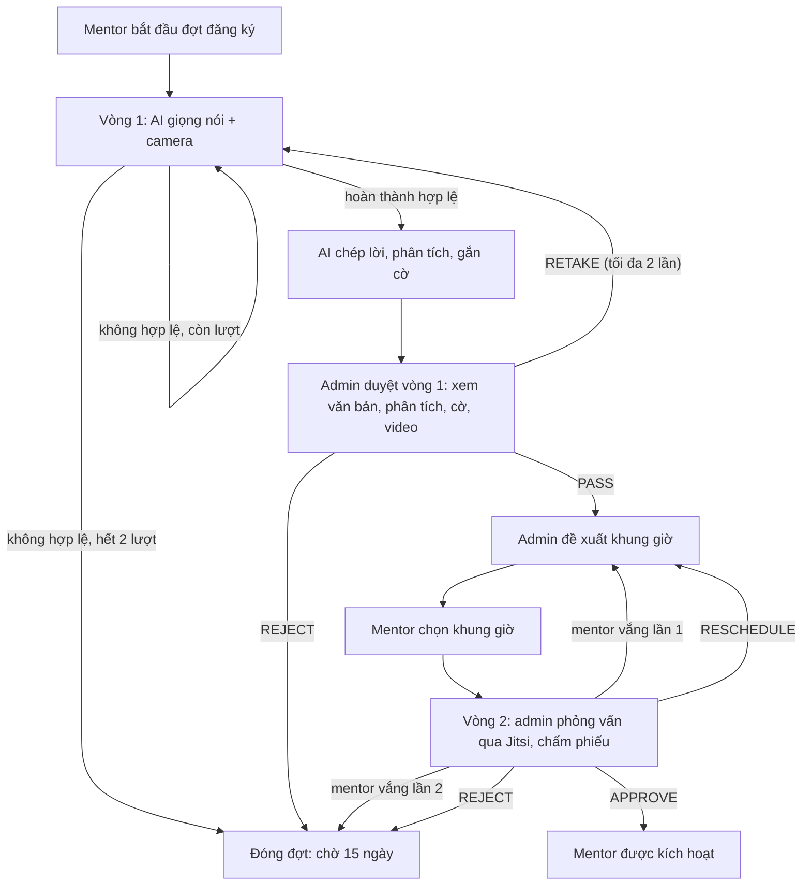
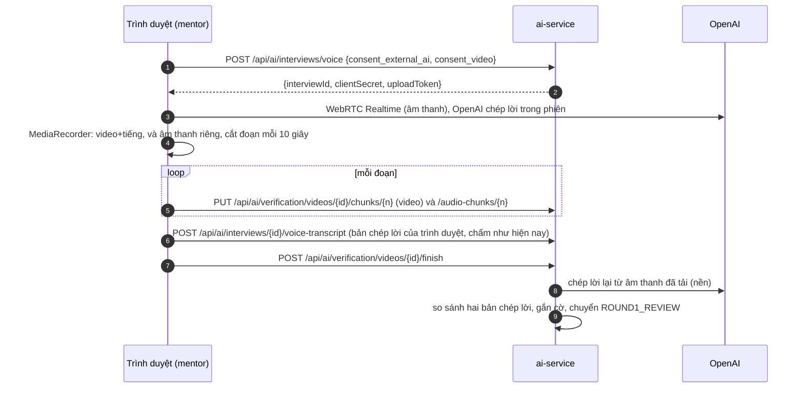
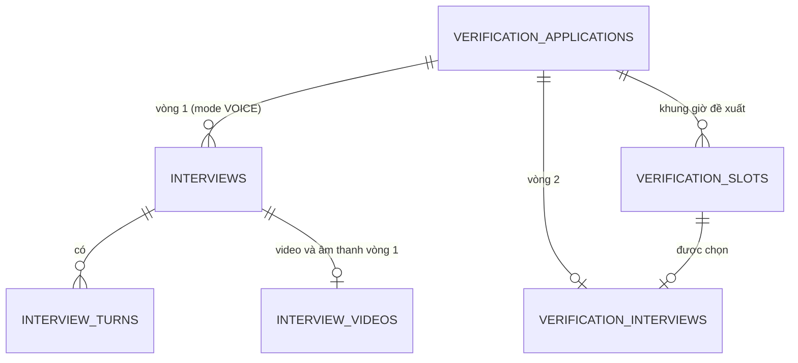

# Thiết kế: xác thực mentor 2 vòng

> **Trạng thái: THIẾT KẾ ĐÃ CHỐT (nhóm xác nhận 24/10/2026) và ĐÃ HIỆN THỰC qua 5 PR (1a, 1b, 2, 3, 4 — xem [report-task-verification.md](report-task-verification.md)).** Còn việc kiểm tay ở mục 16 (camera 30 phút, hai người thật vào phòng Jitsi, buổi dài hơn trần 4 giờ). Soạn 24/10/2026 cho AI Interview (xác thực mentor). Bản này thay bản 3 vòng
> (trắc nghiệm, AI chat, AI giọng nói) bằng **2 vòng**: AI phỏng vấn giọng nói có camera, rồi phỏng vấn với admin.
> Hiện trạng đang chạy (một buổi chat 5 lượt, có cấp độ) được mô tả ở [ai-features.md](ai-features.md) §2.
> Khi hiện thực xong, các quy tắc ở đây thay thế phần tương ứng của [ban-chot-nghiep-vu.md](ban-chot-nghiep-vu.md) §3–4 và §16.1.
> Tên endpoint, bảng, biến cấu hình của **hiện trạng** đã được đối chiếu với mã nguồn; mọi thứ ghi **(đề xuất)** hoặc "mới" là chưa tồn tại.

## 1. Mục tiêu và phạm vi

**Mục tiêu.** Quyết định một mentor mới có được xuất hiện trong kết quả matching và nhận mentee hay không, bằng hai vòng: AI phỏng vấn
giọng nói (rẻ, mở rộng được) rồi admin phỏng vấn trực tiếp (đắt, đáng tin). Admin quyết định cuối (NFR-8).

**Thay đổi so với hiện trạng.**

| Hạng mục | Hiện trạng | Thiết kế mới |
|---|---|---|
| Cấu trúc | Một buổi chat 5 lượt; giọng nói là chế độ thay thế (`mode = VOICE`) | Hai vòng nối tiếp trong một **đợt đăng ký** |
| Vòng 1 | Chat | AI **giọng nói**, bắt buộc **camera**, video lưu 60 ngày. AI chuyển giọng nói thành văn bản, phân tích và gắn cờ; **admin duyệt** kết quả |
| Vòng 2 | Không có (admin duyệt trên bản ghi) | **Admin phỏng vấn** qua video call (phòng Jitsi), chấm theo **phiếu thống nhất**, không giới hạn thời lượng |
| Số lần | Tối đa 3 buổi, chờ 7 ngày, admin mở khoá | Mỗi vòng tối đa 2 lần, bị đóng đợt thì chờ 15 ngày, **không còn nút mở khoá** |
| Cấp độ Junior/Senior/Expert | Có, quyết định khung giá, có luồng xin nâng cấp 90 ngày | **Bỏ hoàn toàn** |
| Giá | Trong khung của cấp | Mentor đặt tự do |
| Chế độ chat và dữ liệu phỏng vấn cũ | Có | **Xoá khỏi dự án** (D10) |

**Ngoài phạm vi.** Luyện phỏng vấn cho mentee và phỏng vấn thử với mentor (`practice_interviews`, `mock-interviews`). Mức `JUNIOR` của **mentee**
trong luyện phỏng vấn giữ nguyên. Phân tích khuôn mặt trong video (D5). Đối chiếu danh tính với giấy tờ.

## 2. Quyết định đã chốt

| # | Quyết định |
|---|---|
| D1 | Hai vòng: (1) AI phỏng vấn giọng nói, bắt buộc camera; (2) phỏng vấn với người |
| D2 | Người phỏng vấn vòng 2 là **admin**, cũng là người quyết định cuối |
| D3 | Vòng 2 là video call qua **phòng Jitsi có sẵn** |
| D4 | Đặt lịch vòng 2: admin đề xuất khung giờ, mentor chọn |
| D5 | Video vòng 1: quay, lưu 60 ngày, admin xem và xoá được, mentor chỉ xem. **Không phân tích khuôn mặt** (vòng 2 gặp người thật nên không cần OpenCV hay MediaPipe) |
| D6 | Bỏ cấp độ khỏi toàn bộ dự án (cả luồng xin nâng cấp 90 ngày); giá mentor tự đặt; bị đóng đợt hoặc bị từ chối thì chờ 15 ngày |
| D7 | Vòng 1 kết thúc bằng bước **admin duyệt**: video được lưu; AI chuyển giọng nói thành văn bản, phân tích và gắn cờ; admin xem văn bản, phân tích, cờ và video rồi cho sang vòng 2 hoặc từ chối. Admin có **hai quyết định** trong một đợt: duyệt vòng 1 và kết luận sau vòng 2 |
| D8 | **Buổi vòng 2 không giới hạn thời lượng.** Khung giờ chỉ có giờ bắt đầu; admin kết thúc buổi bằng cách nộp phiếu chấm và quyết định. Phòng Jitsi vẫn cần một trần kỹ thuật (mục 6.2) |
| D9 | **Đổi lịch vòng 2:** mentor được đổi tối đa **2 lần** mỗi đợt, và phải báo trước **ít nhất 24 giờ** so với giờ bắt đầu. Muộn hơn thì không được đổi; không đến thì tính là vắng |
| D10 | **Bỏ phần cũ khỏi dự án:** chế độ chat của mentor (không giữ dự phòng), luồng cấp độ và nâng cấp, mở khoá, và toàn bộ dữ liệu phỏng vấn cũ, **kể cả buổi giọng nói đã có** (xoá sau khi sao lưu). Mentor đã `APPROVED` giữ nguyên trạng thái |
| D11 | Vòng 2 chấm theo **phiếu thống nhất** 5 tiêu chí (mục 6.3), cùng thang và cùng ngưỡng với vòng 1 để so sánh được. Nhóm đã xác nhận trọng số 30/25/10/20/15, điều kiện chặn và quy tắc bắt buộc lý do |
| D12 | **Bản chép lời có kiểm tra chéo:** trình duyệt vẫn gửi bản chép lời của OpenAI để chấm nhanh; server chép lời lại từ âm thanh đã tải lên và so sánh, lệch nhiều thì gắn cờ `TRANSCRIPT_MISMATCH` (mục 5.3). Nhóm đã đồng ý làm cách này ngay từ bản đầu |
| D13 | **`RETAKE` ở bước duyệt vòng 1:** admin được yêu cầu mentor làm lại vòng 1 tối đa **2 lần mỗi đợt** (`VERIFICATION_ROUND1_MAX_RETAKE`), **không tính** vào 2 lần làm (mục 4). Hết 2 lần `RETAKE` thì admin chỉ còn `PASS` hoặc `REJECT` |

Các giá trị ghi **(đề xuất)** là giá trị khởi đầu của người soạn, hiệu chỉnh khi có dữ liệu thật (mục 16).

## 3. Tổng quan quy trình

Một **đợt đăng ký** (application) gom hai vòng. Mentor chỉ có một đợt đang mở tại một thời điểm.

**Trạng thái đợt** (`verification_applications.status`, mới) và quan hệ với `mentor_profiles.verification_status` (giữ nguyên bốn giá trị hiện có):

| `status` của đợt | Ý nghĩa | `verification_status` |
|---|---|---|
| `ROUND1` | Đang làm vòng 1 (hoặc chưa có lần nào) | `PENDING_INTERVIEW` |
| `ROUND1_REVIEW` | Vòng 1 xong, AI đã chép lời và phân tích, chờ admin duyệt | `PENDING_REVIEW` |
| `ROUND2_PENDING_SLOTS` | Admin đã duyệt vòng 1, chờ đề xuất giờ | `PENDING_REVIEW` |
| `ROUND2_PENDING_CHOICE` | Admin đã đề xuất, chờ mentor chọn | `PENDING_REVIEW` |
| `ROUND2_SCHEDULED` | Đã chốt giờ, chờ buổi phỏng vấn | `PENDING_REVIEW` |
| `APPROVED` | Admin duyệt | `APPROVED` (mới vượt hard filter của matching) |
| `REJECTED` | Admin từ chối | `REJECTED` |
| `CLOSED` | Hết lượt hoặc vắng hai lần | `REJECTED` |

Sau 15 ngày kể từ lúc đóng, mentor bắt đầu đợt mới và `verification_status` quay về `PENDING_INTERVIEW`.

## 4. Luật số lần và 15 ngày

Một **lần** (attempt) là một lượt làm vòng 1. Một lần có kết quả `PASSED`, `ABANDONED` hoặc `INVALIDATED`.

| Tình huống | Kết quả |
|---|---|
| Vòng 1 không hoàn thành hợp lệ, lần 1 | Làm lại vòng 1 ngay |
| Vòng 1 không hoàn thành hợp lệ, lần 2 | Đóng đợt, chờ 15 ngày |
| Vòng 1 hoàn thành hợp lệ | AI chép lời, phân tích, gắn cờ; đợt chuyển `ROUND1_REVIEW` chờ admin duyệt |
| Admin duyệt vòng 1: `PASS` | Giữ kết quả vòng 1, không làm lại trong cùng đợt, sang vòng 2 |
| Admin duyệt vòng 1: `REJECT` | Đóng đợt, chờ 15 ngày |
| Admin duyệt vòng 1: `RETAKE` (D13) | Mở lại vòng 1, **không tính** vào 2 lần làm; tối đa 2 lần `RETAKE` mỗi đợt, hết thì admin chỉ còn `PASS` hoặc `REJECT`. Dùng khi video hoặc âm thanh hỏng, hoặc cần xem lại, không phải lỗi của mentor |
| Vòng 2: mentor đổi giờ, báo trước **≥ 24 giờ** | Được tối đa **2 lần** mỗi đợt (D9), không tính lần vắng; admin đề xuất lại giờ |
| Vòng 2: mentor đổi giờ muộn hơn 24 giờ, hoặc đã đổi đủ 2 lần | Không được đổi; nếu không đến thì tính vắng |
| Vòng 2: mentor vắng buổi đã chốt, lần 1 | Tính một lần vắng, admin đề xuất lại giờ |
| Vòng 2: mentor vắng lần 2 | Đóng đợt, chờ 15 ngày |
| Vòng 2: admin vắng, hoặc admin chọn `RESCHEDULE` | **Không tính** lần của mentor |
| Mentor không chọn giờ trong 3 ngày (đề xuất) | Admin đề xuất lại hoặc đóng đợt, không tính lần |
| Admin từ chối (sau vòng 1 hoặc sau buổi vòng 2) | Đóng đợt, chờ 15 ngày |
| Sau 15 ngày | Bắt đầu đợt mới, làm lại từ vòng 1 |

**"Không hoàn thành hợp lệ" ở vòng 1 (đề xuất).** Vì không có điểm đạt cố định, vòng 1 chỉ bị tính là một lần thất bại khi:
bỏ dở (**buổi giọng nói: IN_PROGRESS quá 30 phút (`VOICE_SESSION_MINUTES`) mà chưa gửi bản chép lời**; ngưỡng 24 giờ của chat không áp dụng ở đây),
bị vô hiệu hoá (từ chối cấp camera hoặc micro, camera mất quá `VIDEO_RECONNECT_SECONDS` = 60 giây tổng cộng), hoặc lỗi từ phía mentor.
Lỗi do hệ thống (OpenAI hoặc DeepSeek không phản hồi) **không** tính lần. **Điểm thấp không loại mentor**: nó chảy vào khuyến nghị cho admin (mục 7).

**Thời hạn 15 ngày** tính từ lúc đóng đợt (`closed_at`) hoặc lúc admin từ chối (`reviewed_at`). Cấu hình `VERIFICATION_RETRY_DAYS = 15`.

## 5. Vòng 1: AI phỏng vấn giọng nói và camera

### 5.1 Trải nghiệm và phần tái dùng

- AI chỉ có giọng nói. Màn hình hiện chữ AI nói (phụ đề), không hiện hình AI.
- **Tái dùng nguyên trạng:** `POST /api/ai/interviews/voice` (trả client secret ngắn hạn, `ai-service/app/interview/voice.py`),
  `POST /api/ai/interviews/{id}/voice-transcript` (chấm bản chép lời bằng `engine.evaluate` và `engine.summarize`, DeepSeek có fallback rule-based),
  kế hoạch chủ đề AI soạn từ hồ sơ và CV (cột `interviews.plan`, migration 011, `planner.mentor_plan`), rubric 4 tiêu chí,
  chống prompt injection, `interviews.consent_external_ai` (đồng ý âm thanh được OpenAI xử lý, migration 010), tự đánh dấu `ABANDONED` sau 30 phút.
- **Mới:** camera và micro **bắt buộc**; đồng ý quay và lưu video; quay và tải lên theo đoạn; lưu 60 ngày; phát lại cho admin; chép lời lại phía server.
- Mentor từ chối cấp camera thì không bắt đầu được, và **chưa tính lần**.
- Chế độ chat (`mode = CHAT`) **bị xoá khỏi dự án** (D10, mục 8), không giữ làm dự phòng.

### 5.2 Luồng quay và tải lên

Trình duyệt quay **hai luồng** từ cùng camera và micro: (a) video có tiếng cho admin xem; (b) **chỉ âm thanh**, nhỏ, dùng cho server chép lời.
Làm vậy để không phải cài ffmpeg vào image ai-service chỉ để tách tiếng (và vì file video 30 phút ~110 MB, lớn hơn nhiều so với giới hạn upload của API chép lời, cần kiểm khi hiện thực).

- **Tải theo đoạn** để không mất dữ liệu khi đóng tab, và để biết camera ngắt ở đâu.
- Giới hạn khi quay video: 640×360, khoảng 500 kbps; buổi 30 phút nặng khoảng 110 MB (500 kbps × 1.800 s ÷ 8 ≈ 112 MB). Luồng chỉ âm thanh khoảng 32 kbps, ≈ 7 MB.
- Camera hoặc micro ngắt giữa buổi: cho kết nối lại, tổng thời gian mất tối đa 60 giây (đề xuất). Vượt quá thì lần làm bị `INVALIDATED`.

### 5.3 Chép lời, phân tích và gắn cờ

Sau khi mentor kết thúc buổi, AI xử lý trước khi admin duyệt:

1. **Chép lời kép.** Bản chép lời của OpenAI trong phiên (`OPENAI_TRANSCRIBE_MODEL`, `voice.py` `session_config`) do **trình duyệt gom và gửi lên**
   (`TranscriptInput.items`), nên về nguyên tắc có thể bị sửa. Vì vậy server **chép lời lại** từ luồng âm thanh đã tải lên (nguồn không đi qua tay người dùng sau khi tải) và lưu riêng.
2. **So sánh.** Chuẩn hoá (bỏ dấu câu, chữ thường) rồi tính tỉ lệ khác biệt theo từ giữa hai bản (`transcript_diff`). Vượt `TRANSCRIPT_MISMATCH_THRESHOLD` (khởi đầu 0,30, đề xuất, hiệu chỉnh khi có dữ liệu thật) thì gắn cờ `TRANSCRIPT_MISMATCH`. Chép lời lại thất bại (OpenAI lỗi, file quá lớn) thì ghi `transcript_check = UNAVAILABLE`, **không** gắn cờ và **không** chặn quy trình.
3. **Phân tích.** Chấm bản chép lời của trình duyệt bằng engine hiện có (DeepSeek, fallback rule-based), rubric 4 tiêu chí, điểm 0 đến 100, nhận xét từng chủ đề. Không đổi so với hiện trạng. Khi có cờ `TRANSCRIPT_MISMATCH`, giao diện hiện hai bản cạnh nhau và đánh dấu điểm là "chưa đáng tin".
4. **Gắn cờ.** Các cờ rubric áp dụng được cho bản chép lời (ví dụ `PROMPT_INJECTION`), cờ camera (5.4) và `TRANSCRIPT_MISMATCH`. Cờ chỉ là tín hiệu cho admin, **không tự loại** mentor.

Kết quả (văn bản, phân tích, điểm, cờ) và video được trình bày gộp cho admin ở bước duyệt vòng 1 (mục 7).

### 5.4 Cờ camera (không cần thị giác máy tính)

Không phân tích hình ảnh. Cờ suy ra từ **khoảng trống giữa các đoạn tải lên**:

| Cờ | Điều kiện (đề xuất) | Tác động |
|---|---|---|
| `CAMERA_OFF` | Thiếu đoạn hoặc khoảng trống thời gian giữa các đoạn vượt `VIDEO_MAX_GAP_SECONDS` (10 giây) | Buộc khuyến nghị của AI là `NEEDS_REVIEW` bất kể điểm, giống cách `PROMPT_INJECTION` đang xử lý |

### 5.5 Lưu trữ và quyền truy cập video

| Mục | Quy định |
|---|---|
| Thời hạn lưu | **60 ngày** kể từ khi kết thúc buổi (`VIDEO_RETENTION_DAYS`), áp cho cả video và âm thanh. Job nền xoá file và đánh dấu `deleted_at`, cùng khuôn với `purge_expired_cvs_forever` (CV) đã chạy trong `ai-service/app/main.py` |
| Admin | Xem và **xoá** được |
| Mentor | Chỉ **xem** video của chính mình, không xoá |
| Người khác | Không truy cập được |
| Nơi lưu | Một Docker volume mới cho ai-service (dev), cùng kiểu `cv-storage`; mẫu chống path traversal đã có ở `ai-service/app/storage.py`. Triển khai thật nên dùng object storage |
| Phát video | Qua endpoint có kiểm quyền, không có đường dẫn file công khai |
| Nhật ký | Ghi audit log mỗi lần admin xem hoặc xoá |

Xoá sớm bởi admin là xoá vĩnh viễn file; bản ghi, cờ và hai bản chép lời vẫn giữ để admin còn căn cứ.

### 5.6 Đồng ý và quyền riêng tư

Hai nội dung đồng ý **khác nhau** nên tách thành hai trường (đề xuất): `consent_external_ai` (có sẵn: âm thanh được OpenAI xử lý, nay gồm cả lần chép lời lại phía server)
và `consent_video` (mới: quay camera, video lưu 60 ngày, admin xem được, mentor chỉ xem). Mentor phải tick cả hai trước khi bắt đầu. Cần bổ sung một **chính sách dữ liệu video**
tương tự [cv-data-policy.md](cv-data-policy.md) khi hiện thực.

## 6. Vòng 2: phỏng vấn với admin (mới)

### 6.1 Luồng

1. Admin **duyệt vòng 1 là `PASS`** (mục 7): đợt chuyển `ROUND2_PENDING_SLOTS`. Vòng 2 chỉ mở sau bước này.
2. Admin **đề xuất khung giờ** (mặc định 3, `VERIFICATION_ROUND2_SLOT_COUNT`), mỗi khung chỉ gồm **giờ bắt đầu**. Giao diện có thể gộp duyệt vòng 1 và đề xuất giờ thành một thao tác.
3. Mentor chọn một khung giờ trong **trang trong app** (nguồn chính), trong 3 ngày (`VERIFICATION_SLOT_CHOICE_DAYS`). Mentor đổi giờ theo D9: tối đa 2 lần, báo trước ≥ 24 giờ.
4. Hệ thống chốt giờ: `ROUND2_SCHEDULED`. **Không giới hạn thời lượng** (D8). Hệ thống cảnh báo (không chặn) khi admin đã có buổi khác bắt đầu trong vòng 60 phút (đề xuất), vì không có thời lượng nên không tự tính được chồng lịch.
5. Tới giờ cả hai vào phòng Jitsi. Admin chấm phiếu (6.3) rồi ghi kết luận: `APPROVE`, `REJECT` hoặc `RESCHEDULE`.

### 6.2 Phòng Jitsi

Tái dùng hạ tầng Jitsi sẵn có (compose profile `jitsi`, prosody `AUTH_TYPE=jwt`, `ENABLE_GUESTS=0`) và cách ký JWT của mentoring-service, nhưng **không dùng lại `RoomService.join`**
vì hàm đó gắn chặt với bảng `sessions` (đọc phiên, `mentorId`/`menteeId`, trạng thái `CONFIRMED`).

| Mục | Quy định (đề xuất) |
|---|---|
| Tên phòng | `mentorhub-verify-<uuid>` |
| Quyền | Admin là moderator, mentor là khách |
| Khung giờ vào phòng | Mở trước giờ bắt đầu `ROOM_OPENS_BEFORE` (10 phút, cấu hình sẵn của mentoring-service). **Không có giờ đóng theo lịch** (D8); token có hạn `exp` = giờ bắt đầu + `VERIFICATION_ROOM_MAX_HOURS` (4 giờ) chỉ như **trần kỹ thuật an toàn**, không phải thời lượng chính sách. Admin chấm xong thì buổi kết thúc (`ended_at`) |
| Nhật ký | `mentor_joined_at`, `admin_joined_at` trên bản ghi `verification_interviews` |
| Mentor vắng | Sau `ROOM_GRACE` (10 phút) kể từ giờ bắt đầu mà `mentor_joined_at` còn rỗng thì admin được báo vắng. Quy tắc giống `ROOM_REQUIRE_JOIN_LOG`: **nhật ký vào phòng quyết định**, không phải lời khai |
| Cấp token | Endpoint nội bộ **mới** ở mentoring-service (`POST /internal/rooms/token`), ai-service gọi bằng `X-Internal-Token`. Giữ `JITSI_JWT_SECRET` ở một nơi duy nhất |

Phần việc phía mentoring-service: tách `RoomService.issueToken(roomName, userId, name, moderator, opensAt, expiresAt)` dùng chung cho phiên học và phỏng vấn xác minh.
**Cần chạy thử khi hiện thực:** Jitsi/prosody có ngắt người đã vào phòng khi JWT hết hạn hay chỉ kiểm lúc vào. Kết quả quyết định trần 4 giờ có cắt buổi đang diễn ra hay không.

### 6.3 Phiếu chấm thống nhất (D11)

Mục tiêu: mọi buổi phỏng vấn của mọi mentor được chấm bằng **cùng tiêu chí, cùng thang, cùng quy tắc**, và so sánh được với điểm AI ở vòng 1. Dùng cùng thang 0 đến 10 và cùng ba mức mô tả (0–2, 3–6, 7–10) với rubric AI trong `rubric.py`, thêm tiêu chí thứ năm mà chỉ người mới kiểm được.

| Tiêu chí | Trọng số | 0–2 | 3–6 | 7–10 |
|---|---|---|---|---|
| `technical` (kỹ thuật) | 30% | Sai, lạc đề, hoặc không trả lời được câu cơ bản | Đúng nhưng chung chung, thiếu đánh đổi | Đúng, nêu được đánh đổi và giới hạn, xử lý tốt câu hỏi đào sâu |
| `depth` (kinh nghiệm thực tế) | 25% | Không có ví dụ cụ thể, hoặc không khớp hồ sơ | Có dự án nhưng mơ hồ về vai trò và kết quả | Dự án thực tế, vai trò rõ, số liệu, giải thích quyết định |
| `communication` (giao tiếp) | 10% | Khó theo dõi | Dễ hiểu | Có cấu trúc, điều chỉnh theo người nghe |
| `mentoring` (hướng dẫn) | 20% | Không có góc nhìn hướng dẫn | Có chỉ dẫn chung | Kế hoạch dạy cụ thể, biết gỡ vướng, hỏi ngược để chẩn đoán trình độ mentee |
| `authenticity` (xác thực và cam kết) | 15% | Hồ sơ, CV hoặc vòng 1 không khớp lời nói; nghi người khác làm bài; né câu hỏi kiểm tra | Khớp phần lớn; cam kết thời gian, số mentee còn mơ hồ | Khớp hoàn toàn; cam kết rõ (giờ rảnh, số mentee, giá, cách làm việc) |

Tổng trọng số = 30 + 25 + 10 + 20 + 15 = 100%. Trọng số và mô tả là **hằng số trong mã**, đặt cạnh `rubric.py` (cùng cách `WEIGHTS` đang làm), không phải biến môi trường.

**Cách tính và khuyến nghị.**
1. Điểm tổng (0–100) = Σ trọng số × điểm tiêu chí × 10, làm tròn như `round1` ở `rubric.py`.
2. Khuyến nghị theo điểm, **cùng ngưỡng vòng 1** (`APPROVE_THRESHOLD` 70, `REJECT_THRESHOLD` 50): ≥ 70 `APPROVE`, 50 đến 69.9 `NEEDS_REVIEW`, dưới 50 `REJECT`.
3. **Điều kiện chặn:** `authenticity` ≤ 2 hoặc `technical` ≤ 2 thì khuyến nghị tối đa là `NEEDS_REVIEW` bất kể điểm tổng (không ai được khuyến nghị duyệt khi sai kiến thức nền hoặc nghi gian lận).
4. **Bằng chứng:** tiêu chí chấm **≤ 2 hoặc ≥ 9** phải kèm lý do ít nhất 10 ký tự. Giữ nhất quán giữa các lần và làm căn cứ khi mentor khiếu nại.
5. **So với vòng 1:** giao diện đặt điểm bốn tiêu chí chung (`technical`, `depth`, `communication`, `mentoring`) của AI cạnh điểm admin. Chênh từ 4 điểm trở lên ở một tiêu chí thì đánh dấu "lệch lớn" (chỉ là thông tin để admin xem lại: AI chấm sai, hoặc người làm bài vòng 1 khác người đang nói; không tự chặn).
6. `APPROVE` và `REJECT` bắt buộc đủ 5 điểm. `RESCHEDULE` không cần phiếu.
7. Admin vẫn là người quyết định cuối. Quyết định **ngược** khuyến nghị cần ghi chú tổng ít nhất 10 ký tự (giữ nguyên `MIN_OVERRULE_NOTE`).

**Khung câu hỏi thống nhất.** Không giới hạn thời gian, nhưng mỗi buổi hỏi **ít nhất một câu cho mỗi tiêu chí**:

| Phần | Mục đích | Gợi ý |
|---|---|---|
| Xác minh | `authenticity` | Đối chiếu 2 đến 3 chi tiết giữa lời nói với CV, hồ sơ; nhờ giải thích lại một câu đã trả lời ở vòng 1 |
| Kỹ thuật | `technical` | 2 đến 3 chủ đề theo lĩnh vực và kỹ năng khai báo (lấy từ ngân sách chủ đề `question_bank.py`), ưu tiên chủ đề điểm thấp ở vòng 1; hỏi đào sâu hai tầng |
| Kinh nghiệm | `depth` | Một dự án gần nhất: vai trò, quyết định, số liệu, điều sẽ làm khác đi |
| Hướng dẫn | `mentoring`, `communication` | Một tình huống chuẩn dùng chung cho mọi mentor cùng lĩnh vực: "mentee mới bị kẹt ở chủ đề X, bạn hướng dẫn thế nào" |
| Cam kết | `authenticity` | Giờ rảnh mỗi tuần, số mentee nhận cùng lúc, giá, kỳ vọng |

### 6.4 Thông báo

Dùng đường sẵn có `ai-service/app/clients/mentoring.py` (`notify_user`) tới `POST /internal/notifications` của mentoring-service, nơi tạo thông báo trong app và gọi `EmailClient`.
Thêm các loại: `MENTOR_INTERVIEW_SLOTS_PROPOSED`, `MENTOR_INTERVIEW_SCHEDULED`, đăng ký vào `EmailClient.CATEGORIES` nhóm `ACCOUNT` (luôn gửi, kể cả giờ yên tĩnh).
Lời gọi là **bắn-rồi-quên** và hàng đợi email có thể bỏ thư khi đầy, nên **trang trong app là nguồn chính**, email chỉ nhắc.

## 7. Khuyến nghị của AI và duyệt của admin

Admin có **hai quyết định** trong một đợt: **duyệt vòng 1** (mục này) và **kết luận sau vòng 2** (mục 6.3). AI chỉ đưa thông tin và khuyến nghị, không quyết định.

**Duyệt vòng 1.**
- Điều kiện: đợt ở `ROUND1_REVIEW`, tức AI đã chép lời, phân tích và gắn cờ xong.
- Admin xem gộp: văn bản chép lời (cả hai bản nếu có `TRANSCRIPT_MISMATCH`), điểm và nhận xét theo rubric, các cờ, **trình phát video**, số lần đã làm.
- Quyết định: `PASS` (sang vòng 2), `REJECT` (đóng đợt, chờ 15 ngày), `RETAKE` (làm lại vòng 1, không tính vào 2 lần làm, tối đa 2 lần mỗi đợt, D13). Ghi chú bắt buộc khi `RETAKE` để mentor biết cần làm lại vì sao.
- Ghi chú tối thiểu 10 ký tự khi quyết định **ngược** khuyến nghị của AI: `PASS` khi AI khuyến nghị `REJECT`, hoặc `REJECT` khi AI khuyến nghị `APPROVE`.

**Khuyến nghị của AI (vòng 1).**
- Một điểm 0 đến 100 từ rubric. **Không còn điểm tổng hợp hai vòng** (không có `FINAL_WEIGHT_*`): vòng 1 do AI chấm, vòng 2 do admin chấm riêng bằng phiếu 6.3.
- Giữ ngưỡng hiện có: ≥ 70 `APPROVE`, 50 đến 69.9 `NEEDS_REVIEW`, dưới 50 `REJECT`.
  Có cờ nghiêm trọng (`PROMPT_INJECTION`, `CAMERA_OFF`, `TRANSCRIPT_MISMATCH`) thì `NEEDS_REVIEW`.
- Khuyến nghị **không** tự quyết định trạng thái đợt.

**Khác.**
- Trang admin ở bước kết luận vòng 2 hiển thị lại toàn bộ thông tin vòng 1 cùng trạng thái lịch, nhật ký vào phòng và phiếu chấm.
- Audit log và thống kê đồng thuận admin và AI (`GET /api/ai/admin/stats`) giữ nguyên, ghi riêng hai loại quyết định; bỏ trường `tier`, `fromTier`, `suggestedTier`.

## 8. Bỏ phần cũ khỏi dự án (D6, D10)

**Bỏ cấp độ và giá tự do.**

| Phần | Tác động |
|---|---|
| ai-service | Bỏ `kind = UPGRADE`, `from_tier` (migration 009); `rubric.suggest_tier`, `TIERS`; trong `attempts.py`: `TIER_RANK`, `is_higher_tier`, `upgrade_available_at`; trong `config.py`: `TIER_PASS_FROM`, `TIER_SENIOR_FROM`, `TIER_EXPERT_FROM`, `INTERVIEW_UPGRADE_AFTER_DAYS`; trong `service.py`: `UPGRADE_COOLDOWN`, `TIER_MAX`, thông báo `MENTOR_TIER_UPGRADED` và `MENTOR_TIER_UPGRADE_REJECTED`, trường audit `fromTier`/`suggestedTier`. Bỏ endpoint `POST /admin/interviews/mentors/{id}/unlock` (thay bằng quy tắc 15 ngày) |
| profile-service | Xoá `PricingTiers` và kiểm tra khung giá (`requireRateInTier`, `violation()`). **Sửa `ProfileService.updateRate`**: hiện ném `409 TIER_NOT_ASSIGNED` khi chưa có tier, nên bỏ tier mà không sửa thì mentor **không đặt được giá**. Sửa `updateProfile` (kiểm giá theo khung) và `updateVerification` (tự suy tier từ giá khi `APPROVED`). Bỏ `PUT /internal/mentor/{id}/tier`, `GET /api/profile/pricing-tiers`, DTO `TierUpdate`, `PricingTiersResponse`, `TierBand`, các biến `PRICING_*` và `TIER_*`. Migration `V11__*.sql` xoá cột `tier`, `tier_assigned_at` (`V9__mentor_tier.sql` đã backfill tier cho mentor `APPROVED`) |
| Giá | Mentor đặt `hourly_rate` tự do (giữ ràng buộc tối thiểu, ví dụ không âm). Giá hiện có giữ nguyên |
| mentoring-service | Chỉ `EmailClient` nhắc loại thông báo tier. `MentoringRequest` và `RequestRules` **không** dính cấp độ |
| Matching | Không đổi. Bộ lọc giá `maxRate` của mentee vẫn hoạt động |

**Bỏ chế độ chat của mentor (D10).** Danh sách dưới đây dựa trên các hàm đã đọc; danh sách cuối cùng xác nhận bằng grep khi hiện thực.

| Loại bỏ (chỉ phục vụ chat) | Giữ lại (dùng chung với giọng nói và luyện phỏng vấn) |
|---|---|
| Endpoint `POST /interviews`, `POST /interviews/{id}/answers`; `service.start`, `service.answer`; `engine.first_question` và bản cài đặt ở `rule_based.first_question`, `deepseek_engine.first_question`; giao diện chat trong `frontend/src/app/interview/page.tsx`; thông báo `INTERVIEW_RETAKE_REQUESTED` của luồng cũ | `rubric.py`; `engine.evaluate`, `engine.summarize` (cả đường giọng nói dùng ở `service.submit_voice_transcript`); `planner.py`; `question_bank.py`; `voice.py`; `deepseek_engine`, `rule_based` phần chấm |

**Dữ liệu cũ.** Toàn bộ dòng phỏng vấn cũ (`interviews`, `interview_turns`, bảng `interview_attempt_unlocks`) thuộc mô hình một buổi có cấp độ, không có `application_id`, không ánh xạ sang mô hình mới nên **xoá** trong migration `012`.
Xoá này **không đảo ngược được**: sao lưu trước khi chạy. `mentor_profiles.verification_status` là thuộc tính hồ sơ, **không** bị đụng: mentor đã `APPROVED` vẫn hiện trong matching. Dữ liệu demo seed lại.
`practice_interviews` (luyện phỏng vấn của mentee) giữ nguyên.

**Hệ quả của việc bỏ chat.** Vòng 1 **phụ thuộc OpenAI**: không có `OPENAI_API_KEY` thì mentor mới không qua được vòng 1 (xem rủi ro, mục 15), và dòng "để trống khoá thì chat vẫn chạy" trong `scope-core.md` §3 không còn đúng.

**Phần còn lại cần sửa.**

| Phần | Tác động |
|---|---|
| Frontend | `interview/page.tsx`, `admin/interviews/page.tsx` và `[id]/page.tsx`, `profile/page.tsx` (ô giá đang khoá khi chưa có tier), `mentors/[id]/page.tsx`, `mentoring/book/[mentorId]/page.tsx`, `features/ai/api.ts`, `features/profile/api.ts`, `types/ai.ts`, `types/profile.ts` |
| Contracts | `contracts/ai-service.yaml`, `contracts/profile-service.yaml` |
| Test | Xoá `test_interview_tier.py` (7), `test_interview_upgrade.py` (10), `MentorTierTest.java` (12). Sửa `test_interview_attempts.py` (15, có logic unlock và cooldown), `test_interview_flow.py` (7, phần chat). Xem lại `test_interview_rule_based.py`, `test_interview_planner.py`, `test_voice_interview.py` |
| Script e2e | Xoá `e2e_v2_tier.py`. Sửa các script gửi `tier` khi duyệt: `common.py` (`tier_for_rate`), `e2e_acceptance.py`, `e2e_p0_mentoring.py`, `e2e_s2_mentoring.py`, `e2e_s3_mentoring.py`, `e2e_s5_ai_auth.py`, `e2e_v2_booking.py` (assert `tier == "SENIOR"`), `e2e_v2_room_referral.py`, `e2e_v2_trial.py`, `seed_demo.py`. Các script dùng luồng chat (`e2e_s3_ai_auth.py`, `e2e_s5_ai_auth.py`, đã kiểm bằng grep; `e2e_s4_ai_auth.py` không dùng) cần viết lại theo luồng mới |
| Tài liệu | `ban-chot-nghiep-vu.md` §3–4, §15 (hàng 3) và §16.1; `scope-core.md`; `ai-features.md`; `api-reference.md`; `database-design.md`; `architecture.md`; `SRD-Mentor-Mentee-Platform.md`; `business-domain-mentor-mentee.md`; `user-guide.md`; `testing-report.md`; `deployment-guide.md`. `eval-interview.md` và `scripts/eval/interview` đánh giá engine chấm câu trả lời (dùng chung với bản chép lời) nên giữ, chỉ sửa chỗ nhắc chat |

## 9. Mô hình dữ liệu (ai_db)

Ý tưởng: thêm tầng **đợt** phía trên bảng `interviews` (tái dùng cho vòng 1), thêm bảng cho vòng 2 và video.

| Bảng | Trạng thái | Nội dung chính |
|---|---|---|
| `verification_applications` | **Mới** | `id`, `mentor_id`, `status` (mục 3), `retry_after`, `closed_at`, `reschedule_count`, `no_show_count`, `retake_count`, `round1_decision` (`PASS`, `REJECT`, `RETAKE`), `round1_reviewed_by`, `round1_reviewed_at`, `round1_note`, `reviewed_by`, `review_note`, `reviewed_at` (ba cột cuối là kết luận sau vòng 2). Ràng buộc: mỗi mentor tối đa một đợt chưa kết thúc |
| `verification_slots` | **Mới** | `id`, `application_id`, `starts_at` (không có giờ kết thúc, D8), `status` (`PROPOSED`, `CHOSEN`, `EXPIRED`), `proposed_by`, `created_at` |
| `verification_interviews` | **Mới** | `id`, `application_id`, `slot_id`, `admin_id`, `scheduled_at`, `status` (`SCHEDULED`, `COMPLETED`, `MENTOR_NO_SHOW`, `RESCHEDULED`), `mentor_joined_at`, `admin_joined_at`, `ended_at`, `scores` (JSON 5 tiêu chí), `score_notes` (JSON), `total_score`, `recommendation`, `note` |
| `interview_videos` | **Mới** | `id`, `interview_id`, `storage_path`, `audio_storage_path`, `size_bytes`, `duration_s`, `chunk_count`, `gap_detected`, `server_transcript`, `transcript_diff`, `transcript_check` (`OK`, `MISMATCH`, `UNAVAILABLE`), `consent_video`, `created_at`, `expires_at`, `deleted_at`, `deleted_by` |
| `interviews` | **Đổi** | Thêm `application_id`. Bỏ `kind`, `from_tier`. Giữ các cột đã có: `mode`, `consent_external_ai`, `plan`, `abandoned_at`. Quyết định `APPROVED`, `REJECTED`, `RETAKE_REQUESTED` ở mức buổi chuyển lên đợt nên không còn dùng |
| `interview_attempt_unlocks` | **Bỏ** | Thay bằng quy tắc 15 ngày (bảng này tạo ở migration 005) |

**Migration.** ai-service dùng runner SQL đánh số (`ai-service/app/migrations.py`, `ai-service/migrations/NNN_*.sql`, bảng `schema_migrations`, hiện có 001 đến 011): thêm `012_*.sql`, gồm cả việc xoá dữ liệu cũ ở mục 8.
profile-service dùng Flyway: thêm `V11__*.sql`. (ADR-04 ghi "không dùng công cụ migration" đã được thay thế.) **Xoá dữ liệu cũ và cột `tier` không đảo ngược được**, nên sao lưu trước khi chạy.

## 10. API đề xuất

**Giữ nguyên (đã có, `ai-service/app/routers/interview.py`, prefix `/api/ai`):** `POST /interviews/voice`, `POST /interviews/{id}/voice-transcript`, `GET /interviews/{id}`,
`GET /interviews/me`, `GET /admin/stats`. **Đổi:** `GET /interviews/eligibility` thay bằng `GET /verification/status`; `POST /admin/interviews/{id}/review` và `/admin/interviews/mentors/{id}/unlock` được thay (mục 6.3, 7, 8).
**Xoá (chat, D10):** `POST /interviews` và `POST /interviews/{id}/answers`.

| Method | Đường dẫn (mới, tiền tố `/api/ai`) | Mục đích |
|---|---|---|
| GET | `/verification/status` | Đợt hiện tại: vòng đang ở, số lần còn lại, `retry_after`, khung giờ đề xuất, số lần đổi giờ còn lại, lý do chưa bắt đầu được |
| POST | `/verification/applications` | Bắt đầu đợt mới |
| PUT | `/verification/videos/{id}/chunks/{n}` | Tải một đoạn video |
| PUT | `/verification/videos/{id}/audio-chunks/{n}` | Tải một đoạn âm thanh riêng |
| POST | `/verification/videos/{id}/finish` | Kết thúc tải lên, xếp hàng chép lời lại và so sánh |
| GET | `/verification/videos/{id}/stream` | Phát video (mentor chỉ video của mình, admin xem tất cả) |
| POST | `/verification/slots/{id}/choose` | Mentor chọn khung giờ |
| POST | `/verification/round2/reschedule` | Mentor xin đổi giờ (tối đa 2 lần, báo trước ≥ 24 giờ) |
| GET | `/verification/round2/room` | Lấy thông tin vào phòng Jitsi (kiểm quyền và khung giờ, gọi mentoring-service lấy token) |
| GET | `/admin/verification/applications` | Danh sách đợt chờ xử lý |
| GET | `/admin/verification/applications/{id}` | Chi tiết gộp vòng 1 (văn bản chép lời, phân tích, cờ, video) và vòng 2 |
| POST | `/admin/verification/applications/{id}/round1-review` | Admin duyệt vòng 1: `PASS`, `REJECT`, `RETAKE` (tối đa 2 lần, kèm ghi chú) |
| POST | `/admin/verification/applications/{id}/slots` | Admin đề xuất khung giờ (chỉ khi vòng 1 đã `PASS`) |
| POST | `/admin/verification/applications/{id}/mentor-absent` | Admin báo mentor vắng (cần nhật ký vào phòng) |
| POST | `/admin/verification/applications/{id}/decision` | Kết luận sau vòng 2: `APPROVE`, `REJECT` (kèm phiếu chấm đủ 5 tiêu chí), `RESCHEDULE` |
| DELETE | `/admin/verification/videos/{id}` | Admin xoá video |

mentoring-service thêm `POST /internal/rooms/token` (mục 6.2). Frontend tách `JitsiEmbed({domain, roomName, jwt})` từ trang
`mentoring/sessions/[id]/room/page.tsx` để dùng chung, và thêm trang phòng cho vai trò `ADMIN` và `MENTOR` (không có nút "báo vắng" của buổi học).

## 11. Cấu hình đề xuất

| Biến | Mặc định | Ý nghĩa |
|---|---|---|
| `VERIFICATION_MAX_ATTEMPTS_PER_ROUND` | 2 | Số lần vòng 1; số lần vắng vòng 2 |
| `VERIFICATION_RETRY_DAYS` | 15 | Chờ sau khi bị đóng đợt hoặc từ chối |
| `VERIFICATION_ROUND1_MAX_RETAKE` | 2 | Số lần admin được yêu cầu làm lại vòng 1 mỗi đợt, không tính vào số lần làm (D13) |
| `VERIFICATION_ROUND2_SLOT_COUNT` | 3 | Số khung giờ admin đề xuất |
| `VERIFICATION_ROUND2_MAX_RESCHEDULE` | 2 | Số lần mentor được đổi giờ mỗi đợt (D9) |
| `VERIFICATION_ROUND2_RESCHEDULE_NOTICE_HOURS` | 24 | Báo trước tối thiểu khi đổi giờ (D9) |
| `VERIFICATION_SLOT_CHOICE_DAYS` | 3 | Hạn mentor chọn giờ |
| `VERIFICATION_ROOM_MAX_HOURS` | 4 | Trần kỹ thuật của token phòng Jitsi (không phải thời lượng chính sách, D8) |
| `VIDEO_RETENTION_DAYS` | 60 | Thời hạn lưu video và âm thanh |
| `VIDEO_RECONNECT_SECONDS` | 60 | Tổng thời gian được phép mất camera |
| `VIDEO_MAX_GAP_SECONDS` | 10 | Khoảng trống giữa các đoạn để bật `CAMERA_OFF` |
| `TRANSCRIPT_MISMATCH_THRESHOLD` | 0.30 | Tỉ lệ khác biệt theo từ giữa hai bản chép lời để bật `TRANSCRIPT_MISMATCH` |
| `VOICE_SESSION_MINUTES` | 30 | **Giữ nguyên** (đã có), hạn bỏ dở của buổi giọng nói |

Hằng số trong mã (không phải biến môi trường): trọng số và ngưỡng của phiếu chấm vòng 2 (mục 6.3).
Bỏ: `INTERVIEW_MAX_ATTEMPTS`, `INTERVIEW_COOLDOWN_DAYS`, `INTERVIEW_UPGRADE_AFTER_DAYS`, `INTERVIEW_MAX_TURNS` (chỉ dùng cho chat; xác nhận bằng grep), `TIER_*`, `PRICING_*`.
Tái dùng của mentoring-service: `ROOM_OPENS_BEFORE`, `ROOM_GRACE`, `JITSI_*`.

## 12. Bảo mật và quyền riêng tư

- API key thật của OpenAI không tới trình duyệt (giữ cơ chế client secret ngắn hạn). `JITSI_JWT_SECRET` chỉ nằm ở mentoring-service; ai-service lấy token qua endpoint nội bộ.
- Video và âm thanh chỉ truy cập qua endpoint có kiểm quyền. Mentor chỉ xem video của mình, admin xem và xoá. Mọi lần xem hoặc xoá ghi audit log.
- Giữ cơ chế chống prompt injection cho bản chép lời. Video không đưa cho LLM bên ngoài (không phân tích hình ảnh); **âm thanh được gửi cho OpenAI** (Realtime và chép lời lại), nên nằm trong phần đồng ý `consent_external_ai`.
- Cần chính sách dữ liệu video và cập nhật phần đồng ý. Mentor cần biết rõ ai xem video và trong bao lâu.
- Endpoint cấp phòng chỉ cấp token khi người gọi là admin hoặc đúng mentor của đợt, trong khung giờ cho phép.
- Phiếu chấm vòng 2 và ghi chú lưu cùng audit log, không sửa sau khi đã quyết định.

## 13. Kiểm thử đề xuất

| Lớp | Nội dung |
|---|---|
| Unit | Luật số lần và 15 ngày (hàm thuần như `attempts.py`), **giới hạn `RETAKE` 2 lần và không tính vào số lần làm**, chuyển trạng thái đợt, **luật đổi giờ (≥ 24 giờ, tối đa 2 lần)**, quy tắc vắng theo nhật ký vào phòng, **phiếu chấm** (tính điểm, ngưỡng khuyến nghị, điều kiện chặn `technical`/`authenticity` ≤ 2, bắt buộc lý do khi chấm ≤ 2 hoặc ≥ 9, đánh dấu lệch ≥ 4 so với vòng 1), phát hiện khoảng trống giữa các đoạn video, so sánh hai bản chép lời (`transcript_diff`) |
| API | Không sang vòng 2 khi chưa `PASS`, hết 2 lần, chờ 15 ngày, chọn giờ ngoài khung đã đề xuất, đổi giờ muộn hơn 24 giờ hoặc quá 2 lần, quyền xem video (mentor, admin, người khác), chỉ admin hoặc đúng mentor lấy được token phòng, `APPROVE` thiếu phiếu bị từ chối |
| e2e | Mentor đi qua hai vòng (OpenAI giả lập), admin duyệt vòng 1, đề xuất giờ, mentor chọn, admin chấm phiếu và quyết định, mentor xuất hiện trong matching; ca admin `REJECT` ở vòng 1; ca vắng hai lần; ca `TRANSCRIPT_MISMATCH` |
| Video | Tải đoạn và ghép, phát hiện khoảng trống, job xoá sau 60 ngày |
| Thủ công | Hai người vào cùng phòng Jitsi trên trình duyệt thật (e2e hiện chỉ kiểm JWT, log và khung giờ); buổi dài hơn 30 phút (kiểm hành vi khi token hết hạn); quay camera 30 phút trên máy thật; gửi âm thanh 7 MB cho API chép lời (kiểm giới hạn kích thước và định dạng) |
| Phi chức năng | Dung lượng và thời gian tải video; dung lượng ổ đĩa khi nhiều mentor (100 mentor ≈ 11 GB video); chi phí chép lời lại |

Rule-based và DeepSeek tiếp tục được đánh giá theo [eval-interview.md](eval-interview.md) (hiện **PROVISIONAL**: hai cột người chấm còn trống, DeepSeek chưa chạy). Bộ nhãn vòng 1 cần hai người chấm độc lập để số liệu hết ở trạng thái tạm thời.

## 14. Kế hoạch triển khai

| Giai đoạn | Nội dung | Phụ thuộc |
|---|---|---|
| 1 | Bỏ phần cũ: cấp độ, giá tự do, chế độ chat, mở khoá, xoá dữ liệu cũ (mục 8) | Không |
| 2 | Mô hình đợt, luật số lần và 15 ngày, trạng thái hồ sơ | 1 |
| 3 | Vòng 1: camera, quay và tải đoạn (video và âm thanh), lưu 60 ngày, đồng ý, trình phát, cờ `CAMERA_OFF`, chép lời lại và `TRANSCRIPT_MISMATCH`, trang admin duyệt vòng 1 | 2 |
| 4 | Vòng 2: khung giờ, đổi giờ, endpoint token Jitsi, trang admin và mentor, phiếu chấm, thông báo, quyết định, quy tắc vắng | 2 |

Giai đoạn 3 và 4 độc lập nhau nên làm song song được sau giai đoạn 2. Mỗi giai đoạn chạy và kiểm thử được riêng. Giai đoạn 4 có rủi ro lớn nhất về hạ tầng (Jitsi, mục 15), giai đoạn 3 về dữ liệu cá nhân.

## 15. Rủi ro

| Rủi ro | Giảm thiểu |
|---|---|
| Vòng 1 phụ thuộc OpenAI: không có `OPENAI_API_KEY` hoặc OpenAI ngừng thì không ai qua được vòng 1 (đã bỏ chat dự phòng, D10) | Lỗi hệ thống không tính lần; e2e và demo dùng OpenAI giả lập; ghi rõ yêu cầu khoá trong hướng dẫn triển khai và `scope-core.md` |
| Jitsi đang ở mục "Tạm gác" của `scope-core.md`; video thật mới kiểm tay một lần (22/10), e2e chỉ kiểm JWT | Đưa Jitsi ra khỏi danh sách gác; chạy lại thủ công trước khi hiện thực xong; thêm kiểm thử thủ công vào mục 13 |
| Buổi vòng 2 không giới hạn thời lượng nhưng token Jitsi có `exp`: chưa rõ Jitsi có ngắt người đã vào khi token hết hạn không | Trần kỹ thuật 4 giờ; chạy thử buổi dài hơn trần trước khi chốt (mục 13) |
| Không có thời lượng nên không tự phát hiện được chồng lịch của admin | Cảnh báo khi admin có buổi bắt đầu trong vòng 60 phút (đề xuất); admin tự chịu trách nhiệm khi xếp lịch |
| Jitsi tự host cần UDP 10000 và TLS thật khi demo từ xa (chứng chỉ tự ký chỉ chạy cục bộ) | Chuẩn bị domain và TLS cho triển khai thật; demo cục bộ khi chưa có |
| Nghẽn ở admin: mỗi mentor cần hai lần admin xử lý (duyệt vòng 1, rồi buổi phỏng vấn không giới hạn thời lượng) | Bước duyệt vòng 1 loại bớt ca không đạt; giao diện gộp duyệt vòng 1 và đề xuất giờ; giới hạn số đợt chờ; cân nhắc thêm người phỏng vấn sau |
| Chép lời lại phía server lỗi hoặc file âm thanh vượt giới hạn của API chép lời | Âm thanh riêng ~7 MB (không dùng video 110 MB); lỗi thì `UNAVAILABLE`, không chặn; admin vẫn đối chiếu với video; kiểm giới hạn khi hiện thực |
| Ngưỡng `TRANSCRIPT_MISMATCH_THRESHOLD` báo nhầm vì nhận dạng giọng nói khác nhau giữa hai lần chép | Giá trị khởi đầu 0,30, chỉ gắn cờ không loại, hiệu chỉnh bằng dữ liệu thật |
| Dung lượng video lớn | Giới hạn bitrate và độ phân giải, chia đoạn, chuyển object storage khi triển khai thật |
| Dữ liệu cá nhân nhạy cảm | Đồng ý rõ ràng (hai trường riêng), thời hạn 60 ngày, phân quyền, audit log |
| Quy tắc vắng mặt hiện gắn với `sessions` (`RoomRules`, `AttendanceService`) | Viết quy tắc riêng cho vòng 2 (mục 6.2), không dùng lại hàm của buổi học |
| Xoá dữ liệu phỏng vấn cũ và cột `tier` không đảo ngược | Sao lưu trước khi chạy migration; không đụng `verification_status` của mentor đã duyệt |
| Điểm vòng 1 chưa kiểm chứng (nhãn nháp, DeepSeek chưa chạy); trọng số phiếu chấm vòng 2 chưa thử với dữ liệu thật | Điểm AI chỉ là khuyến nghị; hiệu chỉnh trọng số sau vài chục buổi đầu |

## 16. Việc phải kiểm khi hiện thực

Không còn câu hỏi thiết kế nào để mở: nhóm đã xác nhận D8–D13 (24/10/2026). Những điểm dưới đây **không phải quyết định mà là giả định chưa kiểm**, phải chạy thử hoặc đo thật khi hiện thực rồi cập nhật spec nếu khác dự kiến.

| # | Việc cần kiểm | Giai đoạn | Nếu khác dự kiến |
|---|---|---|---|
| 1 | **Jitsi/prosody có ngắt người đã vào phòng khi JWT hết hạn không** (chạy buổi dài hơn `VERIFICATION_ROOM_MAX_HOURS`) | 4 | Nếu có ngắt: tăng trần hoặc cấp lại token; nếu không: trần chỉ chặn người vào muộn |
| 2 | **API chép lời nhận file âm thanh ~7 MB, định dạng webm/opus**; giới hạn kích thước và định dạng; model chép lời dùng được ở endpoint `/audio/transcriptions` | 3 | Nếu không nhận: đổi định dạng quay, hoặc cắt âm thanh thành nhiều phần |
| 3 | **Ngưỡng `TRANSCRIPT_MISMATCH_THRESHOLD` 0,30** có báo nhầm nhiều không (hai lần nhận dạng giọng nói vốn khác nhau) | 3 | Hiệu chỉnh bằng dữ liệu thật; cờ chỉ gắn, không loại nên rủi ro thấp |
| 4 | **Trọng số phiếu chấm 30/25/10/20/15** và điều kiện chặn có phân biệt được mentor tốt/kém không | 4 | Hiệu chỉnh sau vài chục buổi đầu (hằng số trong mã, đổi dễ) |
| 5 | **Trang admin ở vòng 1** có quá tải khi nhiều mentor chờ duyệt cùng lúc không; đã gộp duyệt vòng 1 và đề xuất giờ chưa | 3, 4 | Giới hạn số đợt chờ, hoặc thêm người phỏng vấn |
| 6 | **Quay camera 30 phút và tải đoạn** trên máy thật, mạng yếu (mất đoạn, kết nối lại 60 giây) | 3 | Điều chỉnh bitrate, kích thước đoạn |
| 7 | **Chạy lại hai người vào cùng phòng Jitsi** trên trình duyệt thật (video thật mới kiểm tay một lần, 22/10) | 4 | Sửa cấu hình Jitsi trước khi làm tiếp |
| 8 | **Danh sách cuối cùng của mã chỉ phục vụ chat** (grep `INTERVIEW_MAX_TURNS`, `question_count`, các import của `engine.first_question`) | 1 | Cập nhật bảng loại bỏ/giữ lại ở mục 8 |
| 9 | **Sao lưu `ai_db` và `profile_db`** trước migration `012` và `V11` (xoá dữ liệu cũ và cột `tier` không đảo ngược) | 1 | Không chạy migration nếu chưa có bản sao lưu |

## 17. Câu hỏi hội đồng có thể hỏi

- *Vì sao chỉ hai vòng?* Hai vòng đủ phủ hai mục tiêu: AI sàng lọc quy mô lớn với chi phí thấp, người xác nhận năng lực và con người thật. Trắc nghiệm không đo được năng lực hướng dẫn nên bị bỏ.
- *Vì sao vòng 2 do admin phỏng vấn?* Giữ quyết định cuối ở người (NFR-8) và không cần thêm vai trò phỏng vấn viên. Đánh đổi: admin thành điểm nghẽn, nên bước duyệt vòng 1 loại bớt các ca không đạt trước khi tốn một buổi phỏng vấn.
- *Phiếu chấm để làm gì?* Để mọi mentor được chấm bằng cùng tiêu chí và cùng thang với điểm AI, nên so sánh được và hạn chế cảm tính của từng lần phỏng vấn. Điểm vẫn chỉ là khuyến nghị, admin quyết định cuối.
- *Vì sao không giới hạn thời lượng buổi phỏng vấn?* Để admin hỏi đủ cho đến khi có thể chấm đủ 5 tiêu chí. Đánh đổi: phải tự xếp lịch cẩn thận, và phòng có trần kỹ thuật 4 giờ.
- *Vì sao quay video nhưng không phân tích?* Phân tích khuôn mặt có độ chính xác thấp, dễ thiên vị, khó bảo vệ, làm nặng hệ thống. Việc xác nhận người thật đã có vòng 2 đảm nhiệm. Video giữ lại để admin xem khi cần.
- *Vì sao giữ video 60 ngày?* Đủ để admin duyệt và khiếu nại, ngắn để giảm rủi ro lưu dữ liệu nhạy cảm. Admin xoá sớm được.
- *AI chấm sai thì sao?* Điểm AI chỉ là khuyến nghị. Admin duyệt vòng 1 sau khi xem văn bản, phân tích, cờ và video, rồi lại chấm riêng ở vòng 2; chênh lớn giữa hai điểm được đánh dấu.
- *Bản chép lời có đáng tin không?* Bản của trình duyệt có thể bị sửa, nên server chép lời lại từ âm thanh đã tải lên và gắn cờ nếu hai bản lệch nhiều.
- *Vì sao bỏ cấp độ?* Quyết định của nhóm để đơn giản hoá mô hình. Giá do mentor tự đặt, mentee dùng bộ lọc giá để chọn.
- *Nếu OpenAI hoặc DeepSeek không phản hồi?* Lỗi từ phía hệ thống không tính lần làm. Việc chấm có fallback rule-based; vòng 1 không có đường dự phòng khác vì chế độ chat đã bị bỏ.
