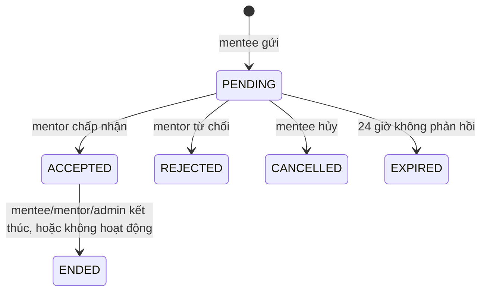
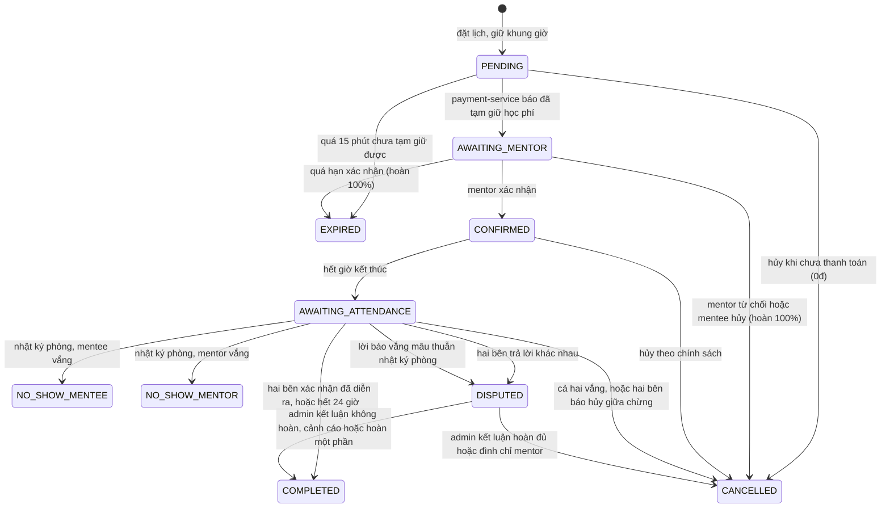

# Đặc tả luồng nghiệp vụ — mentoring-service

> **Trạng thái (29/10/2026):** các gói G1–G5 đã hiện thực (chưa gói nào ở trạng thái "đề xuất" trong code), G6 là bước đồng bộ tài liệu này. Tài liệu có hai phần:
> - **Phần I (mục 1–9):** hành vi của 8 luồng **sau khi hiện thực G1–G5**. Phụ lục A–E giữ nguyên văn bản gốc (mô tả vấn đề và thay đổi tại commit `5e40e2e`), mỗi phụ lục có ghi chú trạng thái xử lý.
> - **[Phần II](#phần-ii--hành-vi-đích-và-kế-hoạch-hiện-thực):** quyết định thiết kế (D1–D17), bất biến hệ thống, thay đổi dữ liệu/hợp đồng, test nghiệm thu, tiến độ từng gói. Nếu có chỗ khác Phần I, **Phần II thắng** (Phần II mô tả ý định gốc; mục *Tiến độ* ghi các chỗ hiện thực khác kế hoạch).
> Nguồn: mã nguồn `mentoring-service/` (và `payment-service/` ở phần tiền) tại commit `5e40e2e`, cấu hình `mentoring-service/src/main/resources/application.yml`. Quyết định nghiệp vụ gốc: [ban-chot-nghiep-vu.md](ban-chot-nghiep-vu.md).

Các thay đổi đã thống nhất ở [Phụ lục E](#phụ-lục-e-thay-đổi-đã-thống-nhất-chưa-hiện-thực) (đổi lịch) đã được hiện thực ở G3 và nay là hành vi hiện tại của F8.

Phạm vi: 8 luồng — (F1) Gửi yêu cầu, (F2) Đặt lịch, (F3) Xác nhận, (F4) Buổi thử đầu tiên, (F5) Thực hiện, (F6) Hoàn thành và đánh giá, (F7) Hủy, (F8) Đổi lịch. Ngoài phạm vi: nhắn tin, ghi chú/mục tiêu, phỏng vấn thử (mock), thông báo ngoài các điểm kích hoạt của 8 luồng.

Quy ước: tên endpoint, mã lỗi, khóa cấu hình và trạng thái để trong `backtick`. "Giá trị hiệu lực" là giá trị trong `application.yml` (đã gồm giá trị mặc định sau dấu `:` của biến môi trường). Đường dẫn code tính từ `mentoring-service/src/main/java/com/mmp/mentoring/`; `SessionService.java:N` là số dòng tại commit trên.

---

## 1. Tổng quan

### 1.1 Actor và quyền

| Actor | Vai trò | Làm gì trong 8 luồng |
|---|---|---|
| Mentee | `MENTEE` | Gửi/hủy yêu cầu, đặt lịch, hủy phiên, đề xuất/chấp nhận đổi lịch, vào phòng, xác nhận tham dự, khiếu nại, đánh giá |
| Mentor | `MENTOR` | Trả lời yêu cầu, xác nhận/từ chối phiên, vào phòng (moderator), xác nhận tham dự, hủy phiên, đề xuất đổi lịch, chấm mentee |
| Admin | `ADMIN` | Làm thay mentor/mentee ở nhiều endpoint (không vào được phòng, không đổi lịch), xử lý tranh chấp |
| Hệ thống | job nền | Hết hạn yêu cầu/thanh toán/xác nhận, nhắc lịch, kết luận tham dự, gửi outbox |
| Dịch vụ khác | `X-Internal-Token` (`ROLE_INTERNAL`) | payment-service báo đã tạm giữ tiền; auth/profile khóa tài khoản, đình chỉ mentor |

### 1.2 Máy trạng thái

**Yêu cầu mentoring** (`entity/MentoringRequest.java`)



Trạng thái `COMPLETED` của yêu cầu đã gỡ (migration V12 và V23 đổi mọi dòng cũ sang `ENDED`).

**Phiên mentoring** (`entity/MentoringSession.java`)



Các trạng thái giữ khung giờ của mentor (`BookingRules.HOLDING_STATUSES`): `PENDING`, `AWAITING_MENTOR`, `CONFIRMED`.
Loại phiên `Kind`: `REGULAR`, `TRIAL`.

### 1.3 Cấu hình hiệu lực

| Nhóm | Khóa | Giá trị | Dùng ở |
|---|---|---|---|
| Đặt lịch | `app.booking.min-lead-time` | `PT3H` | F2, F8 |
| | `app.booking.max-advance` | `P60D` | F2, F8 |
| | `app.booking.payment-hold` | `PT15M` | F2 |
| | `app.booking.max-unpaid-per-mentee` | `2` | F2 |
| | `app.booking.confirm-within` | `PT24H` | F3 |
| | `app.booking.confirm-before-start` | `PT1H` | F3 |
| Yêu cầu | `app.requests.max-pending` | `3` | F1 |
| | `app.requests.expire-after` | `PT24H` (job `PT5M`) | F1 |
| | `app.requests.inactivity-warn-after` / `inactivity-end-after` | `P30D` / `P7D` (job `PT1H`) | F1 |
| Buổi thử | `app.trial.fee` | `30000` | F4 |
| | `app.trial.max-open-per-mentee` | `3` | F4 |
| Phòng học | `app.room.opens-before` / `closes-after` | `PT10M` / `PT30M` | F5 |
| | `app.room.grace` / `trial-grace` | `PT10M` / `PT5M` | F5 |
| | `app.room.require-join-log` | `true` | F5, F6 |
| Tham dự | `app.attendance.window` | `PT24H` (job `PT1M`) | F6 |
| Tranh chấp | `app.disputes.open-window` | `PT72H` | F6 |
| | `app.disputes.first-response-sla` | `PT48H` | F6 |
| Hủy | `app.cancellation.full-refund-before` | `PT24H` | F7 |
| | `app.cancellation.half-refund-before` | `PT4H` | F7 |
| | `app.cancellation.trial-full-refund-before` | `PT2H` | F4, F7 |
| Strike | `app.strikes.threshold` / `window` | `3` / `P30D` | F7 |
| Đổi lịch | `app.reschedule.max-per-session` | `2` | F8 |
| | `app.reschedule.proposal-ttl` | `PT24H`; hạn đề xuất = min(tạo + `proposal-ttl`, giờ bắt đầu hiện tại); job `PT1M` | F8 |
| Outbox | `app.outbox.interval` | `PT1M` | F6, F7 |
| Chung | `app.timezone` | `Asia/Ho_Chi_Minh` | F2, F8 |
| payment-service | `app.payment.platform-fee-rate` | `0.15` | F6 |
| | `app.earnings.release-delay` | `PT72H` (job `PT5M`) | F6 |

Hằng số cố định trong code: thời lượng phiên thường 60 phút, buổi thử 15 phút; agenda 20–500 ký tự (`BookingRules`); đệm giữa hai phiên của mentor mặc định 15 phút và báo trước tối thiểu của mentor mặc định 12 giờ khi hồ sơ không đặt (`client/ProfileClient.java`).

### 1.4 Định dạng lỗi

`ApiException`: `badRequest` → 400, `forbidden` → 403 (mã luôn là `FORBIDDEN`), `notFound` → 404, `conflict` → 409, lỗi dịch vụ ngoài → 502. Validation DTO thất bại → 400.

---

## 2. F1 — Gửi yêu cầu mentoring

**Mục tiêu:** mentee xin được một mentor cụ thể hướng dẫn dài hạn; mentor chấp nhận thì hai bên có "quan hệ" (`ACCEPTED`), mở đường đặt lịch phiên thường (F2).
**Mã nguồn chính:** `service/MentoringRequestService.java`, `RequestRules.java`, `RequestExpiryService.java`, `MentorshipEndService.java`, `InactivityRules.java`.

### 2.1 Endpoint

| Endpoint | Quyền | Việc |
|---|---|---|
| `POST /api/mentoring/requests` | `MENTEE` | Gửi yêu cầu (201) |
| `GET /api/mentoring/requests` | đã đăng nhập | Danh sách của tôi (mentor: yêu cầu gửi tới; mentee: đã gửi; admin: tất cả) |
| `POST /api/mentoring/requests/{id}/respond` | `MENTOR`, `ADMIN` | Chấp nhận (`ACCEPT`) hoặc từ chối (`REJECT`) |
| `POST /api/mentoring/requests/{id}/cancel` | `MENTEE`, `ADMIN` | Hủy yêu cầu đang chờ |
| `POST /api/mentoring/requests/{id}/end` | participant, admin | Kết thúc quan hệ |

### 2.2 Gửi yêu cầu — điều kiện theo thứ tự kiểm tra

1. Email đã xác minh (`requireVerifiedEmail`, 403 `EMAIL_NOT_VERIFIED`).
2. Mục tiêu (`goal`) sau khi cắt khoảng trắng dài 50–1000 ký tự (400 `INVALID_GOAL`); thời gian dự kiến là 1, 3 hoặc 6 tháng (400 `INVALID_EXPECTED_DURATION`). Tin nhắn kèm tối đa 1000 ký tự.
3. Mentor tồn tại (404 `MENTOR_NOT_FOUND`) và `verificationStatus = APPROVED` (400 `MENTOR_NOT_VERIFIED`).
4. Mentor đang `ACCEPTING` và sẵn sàng; `PAUSED`, `ON_LEAVE`, `SUSPENDED` không nhận mentee mới (400 `MENTOR_UNAVAILABLE`).
5. Trong transaction, có khóa theo mentee (`lockMenteeRequests`):
   - Đã có yêu cầu `PENDING` hoặc `ACCEPTED` với mentor này → 409 `REQUEST_ALREADY_EXISTS`.
   - Đã có từ 3 yêu cầu `PENDING` trở lên → 409 `TOO_MANY_PENDING_REQUESTS`.

Kết quả: lưu `PENDING`; thông báo `REQUEST_RECEIVED` cho mentor.

### 2.3 Mentor trả lời

- Chỉ mentor nhận yêu cầu (hoặc admin); yêu cầu phải đang `PENDING` (409 `REQUEST_NOT_PENDING`).
- `ACCEPT`: nếu số mentee đang hướng dẫn đã bằng `capacity` → 409 `CAPACITY_FULL`; ngược lại `ACCEPTED`. Số mentee đang hướng dẫn được đồng bộ sang profile-service.
- `REJECT`: bắt buộc `rejectReason` ∈ `FULL`, `NOT_MY_EXPERTISE`, `SCHEDULE`, `OTHER` (400 `REJECT_REASON_REQUIRED`); ghi chú tùy chọn (tối đa 500 ký tự).
- Thông báo cho mentee: `REQUEST_ACCEPTED` hoặc `REQUEST_REJECTED` (kèm lý do và ghi chú).

### 2.4 Hủy, hết hạn

- Mentee/admin hủy: chỉ khi `PENDING` → `CANCELLED` (409 `REQUEST_NOT_PENDING` nếu khác).
- Job `RequestExpiryService` (mỗi `PT5M`): yêu cầu `PENDING` tạo cách đây quá `app.requests.expire-after` = `PT24H` → `EXPIRED`. Thông báo `REQUEST_EXPIRED` cho cả hai bên; thông báo cho mentee kèm tối đa 3 mentor tương tự lấy từ matching-service (best-effort, gọi ngoài transaction).

### 2.5 Kết thúc quan hệ

- Mentee, mentor hoặc admin gọi `/end` với `reason` ∈ `GOAL_REACHED`, `NO_LONGER_NEEDED`, `NOT_A_FIT`, `OTHER` (`INACTIVE` chỉ do hệ thống, 400 `INVALID_END_REASON`). Quan hệ phải đang `ACCEPTED` (409 `REQUEST_NOT_ACTIVE`).
- Trước khi đổi trạng thái, các phiên sắp tới đang giữ khung giờ của cặp bị hủy qua `SessionService.cancelWithPolicy` với actor là **người kết thúc** (mentee → áp bậc hoàn tiền của mentee; mentor → hoàn 100%, chỉ phiên `CONFIRMED` bắt đầu trong vòng 24 giờ bị strike (`StrikeMode.WITHIN_FULL_REFUND_WINDOW`); admin → hệ thống, hoàn 100%). Phiên không hủy được vì đã bắt đầu hoặc không còn giữ chỗ thì bỏ qua; lỗi bất ngờ khi hủy một phiên làm cả thao tác thất bại và quan hệ **vẫn `ACCEPTED`** để gọi lại (hoàn tiền đi qua outbox nên không còn lỗi hoàn tiền).
- Sau đó `ACCEPTED → ENDED`, ghi `endedBy`, `endReason`, đồng bộ lại số mentee của mentor, thông báo `MENTORING_ENDED` cho bên còn lại.

### 2.6 Không hoạt động

Job `MentorshipEndService.scheduled` (mỗi `PT1H`), theo `InactivityRules`:

- Mốc hoạt động = lớn nhất của: lúc chấp nhận, lúc tạo phiên mới nhất của cặp, giờ bắt đầu phiên chưa bị hủy muộn nhất.
- Chưa nhắc và không hoạt động ≥ `P30D` → nhắc cả hai "Bạn có muốn tiếp tục?" (`MENTORING_INACTIVE`).
- Đã nhắc mà có phiên mới sau lúc nhắc → xóa lời nhắc (đặt phiên trong `SessionService.book` cũng xóa).
- Đã nhắc, thêm `P7D` vẫn không có phiên mới → `ENDED` với `endReason = INACTIVE`, `endedBy = SYSTEM`.
- Tin nhắn không được tính là hoạt động.

---

## 3. F2 — Đặt lịch

**Mục tiêu:** mentee đã được mentor nhận chọn một khung giờ trống; hệ thống giữ khung giờ, tạm giữ học phí từ ví, rồi chuyển sang chờ mentor xác nhận (F3).
**Mã nguồn chính:** `service/SessionService.java` (`book` tại `:114`, `availableSlots` tại `:334`, `checkSlot` tại `:245`, `markPaid` tại `:371`), `BookingRules.java`, `client/PaymentClient.java`, `SessionScheduler.java`.

### 3.1 Endpoint

| Endpoint | Quyền | Việc |
|---|---|---|
| `GET /api/mentoring/mentors/{mentorId}/available-slots?durationMinutes=60&days=14&excludeSessionId=` | đã đăng nhập | Xem khung giờ trống |
| `POST /api/mentoring/sessions` | `MENTEE`, `ADMIN` | Đặt lịch (201) |
| `GET /api/mentoring/sessions`, `GET /sessions/{id}` | participant, admin | Xem phiên |
| `POST /internal/sessions/{id}/payment-succeeded` | `ROLE_INTERNAL` | payment-service báo đã tạm giữ học phí (`markPaid`) |

Dữ liệu đặt: `menteeId`, `mentorId`, `scheduledAt` (tương lai), `sessionType`, `agenda` (bắt buộc); `durationMinutes`, `preReadLink`, `topic`, `referralCode`, `kind` (`REGULAR` | `TRIAL`) tùy chọn.

### 3.2 Điều kiện theo thứ tự kiểm tra (phiên thường)

1. Email đã xác minh (403 `EMAIL_NOT_VERIFIED`).
2. Không phải admin thì `menteeId` phải là chính mình (403).
3. Thời lượng phải đúng 60 phút (mặc định 60 nếu bỏ trống), nếu khác → 400 `INVALID_DURATION`.
4. `agenda` sau khi cắt dài 20–500 ký tự (400 `INVALID_AGENDA`); `preReadLink` nếu có phải là URL http(s) có host (400 `INVALID_PRE_READ_LINK`).
5. Loại phiên `MOCK_INTERVIEW` thì bắt buộc kèm thông tin phỏng vấn (400 `MOCK_INTAKE_REQUIRED`, `INVALID_TARGET_ROLE`, `INVALID_JD_URL`, `INVALID_INTERVIEW_DATE`).
6. Đặt trước ít nhất `min-lead-time` = 3 giờ (400 `TOO_SOON`) và không quá `max-advance` = 60 ngày (400 `TOO_FAR`).
7. Phải có yêu cầu `ACCEPTED` giữa mentee và mentor (400 `NOT_ACCEPTED`).
8. Mentor tồn tại (404 `MENTOR_NOT_FOUND`).
9. Mã giới thiệu (nếu có): chỉ dùng được khi cặp này chưa có phiên thường nào chưa bị hủy/hết hạn (400 `REFERRAL_NOT_FIRST_BOOKING`), rồi payment-service xác thực (400 với mã trả về, mặc định `INVALID_REFERRAL_CODE`; 502 `REFERRAL_UNAVAILABLE` khi không gọi được).
10. `checkSlot`:
    - Trạng thái mentor: `SUSPENDED` → 409 `MENTOR_SUSPENDED`; `ON_LEAVE` → 409 `MENTOR_ON_LEAVE` (đến hết `onLeaveUntil`, hoặc vô thời hạn nếu để trống); `ACCEPTING` và `PAUSED` cho qua.
    - Báo trước thực tế = lớn hơn của 3 giờ và `minNoticeHours` của mentor (mặc định 12 giờ) (400 `TOO_SOON`).
    - Khung giờ phải nằm trọn trong một ca rảnh hằng tuần của cùng một ngày địa phương và không trùng ngày nghỉ/giờ bận đột xuất (409 `MENTOR_NOT_AVAILABLE`).
11. Giá = giá giờ của mentor × 60 phút, làm tròn tới 1.000đ; giá bằng 0 → 409 `PRICE_NOT_SET`.
12. Trong transaction có khóa theo mentor rồi khóa theo mentee (`pg_advisory_xact_lock`): mentee có từ `app.booking.max-unpaid-per-mentee` = 2 phiên `PENDING` trở lên → 409 `TOO_MANY_UNPAID_SESSIONS`; với buổi thử, kiểm `TRIAL_LIMIT` tại đây; khoảng bận của mentor (kèm đệm) không trùng → 409 `MENTOR_NOT_AVAILABLE`; của mentee (không đệm) → 409 `MENTEE_SCHEDULE_CONFLICT`. Đề xuất đổi lịch đang chờ cũng được tính là khoảng bận.

### 3.3 Các bước sau khi qua kiểm tra

1. Tạo phiên `PENDING` với `kind = REGULAR`, `requestId` = yêu cầu `ACCEPTED`, **giá chốt tại lúc đặt** (mentor đổi giá sau không ảnh hưởng), `meetingLink` lấy từ hồ sơ mentor (đã làm sạch).
2. Xóa lời nhắc không hoạt động của quan hệ.
3. Sau commit: nếu có mã giới thiệu thì `applyReferral` (best-effort, chỉ ghi log khi lỗi).
4. Gọi `POST /internal/wallet/pay` (`PaymentClient.payFromWallet`) — không bao giờ ném lỗi: 2xx = đã tạm giữ; 402 = `INSUFFICIENT_FUNDS`; lỗi khác hoặc mất kết nối chỉ ghi log. Phiên vẫn `PENDING`, kết quả trả 201.
5. Khi payment-service tạm giữ xong thì gọi ngược `payment-succeeded` → `markPaid` (xem F3).

`book` **không** gửi thông báo; thông báo đến từ `markPaid`.

### 3.4 Chuyển trạng thái

| Từ → Đến | Kích hoạt | Ai |
|---|---|---|
| (mới) → `PENDING` | `book` | mentee/admin |
| `PENDING` → `AWAITING_MENTOR` | `markPaid` | payment-service |
| `PENDING` → `EXPIRED` | job `expireUnpaidSessions` (mỗi 60 giây): `PENDING` tạo quá `payment-hold` = 15 phút | hệ thống; ghi `cancelledBy = SYSTEM`, `cancelReason = PAYMENT_TIMEOUT`, `refundPercent = 0` |
| `PENDING` → `CANCELLED` | hủy (F7) | mentee/mentor/admin |

Khi hết hạn thanh toán: báo mentee `SESSION_EXPIRED`; nếu là buổi thử thì trả lại lượt (F4).

### 3.5 Xem khung giờ trống (`available-slots`)

- `durationMinutes` chỉ nhận 60 hoặc 15 (400 `INVALID_DURATION`); `days` từ 1 đến 28 (400 `INVALID_RANGE`).
- Khoảng xét: từ `now + báo trước thực tế` đến `min(now + days, now + 60 ngày)`, bước 30 phút trong từng ca rảnh.
- Loại bỏ giờ vi phạm trạng thái mentor, ngày nghỉ/giờ bận, trùng phiên của mentor (kèm đệm) và của người gọi (không đệm).
- `excludeSessionId` chỉ có hiệu lực khi người gọi là participant của phiên đó (dùng cho đổi lịch).
- Giá trả về: `app.trial.fee` khi `durationMinutes = 15`, ngược lại giá theo giờ của mentor.

### 3.6 Thông báo và tác động ngoài

Đọc từ: profile-service (hồ sơ mentor, tên), payment-service (ví, mã giới thiệu). Không gọi matching-service.

---

## 4. F3 — Xác nhận

**Mục tiêu:** mentor quyết định nhận hay từ chối phiên đã được tạm giữ học phí; quá hạn thì hệ thống hủy và hoàn tiền.
**Mã nguồn chính:** `SessionService.markPaid` (`:371`), `confirm` (`:404`), `decline` (`:427`), `expireUnconfirmed` (`:437`), `cancelUnconfirmed` (`:454`); `SessionScheduler.expireUnconfirmedSessions`.

### 4.1 `markPaid` (payment-service → mentoring-service)

- Đọc phiên bằng `findForUpdate`. Phiên `PENDING` → `AWAITING_MENTOR`; đặt `confirmDeadline = min(lúc tạm giữ + confirm-within, giờ bắt đầu − confirm-before-start)` = nhỏ hơn của 24 giờ sau và 1 giờ trước giờ bắt đầu; lưu `payment_transaction_id`.
- Idempotent: phiên đã qua `PENDING` thì giữ nguyên trạng thái và hạn; gọi lại cùng giao dịch không báo trùng và không xếp thêm outbox.
- Nếu tiền về khi phiên đã `CANCELLED` hoặc `EXPIRED` (lần đầu, `payment_transaction_id` còn trống) → xếp `REFUND(100, SESSION_ALREADY_CANCELLED)` vào outbox trong cùng transaction, gửi ngay sau commit và báo mentee `PAYMENT_REFUNDED`.
- Thông báo (chỉ lần callback đầu): mentor `SESSION_BOOKED` (kèm hạn xác nhận); mentee `SESSION_AWAITING_MENTOR`.

### 4.2 Xác nhận

`POST /api/mentoring/sessions/{id}/confirm` — `MENTOR`, `ADMIN`; không phải admin thì phải là mentor của phiên (403).

- Phiên phải đang `AWAITING_MENTOR` (409 `NOT_AWAITING_MENTOR`).
- Còn trước `confirmDeadline` và trước giờ bắt đầu (409 `CONFIRM_WINDOW_CLOSED`).
- Kết quả: `CONFIRMED`, xóa `confirmDeadline`; thông báo `SESSION_CONFIRMED` cho cả hai. Không có chuyển tiền: học phí vẫn được giữ.

### 4.3 Từ chối

`POST /api/mentoring/sessions/{id}/decline` — `MENTOR`, `ADMIN`; lý do tối đa 300 ký tự, tùy chọn.

- Dùng chung `cancelUnconfirmed` (mục 4.4) với trạng thái đích `CANCELLED`, `cancelledBy = MENTOR`, lý do `MENTOR_DECLINED` nếu không nhập.
- **Không ghi strike.**

### 4.4 Hết hạn xác nhận

Job `expireUnconfirmedSessions` (mỗi 60 giây): phiên `AWAITING_MENTOR` có `confirmDeadline` đã qua → `cancelUnconfirmed(EXPIRED, SYSTEM, MENTOR_NO_RESPONSE)`. Lỗi trên một phiên chỉ ghi log và job tiếp tục.

### 4.5 `cancelUnconfirmed` (dùng chung cho từ chối và hết hạn)

Một transaction duy nhất trên dòng phiên đã khóa (`findForUpdate`):
1. Phiên phải còn `AWAITING_MENTOR` (409 `NOT_AWAITING_MENTOR`; job bỏ qua khi phiên vừa được xác nhận hoặc hủy song song).
2. Đặt trạng thái đích, `cancelledBy`, `cancelReason`, `refundPercent = 100`, `cancelledAt`, xóa `confirmDeadline`.
3. Xếp `REFUND(100)` vào outbox (không còn gọi payment-service đồng bộ, không còn 502 `REFUND_FAILED`); đóng đề xuất đổi lịch đang chờ thành `EXPIRED`.
4. Buổi thử → trả lại lượt (F4).
Sau commit: gửi outbox ngay (job gửi lại mỗi phút nếu lỗi). Rồi gọi matching-service lấy tối đa 3 mentor tương tự; báo mentee `SESSION_CANCELLED` kèm liên kết `/matching` và tên mentor gợi ý. Hết hạn thì báo thêm mentor `SESSION_EXPIRED`; từ chối thì không báo mentor.

### 4.6 Bảng chuyển trạng thái

| Từ → Đến | Kích hoạt | Ai | Tiền | Strike |
|---|---|---|---|---|
| `AWAITING_MENTOR` → `CONFIRMED` | `confirm` | mentor/admin | giữ nguyên | không |
| `AWAITING_MENTOR` → `CANCELLED` | `decline` | mentor/admin | hoàn 100% | không |
| `AWAITING_MENTOR` → `EXPIRED` | job quá hạn | hệ thống | hoàn 100% | không |
| `AWAITING_MENTOR` → `CANCELLED` | mentee hủy (F7) | mentee | hoàn 100% | không |
| `AWAITING_MENTOR` → `CANCELLED` | mentor hủy bằng `/cancel` (F7) | mentor | hoàn 100% | **có** |

---

## 5. F4 — Buổi thử đầu tiên

**Mục tiêu:** mentee thử một buổi 15 phút có phí cố định với mentor **chưa** nhận mình, trước khi gửi yêu cầu dài hạn.
**Mã nguồn chính:** `SessionService.book` (nhánh `trial`), `TrialService.java`, `CancellationPolicy.java`, migration `V20__wallet_booking_trial_room.sql` (`sessions.kind`, bảng `trial_uses`).

Dùng chung `POST /api/mentoring/sessions` với `kind = TRIAL`; không có endpoint riêng. Sau khi đặt, quy trình giống phiên thường (F3 xác nhận, F5 thực hiện, F6 hoàn thành, F7 hủy), trừ các khác biệt dưới đây.

### 5.1 Khác biệt so với phiên thường

| Nội dung | Phiên thường | Buổi thử |
|---|---|---|
| Thời lượng | 60 phút cố định | 15 phút cố định (400 `INVALID_DURATION` nếu khác) |
| Giá | giá giờ của mentor × 60 phút | `app.trial.fee` = 30.000đ cố định, không phụ thuộc mentor (không có `PRICE_NOT_SET`) |
| Yêu cầu `ACCEPTED` | **bắt buộc** (400 `NOT_ACCEPTED`) | **không được có** (409 `TRIAL_NOT_ALLOWED`, "hãy đặt buổi học thường") |
| `requestId` của phiên | id yêu cầu | `null` |
| Mentor | không kiểm tra `verificationStatus` | phải `APPROVED` (409 `MENTOR_NOT_AVAILABLE`) và bật nhận buổi thử (409 `TRIAL_DISABLED`; mặc định bật) |
| Giới hạn | không | mỗi cặp mentee–mentor 1 lần (409 `TRIAL_ALREADY_USED`); mỗi mentee tối đa `max-open-per-mentee` = 3 buổi chưa diễn ra (409 `TRIAL_LIMIT`) |
| Mã giới thiệu | dùng được ở phiên thường đầu tiên với mentor | luôn bị từ chối (400 `REFERRAL_NOT_FIRST_BOOKING`) |
| Hủy bởi mentee sau khi mentor xác nhận | ≥24 giờ 100%, 4–24 giờ 50%, dưới 4 giờ 0% | ≥2 giờ 100%, muộn hơn 0% |
| Thời gian chờ bên vắng mặt trong phòng | `PT10M` | `PT5M` |
| Đánh giá sao | có (F6) | không (409 `TRIAL_NOT_REVIEWABLE`) |

Khác biệt bổ sung (G2): mentor `PAUSED` không nhận buổi thử (409 `MENTOR_PAUSED`); cặp đã có yêu cầu `ACCEPTED` **hoặc `ENDED`** không đặt được buổi thử (409 `TRIAL_NOT_ALLOWED`); giới hạn `TRIAL_LIMIT` kiểm trong transaction đặt lịch dưới khóa theo mentee.

### 5.2 Lượt dùng thử (`trial_uses`)

- Khi đặt: `TrialService.claim` chèn `(mentee, mentor, session)` với `ON CONFLICT DO NOTHING`; nếu không chèn được → 409 `TRIAL_ALREADY_USED` và cả transaction đặt lịch bị hủy.
- Trả lại lượt (`TrialService.restore`, xóa dòng, idempotent) khi:
  - phiên `PENDING` hết hạn thanh toán (`SessionScheduler.expireUnpaidSessions`);
  - mentor từ chối hoặc không xác nhận kịp (`cancelUnconfirmed`);
  - hủy mà mentee không mất tiền: hoàn 100%, hoặc hủy khi phiên còn `PENDING` (chưa thanh toán); lượt được trả ngay trong transaction hủy.
- Không trả lại khi mentee hủy muộn (hoàn 0%) hoặc buổi đã diễn ra.

---

## 6. F5 — Thực hiện buổi học

**Mục tiêu:** hai bên gặp nhau trong phòng học Jitsi của hệ thống; việc ai có mặt được ghi lại làm căn cứ xác định vắng mặt (F6).
**Mã nguồn chính:** `service/RoomService.java`, `RoomRules.java`, `MeetingLinks.java`, `SessionScheduler.sendReminders`, `ReminderRules.java`.

### 6.1 Endpoint

| Endpoint | Quyền | Việc |
|---|---|---|
| `GET /api/mentoring/sessions/{id}/room` | `MENTOR`, `MENTEE` (không có `ADMIN`) | Lấy thông tin phòng + JWT Jitsi |
| `POST /api/mentoring/sessions/{id}/report-absent` | `MENTOR`, `MENTEE` | Báo bên kia vắng mặt |
| `PUT /api/mentoring/sessions/{id}/meeting-link` | `MENTOR`, `ADMIN` | Đặt link họp ngoài (Meet/Zoom/Teams) |
| `GET /api/mentoring/sessions/{id}/calendar.ics` | participant | Xuất lịch |

### 6.2 Vào phòng

Điều kiện theo thứ tự (có khóa dòng phiên): phiên tồn tại (404 `SESSION_NOT_FOUND`) → là mentor hoặc mentee của phiên (403) → trạng thái `CONFIRMED` hoặc `AWAITING_ATTENDANCE` (409 `ROOM_NOT_AVAILABLE`) → trong khoảng từ `giờ bắt đầu − 10 phút` đến `giờ kết thúc + 30 phút` (409 `ROOM_CLOSED`).

Khi qua:
1. Lần đầu mỗi bên lấy token trong khung này: ghi `mentor_joined_at` hoặc `mentee_joined_at` (các lần sau giữ nguyên mốc đầu).
2. Ký JWT Jitsi: phòng `mentorhub-<id phiên bỏ gạch ngang>`, mentor là moderator, hiệu lực từ `mở phòng − 1 phút` đến `giờ kết thúc + 30 phút`.
3. Trả `RoomView` (nhà cung cấp `jitsi`, domain, tên phòng, JWT, thời điểm mở/đóng, số phút chờ, cờ moderator).

"Có mặt" nghĩa là đã **nhận token vào phòng**; hệ thống không theo dõi thời gian thực sự ở trong phòng.

### 6.3 Báo vắng mặt

Điều kiện theo thứ tự: phiên tồn tại → là participant → trạng thái `CONFIRMED`/`AWAITING_ATTENDANCE` (409 `SESSION_NOT_ACTIVE`) → đã qua thời gian chờ kể từ giờ bắt đầu (`room.grace` 10 phút, buổi thử 5 phút; 409 `GRACE_NOT_ELAPSED`) → người báo đã vào phòng (409 `YOU_NOT_JOINED`) → bên kia chưa vào (409 `OTHER_SIDE_JOINED`).

Hiệu lực: ghi câu trả lời tham dự (`MENTEE_NO_SHOW` do mentor, hoặc `MENTOR_NO_SHOW` do mentee) nếu bên đó chưa trả lời, báo bên bị tố `ABSENCE_REPORTED`. **Không đổi trạng thái phiên**; kết luận cuối do F6.

### 6.4 Link họp ngoài

- Sao chép từ hồ sơ mentor lúc đặt, chỉ chấp nhận `https` thuộc `meet.google.com`, `zoom.us`, `*.zoom.us`, `teams.microsoft.com` (400 `INVALID_MEETING_LINK`, tối đa 500 ký tự).
- Mentor (hoặc admin) sửa được khi phiên còn giữ khung giờ và chưa kết thúc (409 `SESSION_NOT_EDITABLE`); chỉ báo mentee `MEETING_LINK_UPDATED` khi phiên đã `CONFIRMED`.
- API chỉ trả link khi phiên ở các trạng thái `CONFIRMED`, `AWAITING_ATTENDANCE`, `COMPLETED`, `NO_SHOW_*`, `DISPUTED`.

### 6.5 Nhắc lịch

Job `sendReminders` (mỗi 60 giây) gửi cho cả hai bên phiên `CONFIRMED`:
- `SESSION_REMINDER_24H` khi còn ≤ 24 giờ;
- `SESSION_REMINDER_15M` khi còn ≤ 15 phút (hằng `H1` giữ tên cũ vì cột cờ là `reminder_1h_sent`).
Mỗi mốc gửi đúng một lần (đánh dấu bằng UPDATE có điều kiện trước khi gửi); nếu mốc 24 giờ chưa gửi mà đã tới mốc 15 phút thì bỏ mốc 24 giờ. Nội dung theo múi giờ của từng người nhận, kèm link họp và agenda. Đổi lịch (F8) đặt lại cả hai cờ.

---

## 7. F6 — Hoàn thành và đánh giá

**Mục tiêu:** sau giờ học, xác định phiên đã diễn ra hay không, xử lý tiền, mở khiếu nại nếu hai bên bất đồng, rồi cho phép đánh giá.
**Mã nguồn chính:** `service/AttendanceService.java`, `AttendanceRules.java`, `RoomRules.java` (kết luận theo nhật ký phòng), `DisputeService.java`, `DisputeRules.java`, `ReviewService.java`, `ReviewRules.java`, `StrikeService.java`, `PaymentOutboxService.java`; payment-service `EarningService`.

### 7.1 Dòng thời gian của một phiên bình thường

Gọi E là giờ kết thúc (`scheduledAt` + thời lượng).

| Mốc | Sự kiện |
|---|---|
| E − 24 giờ, E − 15 phút | Nhắc lịch (F5) |
| Bắt đầu − 10 phút | Phòng mở |
| Bắt đầu + 10 phút (buổi thử + 5) | Hết thời gian chờ, được báo vắng mặt |
| E (trong vòng 1 phút) | Job `attendanceJob`: `CONFIRMED` → `AWAITING_ATTENDANCE`, báo cả hai `ATTENDANCE_REQUIRED` |
| E + 30 phút | Phòng đóng |
| E đến E + 24 giờ | Hai bên trả lời tham dự (`app.attendance.window`) |
| E + 24 giờ | Hết cửa sổ: phiên tự kết luận (thường `COMPLETED`) |
| E + 72 giờ | payment-service giải phóng thu nhập của mentor (`earnings.release-delay`), trừ khi giao dịch đang `ON_HOLD` |
| E + 72 giờ | Hết cửa sổ khiếu nại (`app.disputes.open-window` = `PT72H`), cùng lúc thu nhập được giải phóng |
| Hoàn thành + 14 ngày | Hết cửa sổ đánh giá |

### 7.2 Xác nhận tham dự

Endpoint: `POST /api/mentoring/sessions/{id}/attendance` (`MENTEE`, `MENTOR`) với `answer` ∈ `HELD`, `MENTOR_NO_SHOW`, `MENTEE_NO_SHOW`, `CANCELLED_ON_CALL`; `POST /sessions/{id}/complete` (`MENTOR`, `ADMIN`) tương đương mentor trả lời `HELD`.

- Mentee được trả lời `HELD`, `MENTOR_NO_SHOW`, `CANCELLED_ON_CALL`; mentor được trả lời `HELD`, `MENTEE_NO_SHOW`, `CANCELLED_ON_CALL` (400 `INVALID_ATTENDANCE_ANSWER`).
- Không được tố vắng mặt trái với nhật ký phòng: mentee tố mentor vắng nhưng `mentor_joined_at` đã có (hoặc ngược lại) → 409 `ABSENCE_CONTRADICTS_LOG`.
- Phiên `CONFIRMED` đã qua E được chuyển ngay thành `AWAITING_ATTENDANCE`; trước E → 409 `ATTENDANCE_NOT_OPEN`; ở trạng thái khác → 409 `ATTENDANCE_CLOSED`; ngoài `[E, E + 24 giờ)` → 409 `ATTENDANCE_WINDOW_CLOSED`; trả lời lần hai → 409 `ATTENDANCE_ALREADY_ANSWERED`.

### 7.3 Kết luận phiên

Ba bước của job `attendanceJob` (mỗi `PT1M`), chạy theo thứ tự: (1) chuyển phiên đã hết giờ sang `AWAITING_ATTENDANCE`; (2) kết luận theo nhật ký phòng; (3) kết luận phiên quá cửa sổ trả lời. Bước 2 và 3 bỏ qua phiên đã có tranh chấp.

| Điều kiện | Kết quả | Mã (`attendance_resolution`) | Bởi |
|---|---|---|---|
| Chỉ mentor vào phòng | `NO_SHOW_MENTEE` | `JOIN_LOG_MENTEE_ABSENT` | job (bước 2) |
| Chỉ mentee vào phòng | `NO_SHOW_MENTOR` | `JOIN_LOG_MENTOR_ABSENT` | job (bước 2) |
| Không ai vào phòng (`require-join-log = true`) | `CANCELLED` | `BOTH_ABSENT` | job (bước 2) |
| Hai bên cùng `HELD` | `COMPLETED` | `BOTH_HELD` | ngay khi trả lời |
| Hai bên cùng `CANCELLED_ON_CALL` | `CANCELLED` | `CANCELLED_ON_CALL` | ngay khi trả lời |
| Hai bên trả lời khác nhau | `DISPUTED` | `CONFLICT` | ngay khi trả lời |
| Hết 24 giờ, không ai trả lời | `COMPLETED` | `NO_ANSWER` | job (bước 3) |
| Hết 24 giờ, một bên `HELD` | `COMPLETED` | `HELD_ONE_SIDE` | job (bước 3) |
| Hết 24 giờ, chỉ mentor tố mentee vắng | `NO_SHOW_MENTEE` | `MENTEE_NO_SHOW_REPORTED` | job (bước 3) |
| Hết 24 giờ, chỉ mentee tố mentor vắng | `NO_SHOW_MENTOR` | `MENTOR_NO_SHOW_REPORTED` | job (bước 3) |
| Hết 24 giờ, một bên báo `CANCELLED_ON_CALL` | `CANCELLED` | `CANCELLED_ON_CALL` | job (bước 3) |

### 7.4 Kết quả cuối và tiền

Phiên có phí là phiên có `price > 0` (buổi thử cũng có phí). Ví dụ giá 300.000đ: phí nền tảng 15% = 45.000đ, mentor được 255.000đ (số tiền chốt lúc tạm giữ). Nếu phiên đã có tranh chấp thì không hoàn tự động (tiền do admin quyết định).

| Kết quả | Hoàn cho mentee | Mentor nhận | Strike | Xếp outbox (phiên có phí, chưa tranh chấp) |
|---|---|---|---|---|
| `COMPLETED` | 0 | có (giải phóng sau 72 giờ) | không | `FINAL_STATE(COMPLETED, endedAt = E)` |
| `NO_SHOW_MENTEE` | 0 | có | không | `FINAL_STATE(NO_SHOW_MENTEE)` |
| `NO_SHOW_MENTOR` | 100% | không | **có** (`MENTOR_NO_SHOW`) | `REFUND(100)` |
| `CANCELLED` (cả hai vắng / hủy giữa chừng) | 100% | không | không | `REFUND(100)` |
| `DISPUTED` | giữ lại | giữ lại | không | `HOLD` rồi tạo tranh chấp `SYSTEM/NO_SHOW` |

Strike `MENTOR_NO_SHOW` và bản ghi tranh chấp tự động ghi **trong transaction kết luận**; thông báo, ngưỡng `PAUSED` của strike và gửi outbox chạy **sau commit**. Thông báo: `SESSION_COMPLETED` (kèm lời mời đánh giá), `SESSION_NO_SHOW`, `SESSION_CANCELLED`, `SESSION_DISPUTED`.

**Strike** (`StrikeService`): ghi một lần cho mỗi `(phiên, lý do)`; mỗi strike báo mentor `MENTOR_STRIKE`; đạt `threshold` = 3 strike trong `window` = 30 ngày → gọi profile-service đặt mentor `PAUSED` (lý do `STRIKES`) và báo admin `MENTOR_PAUSED_STRIKES`, mentor `MENTOR_PAUSED`.

**Outbox** (`PaymentOutboxService`): bản ghi gửi theo thứ tự trong cùng phiên; lỗi mạng/5xx giữ lại và chặn các bản ghi sau của phiên đó; lỗi 4xx bị bỏ (riêng `FINAL_STATE` gặp 404 thử tối đa 10 lần); job `flush` mỗi `PT1M`, ngoài ra `flushSession` gửi ngay sau commit.

**payment-service:** `FINAL_STATE` đặt thời điểm giải phóng = `endedAt + earnings.release-delay` (72 giờ), hoặc ngay lập tức khi `releaseNow`; job giải phóng mỗi 5 phút, bỏ qua giao dịch `ON_HOLD`; hoàn tiền bị từ chối khi giao dịch `ON_HOLD` (409 `TRANSACTION_ON_HOLD`).

### 7.5 Tranh chấp

| Endpoint | Quyền | Việc |
|---|---|---|
| `POST /api/mentoring/sessions/{id}/disputes` | `MENTEE`, `MENTOR` | Mở tranh chấp (201) |
| `GET /api/mentoring/sessions/{id}/disputes` | participant, admin | Xem |
| `GET /api/mentoring/admin/disputes?status=`, `/{id}` | `ADMIN` | Danh sách (`ACTIVE` = `OPEN` + `IN_REVIEW`) và chi tiết |
| `POST /api/mentoring/admin/disputes/{id}/start-review` | `ADMIN` | `OPEN` → `IN_REVIEW` (409 `DISPUTE_NOT_OPEN`) |
| `POST /api/mentoring/admin/disputes/{id}/resolve` | `ADMIN` | → `RESOLVED` |

**Mở** — điều kiện theo thứ tự: mô tả 20–2000 ký tự (400 `INVALID_DESCRIPTION`); tối đa 5 link bằng chứng (400 `TOO_MANY_EVIDENCE_LINKS`), mỗi link `https`, ≤ 500 ký tự (400 `INVALID_EVIDENCE_LINK`); phiên tồn tại và người mở là participant; chưa có tranh chấp đang mở của phiên (409 `DISPUTE_ALREADY_OPEN`); trạng thái phiên ∈ `COMPLETED`, `NO_SHOW_MENTEE`, `NO_SHOW_MENTOR`, `AWAITING_ATTENDANCE` (409 `DISPUTE_NOT_ALLOWED`); chưa quá `E + 72 giờ` (409 `DISPUTE_WINDOW_CLOSED`). Phiên có phí thì xếp `HOLD("DISPUTE_OPENED")` để tạm giữ giao dịch. Loại: `NO_SHOW`, `QUALITY`, `BEHAVIOR`, `PAYMENT`, `OTHER`. Người mở: `MENTEE`, `MENTOR`, `SYSTEM`. Có hai đường mở tự động: phiên chuyển `DISPUTED` (`SYSTEM/NO_SHOW`) và khóa tài khoản mentor (`OTHER`, giữ thu nhập chờ).

**Giải quyết** (bắt buộc có ghi chú, 400 `NOTE_REQUIRED`; `PARTIAL_REFUND` cần `refundPercent` từ 1 đến 99, các kết quả khác không được có, 400 `INVALID_REFUND_PERCENT`; 409 `DISPUTE_ALREADY_RESOLVED`):

| Kết quả | Hoàn cho mentee | Mentor | Trạng thái phiên sau đó | Khác |
|---|---|---|---|---|
| `FULL_REFUND` | 100% | không | `DISPUTED`/`AWAITING_ATTENDANCE` → `CANCELLED` (`cancelledBy = SYSTEM`, `refundPercent = 100`); phiên đã ở trạng thái cuối giữ nguyên, chỉ ghi `refundPercent` | `RELEASE` rồi `REFUND(100)` |
| `PARTIAL_REFUND` | p% (1–99) | phần còn lại, giải phóng ngay | `DISPUTED`/`AWAITING_ATTENDANCE` → `COMPLETED` (`refundPercent = p`); phiên đã ở trạng thái cuối giữ nguyên | `RELEASE`, `REFUND`, `FINAL_STATE(releaseNow)` |
| `NO_REFUND` | 0 | toàn bộ, giải phóng ngay | `DISPUTED`/`AWAITING_ATTENDANCE` → `COMPLETED` | `RELEASE`, `FINAL_STATE(releaseNow)` |
| `WARNING` | 0 | toàn bộ | như `NO_REFUND` | báo mentor `MENTOR_WARNING` (không ghi strike) |
| `SUSPEND` | 100% | không | như `FULL_REFUND` | đình chỉ mentor (`SUSPENDED`), hủy mọi phiên sắp tới của mentor (F7) |

Admin phản hồi đầu tiên trong `first-response-sla` = 48 giờ (danh sách đánh cờ quá hạn).

### 7.6 Đánh giá

| Endpoint | Việc |
|---|---|
| `POST /api/mentoring/sessions/{id}/review` | Mentee đánh giá mentor (201) |
| `PUT /api/mentoring/sessions/{id}/review` | Sửa đánh giá |
| `POST /api/mentoring/reviews/{reviewId}/reply` | Mentor trả lời |
| `POST /api/mentoring/sessions/{id}/mentee-feedback` | Mentor nhận xét riêng về mentee |
| `GET /api/mentoring/mentors/{mentorId}/reviews`, `/review-summary` | Xem công khai |
| `GET /api/mentoring/mentees/{menteeId}/reliability` | Mentor/admin/nội bộ xem huy hiệu tin cậy |

**Tạo đánh giá** — điều kiện theo thứ tự: bốn điểm `rating`, `knowledge`, `clarity`, `preparation` đều từ 1 đến 5, bình luận ≤ 2000 ký tự, tối đa 10 tag (400); người gọi là mentee của phiên (403); phiên `COMPLETED` (409 `SESSION_NOT_COMPLETED`); phiên chưa hoàn 100% (409 `SESSION_REFUNDED`); không phải buổi thử (409 `TRIAL_NOT_REVIEWABLE`); trong 14 ngày kể từ lúc hoàn thành (409 `REVIEW_WINDOW_CLOSED`); chưa đánh giá (409 `ALREADY_REVIEWED`, kể cả khi hai yêu cầu tạo đồng thời: ràng buộc UNIQUE ở DB được dịch thành 409 thay vì 500); `rating` từ 2 trở xuống thì bình luận ≥ 20 ký tự (400 `COMMENT_REQUIRED`); tag hợp lệ (400 `INVALID_REVIEW_TAG`). Tag cho phép: `PRACTICAL_EXAMPLES`, `GOOD_LISTENER`, `WELL_PREPARED`, `CLEAR_EXPLANATION`, `ACTIONABLE_ADVICE`, `RAN_OVER_TIME`, `STARTED_LATE`, `TOO_THEORETICAL`.

- **Sửa:** trong 48 giờ sau khi đăng (409 `REVIEW_EDIT_WINDOW_CLOSED`); thứ tự kiểm: tồn tại (404) → quyền (403) → cửa sổ sửa → nội dung (400).
- **Trả lời của mentor:** một lần, tối đa 500 ký tự, không sửa được (409 `ALREADY_REPLIED`, 400 `INVALID_REPLY`).
- **Nhận xét về mentee:** `preparation` và `engagement` từ 1 đến 5, bình luận ≤ 1000 ký tự; chỉ mentor của phiên, phiên `COMPLETED`, trong cùng cửa sổ 14 ngày, mỗi phiên một lần (409 `FEEDBACK_EXISTS`). Chỉ dùng cho huy hiệu `RELIABLE` (cần ít nhất 3 nhận xét, trung bình hai tiêu chí ≥ 4,0).
- **Điểm công khai:** chỉ hiện sao khi mentor có ít nhất 3 đánh giá (dưới đó `newMentor = true`). Điểm gửi sang profile-service là điểm Bayes `(3 × trung bình nền tảng 4,0 + tổng điểm) / (3 + n)`, làm tròn 2 chữ số, gửi sau mỗi lần tạo/sửa (best-effort) và đồng bộ lại hằng đêm lúc 04:15.
- **Thông báo:** `REVIEW_RECEIVED` cho mentor; `REVIEW_REPLIED` cho mentee.

---

## 8. F7 — Hủy

**Mục tiêu:** cho phép mentee/mentor/hệ thống hủy phiên chưa kết thúc, hoàn tiền theo chính sách và xử lý hệ quả với mentor.
**Mã nguồn chính:** `service/CancellationPolicy.java`, `SessionService.java` (`cancel` tại `:500`, `decide` tại `:569`, `requireCancellable` tại `:576`, `actorOf` tại `:586`), `StrikeService.java`, `MentorSuspensionService.java`, `AccountLockService.java`, `MentorshipEndService.java`.

### 8.1 Endpoint

| Endpoint | Quyền | Việc |
|---|---|---|
| `GET /api/mentoring/sessions/{id}/cancel-preview` | participant, admin | Xem trước mức hoàn tiền và hậu quả |
| `POST /api/mentoring/sessions/{id}/cancel` | participant, admin | Hủy (lý do tùy chọn) |
| `POST /api/mentoring/sessions/{id}/decline` | `MENTOR`, `ADMIN` | Từ chối phiên chờ xác nhận (F3) |
| `POST /internal/mentors/{id}/suspend` | nội bộ | Đình chỉ mentor, hủy phiên sắp tới |
| `POST /internal/accounts/{userId}/lock` | nội bộ | Khóa/mở khóa tài khoản |

Vai trò khi hủy suy từ người gọi: mentor của phiên → `MENTOR`; mentee của phiên → `MENTEE`; còn lại (admin, nội bộ) → `SYSTEM`.

### 8.2 Điều kiện hủy

- Phiên phải ở `PENDING`, `AWAITING_MENTOR` hoặc `CONFIRMED` (409 `SESSION_NOT_CANCELLABLE`) và chưa tới giờ bắt đầu (409 `SESSION_ALREADY_STARTED`).
- Không phải participant → 403; không có phiên → 404 `SESSION_NOT_FOUND`.
- Hoàn tiền đi qua outbox nên không còn lỗi 502 `REFUND_FAILED`; tiền về ví sau vài giây (tối đa một chu kỳ outbox nếu gửi ngay lỗi).

### 8.3 Ma trận hoàn tiền (`CancellationPolicy.evaluate`)

Số tiền hoàn = giá × phần trăm, làm tròn HALF_UP về đồng. Các mốc tính gồm cả biên (`>=`). "Đã thanh toán" nghĩa là trạng thái `AWAITING_MENTOR` hoặc `CONFIRMED` và giá > 0.

| Người hủy | Trạng thái và thời điểm | Loại | Hoàn cho mentee | Mentor nhận | Strike |
|---|---|---|---|---|---|
| Mentee | `PENDING` (chưa tạm giữ) | cả hai | 0 (không gọi hoàn tiền) | không | không |
| Mentee | `AWAITING_MENTOR`, bất kỳ lúc nào | cả hai | 100% | không | không |
| Mentee | `CONFIRMED`, còn ≥ 24 giờ | thường | 100% | không | không |
| Mentee | `CONFIRMED`, còn từ 4 giờ đến dưới 24 giờ | thường | 50% | phần còn lại, trừ hoa hồng | không |
| Mentee | `CONFIRMED`, còn dưới 4 giờ | thường | 0% | toàn bộ giá trừ hoa hồng | không |
| Mentee | `CONFIRMED`, còn ≥ 2 giờ | buổi thử | 100% | không | không |
| Mentee | `CONFIRMED`, còn dưới 2 giờ | buổi thử | 0% | toàn bộ giá trừ hoa hồng | không |
| Mentor (qua `/cancel`) | `CONFIRMED`, mọi thời điểm | cả hai | 100% | không | **có** (`MENTOR_CANCEL`) |
| Mentor (qua `/cancel`) | `PENDING` hoặc `AWAITING_MENTOR` | cả hai | 100% nếu đã thanh toán, ngược lại 0 | không | không |
| Mentor (qua `decline`) | `AWAITING_MENTOR` | cả hai | 100% | không | không |
| Hệ thống/admin | mọi trạng thái | cả hai | 100% nếu đã thanh toán, ngược lại 0 | không | không |

Điểm xin lỗi khi mentor hủy và cơ chế "hủy muộn phiên miễn phí" đã bỏ (v2.0): `rewardPoints` luôn 0, `lateFreeCancel` luôn `false`.

### 8.4 Các bước (`cancel`)

1. Ngoài transaction: xác định vai trò và `requireCancellable` (kiểm nhanh).
2. **Một transaction** trên dòng phiên đã khóa (`findForUpdate`): kiểm lại `requireCancellable`; **tính `Decision` (hoàn %, số tiền, có strike không) trên dòng đã khóa**; đặt `CANCELLED`, `cancelledBy`, `cancelReason`, `refundPercent`, `cancelledAt`; đóng đề xuất đổi lịch đang chờ thành `EXPIRED`.
3. Cũng trong transaction, xếp outbox: nếu hoàn % > 0 và số tiền > 0 thì `REFUND(percent, SESSION_CANCELLED_BY_<vai trò>)`; nếu là "hủy muộn đã thanh toán" (phiên `CONFIRMED`, giá > 0, hoàn dưới 100%) thì **sau** `REFUND` là `FINAL_STATE(CANCELLED, endedAt = E)` để mentor nhận phần còn lại; trả lại lượt buổi thử nếu mentee không mất tiền (hoàn 100% hoặc hủy khi còn `PENDING`); ghi strike nếu `Decision.strike` và `StrikeMode` cho phép.
4. Sau commit: gửi outbox ngay (job gửi lại mỗi phút nếu lỗi); đánh giá ngưỡng strike (`PAUSED`) nếu vừa ghi strike; gửi thông báo.

### 8.5 Thông báo

Mentee hủy → báo mentor. Mentor hủy → báo mentee (kèm lý do và khoản hoàn). Hệ thống hủy → báo cả hai.

### 8.6 Strike

Mentor hủy qua `/cancel` phiên đang `CONFIRMED` ghi một strike `MENTOR_CANCEL` (duy nhất theo `(phiên, lý do)`, ràng buộc `UNIQUE` ở migration V5); hủy phiên `PENDING` / `AWAITING_MENTOR` không bị strike. Mentor kết thúc quan hệ: chỉ phiên `CONFIRMED` bắt đầu trong vòng 24 giờ bị strike. Strike ghi trong cùng transaction với việc hủy; đủ `threshold` = 3 trong `window` = 30 ngày → mentor `PAUSED` (đánh giá sau commit; chi tiết ở mục 7.4).

### 8.7 Hủy hàng loạt

Cùng đi qua `cancelWithPolicy`:

| Nguồn | Phạm vi | Vai trò hủy | Khi có phiên lỗi |
|---|---|---|---|
| Đình chỉ mentor (`MentorSuspensionService`) | phiên sắp tới của mentor (kể cả `AWAITING_MENTOR`) | hệ thống | các phiên khác vẫn hủy, cuối cùng ném 502 `SUSPEND_INCOMPLETE` nếu còn phiên lỗi (lỗi bất ngờ, không còn do hoàn tiền) |
| Khóa tài khoản (`AccountLockService`) | phiên sắp tới của user, cả hai vai | hệ thống | đếm phiên lỗi, vẫn trả 200 kèm kết quả; sau đó mở tranh chấp giữ thu nhập đang chờ nếu là mentor, và đóng băng/mở ví |
| Kết thúc quan hệ (F1, mục 2.5) | phiên sắp tới của cặp | theo người kết thúc | lỗi làm quan hệ giữ `ACCEPTED`, gọi lại an toàn |

### 8.8 Quan hệ với đổi lịch (đã chốt)

Chính sách hủy và chính sách dời buổi là hai bộ quy tắc riêng (xem 9.5). Chính sách hủy luôn tính khoảng cách tới **giờ bắt đầu hiện tại** của phiên (`scheduledAt`), kể cả phiên đã được dời; hệ thống không lưu giờ gốc và không có bậc hoàn tiền nào áp cho việc dời. Đề xuất dời đang chờ của một phiên bị đóng `EXPIRED` khi phiên bị hủy.

---

## 9. F8 — Đổi lịch

**Mục tiêu:** hai bên thống nhất dời một phiên đã xác nhận sang giờ khác mà không phải hủy.
**Mã nguồn chính:** `service/RescheduleService.java`, `RescheduleRules.java`, `entity/RescheduleProposal.java`, `IcsCalendar.java`; migration `V6__reschedule_proposals.sql`.

### 9.1 Endpoint

| Endpoint | Quyền | Việc |
|---|---|---|
| `POST /api/mentoring/sessions/{id}/reschedule` | `MENTEE`, `MENTOR` | Đề xuất giờ mới (201), body `{newStart}` |
| `POST /api/mentoring/reschedules/{id}/accept` | `MENTEE`, `MENTOR` | Chấp nhận (trả phiên đã cập nhật) |
| `POST /api/mentoring/reschedules/{id}/decline` | `MENTEE`, `MENTOR` | Từ chối (bên nhận) hoặc rút lại (người đề xuất) |

Admin bị chặn ở tầng controller; service chỉ cho mentee hoặc mentor của phiên (403).

### 9.2 Đề xuất — điều kiện

1. Phiên đang `CONFIRMED` (409 `SESSION_NOT_CONFIRMED`); `AWAITING_MENTOR` và các trạng thái khác không đổi lịch được. Không phân biệt buổi thử với buổi thường.
2. Chưa tới giờ bắt đầu hiện tại (409 `RESCHEDULE_TOO_LATE`: đã tới hoặc quá giờ); chưa có ai vào phòng (409 `SESSION_ALREADY_JOINED`).
3. Chưa dời quá `max-per-session` = 2 lần (409 `RESCHEDULE_LIMIT`).
4. Chưa có đề xuất đang chờ (409 `RESCHEDULE_PENDING`; ràng buộc cả ở DB bằng unique index `uq_reschedule_open_per_session`).
5. Giờ mới khác giờ cũ (400 `SAME_START`), còn trong `max-advance` (400 `TOO_FAR`) và đủ báo trước `max(3 giờ, minNoticeHours của mentor)` (400 `TOO_SOON`).
6. `checkSlot` giống F2: trạng thái mentor (409 `MENTOR_SUSPENDED`, `MENTOR_ON_LEAVE`), nằm trong lịch rảnh và không trùng ngoại lệ (409 `MENTOR_NOT_AVAILABLE`).
7. Trong transaction có khóa theo mentor: không trùng phiên khác của mentor (kèm đệm) hoặc của mentee, loại trừ chính phiên đang dời (409 `MENTOR_NOT_AVAILABLE`, `MENTEE_SCHEDULE_CONFLICT`).

Kết quả: lưu đề xuất `PENDING` với `expiresAt = min(lúc tạo + 24 giờ, giờ bắt đầu hiện tại)`; báo bên kia `RESCHEDULE_PROPOSED`.

### 9.3 Chấp nhận, từ chối, hết hạn

- **Chấp nhận:** chỉ bên **không phải** người đề xuất (403). Đề xuất phải còn `PENDING` (409 `RESCHEDULE_NOT_PENDING`) và chưa quá `expiresAt` (409 `RESCHEDULE_EXPIRED`); trong transaction khóa mentor → phiên → đề xuất, kiểm lại theo thứ tự: phiên vẫn `CONFIRMED` (409 `SESSION_NOT_CONFIRMED`); chưa tới giờ bắt đầu hiện tại (409 `RESCHEDULE_TOO_LATE`); chưa ai vào phòng (409 `SESSION_ALREADY_JOINED`); giờ đề xuất còn ở tương lai (409 `RESCHEDULE_START_PASSED`) — các lỗi này **đóng đề xuất `EXPIRED`** (lệnh đóng được giữ lại, không bị rollback theo lỗi); trạng thái mentor không `SUSPENDED`/`ON_LEAVE` vào ngày mới (409, không đóng đề xuất); không trùng lịch. **Không** kiểm lại lịch rảnh và thời gian báo trước vì hai bên đã đồng ý giờ mới. Cập nhật `scheduledAt`, đặt lại cờ nhắc lịch, tăng `rescheduleCount`, đóng đề xuất `ACCEPTED`; báo người đề xuất `RESCHEDULE_ACCEPTED` kèm lời nhắc tải lại tệp `.ics`.
- **Từ chối/rút lại:** đóng `DECLINED`; báo bên kia `RESCHEDULE_DECLINED` (bên nhận từ chối) hoặc `RESCHEDULE_WITHDRAWN` (người đề xuất rút).
- **Hết hạn:** job `expireProposals` (mỗi `PT1M`) đóng `EXPIRED` các đề xuất quá hạn và báo người đề xuất `RESCHEDULE_EXPIRED`.
- **Hủy phiên** (F7, F3) và **người đầu tiên vào phòng** (F5) cũng đóng đề xuất đang chờ thành `EXPIRED` (vào phòng: báo người đề xuất `RESCHEDULE_EXPIRED`).

### 9.4 Giữ chỗ và tác động

| Nội dung | Hành vi |
|---|---|
| Khung giờ cũ | Giữ nguyên cho tới khi chấp nhận |
| Khung giờ mới | Trong lúc chờ, được tính là khoảng bận của **cả mentor lẫn mentee**, chặn đặt lịch mới và `available-slots` |
| Giá, thanh toán, link họp, thời lượng | Không đổi |
| Nhắc lịch | Đặt lại, tính theo giờ mới |
| Tệp `.ics` | `UID` cố định theo phiên, `SEQUENCE = rescheduleCount`, tải lại sẽ cập nhật sự kiện cũ |
| Chính sách hủy sau khi dời | Tính theo giờ bắt đầu **mới**; không lưu giờ gốc |

### 9.5 Chính sách dời buổi tách riêng khỏi chính sách hủy (đã hiện thực ở G3)

Chính sách dời buổi là một bộ quy tắc **độc lập** với chính sách hủy (mục 8). Dời buổi không chuyển tiền, không có bậc hoàn tiền, không ghi strike.

Bảng dưới giữ cột "Hiện tại" là hành vi **trước G3** để thấy thay đổi; cột "Đã chốt" là hành vi hiện tại.

| Nội dung | Trước G3 | Đã chốt (hiện tại) |
|---|---|---|
| Thời điểm được đề xuất | Cách giờ bắt đầu ít nhất 2 giờ (409 `RESCHEDULE_TOO_LATE`) | Bất kỳ lúc nào **trước giờ bắt đầu hiện tại** của phiên; `RESCHEDULE_TOO_LATE` chỉ còn nghĩa "đã tới hoặc quá giờ bắt đầu" |
| Hạn của đề xuất | Nhỏ hơn của (tạo + 24 giờ) và (giờ gốc − 1 giờ) | Nhỏ hơn của (tạo + `proposal-ttl` = 24 giờ) và **giờ bắt đầu gốc**; bỏ `expire-before-start` |
| Giờ mới | Phải qua `checkSlot`: lịch rảnh, không trùng ngoại lệ, báo trước ≥ lớn hơn của 3 giờ và `minNoticeHours` của mentor | **Giữ nguyên** (tính từ lúc đề xuất) |
| Số lần và đồng ý | Tối đa 2 lần/phiên, 1 đề xuất đang chờ, bên kia phải chấp nhận | **Giữ nguyên** |
| Phạt/theo dõi | Không có | **Không có** (không strike, không thống kê riêng cho đề xuất sát giờ) |
| Đã có người vào phòng | Không chặn | **Chặn**: nếu `mentor_joined_at` hoặc `mentee_joined_at` đã được ghi thì không được đề xuất dời |
| Hủy sau khi dời | Tính theo giờ bắt đầu mới | **Giữ nguyên**: chính sách hủy luôn tính theo giờ bắt đầu hiện tại; không lưu giờ gốc |

Hệ quả cần xác nhận khi hiện thực: đề xuất đang chờ phải bị đóng (`EXPIRED`) và không chấp nhận được nếu đã tới giờ bắt đầu gốc hoặc trong lúc chờ đã có người vào phòng, để nhật ký vào phòng (căn cứ xác định vắng mặt) không mâu thuẫn với giờ mới. Cũng cần quyết định có kiểm lại `checkSlot` khi chấp nhận hay không (hiện chỉ kiểm lại trùng lịch, xem phụ lục A, mục 5).

---

## Phụ lục A. Vấn đề đã biết

Ghi nhận từ việc đọc code tại commit `5e40e2e`, giữ nguyên văn bản gốc. **Trạng thái xử lý (29/10/2026):** mục 1 → G2 (D6); 2 → G1 (D1, D3, I4); 3 → G2 (D4); 4 → G1 (D1–D3); 5 → G3 (D7); 6 → G2 (D5); 7 → G2 (strike trong transaction), G4 (D10, D11); "đã vào phòng = đã nhận token" giữ nguyên (D16); 8 → G4 (D9); 9 → G4 (D12; tạo trùng → 409; gửi điểm Bayes khi dưới 3 đánh giá giữ nguyên, D17); 10 → G1 (D14), G2 (D13); riêng giới hạn DTO **giữ nguyên** có chủ đích (xem tiến độ G4); 11 → G5.

1. **Hủy buổi thử ở `PENDING` không trả lại lượt.** Lượt chỉ được trả khi `refundPercent == 100` (`SessionService.java:537`), mà phiên chưa thanh toán có `refundPercent = 0` (mục 8.3). Trong khi hết hạn thanh toán (job) thì có trả.
2. **Tranh chấp giữa hủy và `markPaid`.** `decide()` đọc trạng thái trước transaction; nếu `markPaid` commit xen giữa, phiên có thể bị ghi `CANCELLED` với `refundPercent = 0` trong khi học phí đã được tạm giữ.
3. **Strike quá rộng:** mentor hủy phiên `PENDING` chưa thanh toán vẫn bị strike (strike chỉ phụ thuộc vai trò); mentor kết thúc quan hệ (F1) bị strike cho từng phiên sắp tới và có thể bị `PAUSED` chỉ vì vậy.
4. **Hoàn tiền trước, đổi trạng thái sau.** Có thể đã hoàn tiền nhưng phiên không đổi trạng thái (ví dụ mentor xác nhận cùng lúc job hết hạn); `confirm` và `expire` không khóa dòng, thực thể `MentoringSession` không có `@Version`; nếu payment-service không idempotent thì hai yêu cầu hủy đồng thời có thể hoàn hai lần.
5. **Chấp nhận đổi lịch không kiểm lại** `checkSlot` (lịch rảnh, báo trước, trạng thái mentor) và `RESCHEDULE_TOO_LATE`; chỉ kiểm lại trùng lịch.
6. **Buổi thử:** giới hạn 3 buổi chưa diễn ra kiểm ngoài transaction khóa theo mentor nên hai lần đặt đồng thời với hai mentor khác nhau có thể vượt; mentor `PAUSED` vẫn nhận buổi thử; điều kiện chỉ là "không có yêu cầu `ACCEPTED`", không xét yêu cầu `ENDED` cũ.
7. **Tham dự và phòng học:**
   - Lời tố vắng mặt được lưu như câu trả lời; nếu bên bị tố vào phòng sau đó và im lặng 24 giờ thì kết quả vẫn là `NO_SHOW_*` dù cả hai đã vào.
   - "Đã vào phòng" chỉ là đã nhận token, không đo thời gian ở trong phòng.
   - Sau `FULL_REFUND`, `PARTIAL_REFUND`, `SUSPEND` trạng thái phiên không đổi: phiên `DISPUTED` không còn đường ra; phiên `AWAITING_ATTENDANCE` có tranh chấp do người dùng mở vẫn có thể bị job `resolveExpired` chuyển `COMPLETED`.
   - Phiên đã hoàn 100% mà trạng thái là `COMPLETED` vẫn đánh giá được.
   - Strike, thông báo và mở tranh chấp tự động chạy sau commit; nếu tiến trình chết giữa chừng thì mất, và phiên `DISPUTED` có thể không có bản ghi tranh chấp.
8. **Cửa sổ khiếu nại dài hơn thời điểm giải phóng thu nhập.** Cấu hình `disputes.open-window = P4D` được giải thích là "24 giờ tự hoàn thành + 72 giờ thu nhập chờ", nhưng `FINAL_STATE` gửi `endedAt = E` nên thu nhập giải phóng ở E + 72 giờ, còn khiếu nại mở đến E + 96 giờ. Khiếu nại trong 24 giờ cuối có thể gặp thu nhập đã giải phóng hoặc đã rút.
9. **Đánh giá:** tạo trùng đồng thời chỉ bị chặn bởi ràng buộc DB và trả 500 `INTERNAL_ERROR`; điểm Bayes vẫn được gửi sang profile-service khi mentor mới có 1–2 đánh giá (giao diện ẩn nhưng profile nhận); `update` kiểm tra nội dung trước khi kiểm tra tồn tại/quyền và không kiểm tra lại trạng thái phiên.
10. **Đặt lịch và thanh toán:** `markPaid` bỏ qua `transactionId` và không kiểm số tiền; một mentee có thể tạo nhiều phiên `PENDING` chưa thanh toán, mỗi phiên giữ khung giờ của mentor 15 phút (chỉ buổi thử có trần 3); bước `payFromWallet` sau commit nên nếu tiến trình chết giữa chừng thì phiên `PENDING` chờ job hết hạn. DTO nới hơn luật nghiệp vụ: `ReplyInput` cho 2000 ký tự (luật 500), mô tả tranh chấp cho 4000 (luật 2000), link bằng chứng cho 20 (luật 5).
11. **Di sản:** trạng thái `COMPLETED` của yêu cầu và endpoint `/complete` (`@Deprecated`); bảng và thực thể `late_cancellations` (V4) chỉ còn dùng trong test; hằng `PaymentOutboxService.MENTOR_CANCEL_APOLOGY` và loại outbox `REWARD` không còn nơi gọi trong luồng hủy.

## Phụ lục B. Comment/javadoc trong code lệch với cấu hình hiệu lực

**Đã sửa ở G5 (29/10/2026)** các comment/javadoc trong code Java của mentoring-service và payment-service; **không sửa** comment trong migration đã chạy (`V4`, `V7`, `V11`) vì Flyway kiểm checksum. Bảng giữ nguyên để biết đã sửa những gì.

| Vị trí | Ghi là | Thực tế |
|---|---|---|
| `AttendanceRules.java` (javadoc đầu lớp), `AttendanceService.java` (javadoc `answer`, `resolveExpired`), `SessionScheduler.java:24,111`, `MentoringController.java:142` | cửa sổ tham dự 48 giờ | `PT24H` |
| `DisputeRules.java:17`, `V11__disputes.sql` (đầu file), `MentoringController.java:192` | khiếu nại trong 7 ngày | `P4D` |
| `AttendanceService.java:228`, `PaymentOutboxService.java:67-69`, payment-service `EarningRules`, `EarningSchedule` | giải phóng thu nhập sau 48 giờ | `PT72H` (`earnings.release-delay`) |
| `RequestExpiryService.java` (javadoc và log) | yêu cầu hết hạn sau 72 giờ | `PT24H` |
| `MentorshipEndService.java` (javadoc) | mentee < 72 giờ hoàn 0%, mentor có điểm xin lỗi | bậc 24 giờ/4 giờ, không còn điểm xin lỗi |
| `InactivityRules.java` (javadoc) | "chưa có nhắn tin" | đã có nhắn tin (không tính là hoạt động) |
| `SessionService.java:506-510` (javadoc `cancelWithPolicy`), `LateCancellation.java`, `V4__cancellation_policy.sql` | ghi hủy muộn phiên miễn phí, xếp điểm thưởng xin lỗi, `FREE_BOOKING_BLOCKED` | không còn làm; chỉ xếp `FINAL_STATE` |
| `MentoringDtos.java` (`BookSessionInput`) | `durationMinutes ∈ {30, 45, 60, 90, 120}` | chỉ 60 hoặc 15 |
| `MentoringSession.java` (javadoc enum) | thiếu `AWAITING_MENTOR` | luồng `PENDING → AWAITING_MENTOR → CONFIRMED` |
| `BookingRules.java` (javadoc khoảng bận) | `PENDING/CONFIRMED` | gồm cả `AWAITING_MENTOR` |
| `PaymentClient.java:102-105` | chính sách chỉ có 100%/0% | còn bậc 50% |
| `application.yml:100` | outbox gửi lại "điểm thưởng" | gồm `REFUND`, `HOLD`, `RELEASE`, `FINAL_STATE` |
| `MentorSuspensionService.java`, `InternalMentorController.java` | hủy phiên `PENDING/CONFIRMED` | gồm cả `AWAITING_MENTOR` |
| `V7__session_attendance.sql` | `PENDING` quá 30 phút | `payment-hold` = 15 phút |
| `SessionScheduler.java:22,55`, `MentoringSession.java:122` | nhắc "1 giờ" trước giờ bắt đầu | `SESSION_REMINDER_15M` (15 phút; tên cột/hằng giữ `1h`) |

## Phụ lục C. Ánh xạ endpoint → luồng

| Luồng | Endpoint (tiền tố `/api/mentoring`) |
|---|---|
| F1 | `POST /requests`, `GET /requests`, `POST /requests/{id}/respond`, `/cancel`, `/end`, `/complete` (cũ) |
| F2 | `GET /mentors/{mentorId}/available-slots`, `POST /sessions`, `GET /sessions`, `GET /sessions/{id}`; nội bộ `POST /internal/sessions/{id}/payment-succeeded` |
| F3 | `POST /sessions/{id}/confirm`, `POST /sessions/{id}/decline` |
| F4 | `POST /sessions` với `kind = TRIAL` |
| F5 | `GET /sessions/{id}/room`, `POST /sessions/{id}/report-absent`, `PUT /sessions/{id}/meeting-link`, `GET /sessions/{id}/calendar.ics` |
| F6 | `POST /sessions/{id}/attendance`, `POST /sessions/{id}/complete`, `POST/GET /sessions/{id}/disputes`, `GET /admin/disputes`, `GET /admin/disputes/{id}`, `POST /admin/disputes/{id}/start-review`, `/resolve`, `POST/PUT /sessions/{id}/review`, `POST /reviews/{reviewId}/reply`, `POST /sessions/{id}/mentee-feedback`, `GET /mentors/{mentorId}/reviews`, `/review-summary`, `GET /mentees/{menteeId}/reliability` |
| F7 | `GET /sessions/{id}/cancel-preview`, `POST /sessions/{id}/cancel`; nội bộ `POST /internal/mentors/{id}/suspend`, `POST /internal/accounts/{userId}/lock` |
| F8 | `POST /sessions/{id}/reschedule`, `POST /reschedules/{id}/accept`, `POST /reschedules/{id}/decline` |

## Phụ lục D. Tác vụ nền liên quan

| Job | Chu kỳ | Việc | Luồng |
|---|---|---|---|
| `SessionScheduler.sendReminders` | 60 giây | Nhắc 24 giờ và 15 phút trước giờ học | F5 |
| `SessionScheduler.expireUnpaidSessions` | 60 giây | `PENDING` quá 15 phút → `EXPIRED` | F2 |
| `SessionScheduler.expireUnconfirmedSessions` | 60 giây | `AWAITING_MENTOR` quá hạn → `EXPIRED`, hoàn 100% | F3 |
| `SessionScheduler.attendanceJob` (`AttendanceService.runJob`) | `PT1M` | `CONFIRMED` → `AWAITING_ATTENDANCE`, kết luận theo nhật ký phòng và theo cửa sổ 24 giờ | F6 |
| `RescheduleService.expireProposals` | `PT1M` | Đóng đề xuất đổi lịch quá hạn | F8 |
| `PaymentOutboxService.flush` | `PT1M` | Gửi lại lời gọi payment-service chưa thành công | F6, F7 |
| `RequestExpiryService.scheduled` | `PT5M` | Yêu cầu `PENDING` quá 24 giờ → `EXPIRED` | F1 |
| `MentorshipEndService.scheduled` | `PT1H` | Nhắc và kết thúc quan hệ không hoạt động | F1 |
| `ReviewService` đồng bộ điểm (cron `0 15 4 * * *`, múi giờ `Asia/Ho_Chi_Minh`) | hằng đêm | Gửi lại điểm đánh giá sang profile-service | F6 |
| payment-service `EarningService` giải phóng thu nhập | `PT5M` | `EARNING_PENDING` → `EARNING_AVAILABLE` khi đến hạn | F6 |

Các job khác của mentoring-service không thuộc 8 luồng này: `MessageEmailDigestJob` (`PT5M`), `MockScorecardJob` (`PT5M`), `ResponseTimeSyncJob` (`PT5M`).

---

## Phụ lục E. Thay đổi đã thống nhất, chưa hiện thực

**E1–E3 đã hiện thực ở G3**, E4 không cần sửa code, E5 hoàn tất ở G6 (29/10/2026). Bảng giữ nguyên văn bản gốc:

| # | Thay đổi | Nơi cần sửa (dự kiến) | Ghi chú |
|---|---|---|---|
| E1 | Cho đề xuất dời bất kỳ lúc nào trước giờ bắt đầu hiện tại; bỏ `min-before-start` | `RescheduleRules.proposeBlock` (dòng 45), `application.yml` (`app.reschedule.min-before-start`) | `RESCHEDULE_TOO_LATE` đổi nghĩa thành "đã tới hoặc quá giờ bắt đầu" |
| E2 | Hạn đề xuất = min(tạo + 24 giờ, giờ bắt đầu gốc); bỏ `expire-before-start` | `RescheduleRules` (hàm tính `expiresAt`), `application.yml`, `RescheduleService.expireProposals` | Nếu giữ mốc 1 giờ thì đề xuất sát giờ hết hạn ngay khi tạo |
| E3 | Chặn đề xuất dời khi `mentor_joined_at` hoặc `mentee_joined_at` đã ghi | `RescheduleService.propose`, thêm mã lỗi mới (tên chốt khi hiện thực) | Chấp nhận cũng nên bị chặn nếu đã có người vào phòng trong lúc chờ (cần xác nhận) |
| E4 | Chính sách hủy tách riêng: luôn tính theo giờ hiện tại, không lưu giờ gốc | Không đổi `CancellationPolicy` | Chỉ ghi thành quy tắc; không cần sửa code |
| E5 | Cập nhật test, hợp đồng và tài liệu | `RescheduleTest`, `contracts/mentoring-service.yaml` (mô tả đề xuất đổi lịch), `ban-chot-nghiep-vu.md` §5, §14 (bỏ `reschedule.min-before-start`, đổi `expire-before-start`) | Làm khi đồng bộ tài liệu |

Giữ nguyên: tối đa 2 lần dời mỗi phiên, 1 đề xuất đang chờ mỗi phiên, bên kia phải chấp nhận, giờ mới phải qua `checkSlot` với báo trước tối thiểu, không phạt/không strike cho việc dời.

---

# Phần II — Hành vi đích và kế hoạch hiện thực

Phần này biến Phần I thành việc có thể code: chốt hành vi đích cho từng mục ở Phụ lục A và Phụ lục E, nêu bất biến hệ thống, thay đổi dữ liệu và hợp đồng, test nghiệm thu, và chia việc thành các gói thay đổi (PR).

**Phạm vi:** 8 luồng F1–F8 của mentoring-service, cùng phần payment-service mà các luồng này gọi tới. **Ngoài phạm vi**, cần spec riêng nếu muốn làm: nhắn tin, mục tiêu và ghi chú phiên, phỏng vấn thử (mock), nội dung câu chữ của thông báo, và tín hiệu có mặt thật từ Jitsi (webhook).

**Nhãn trạng thái:** *Đã chốt* là đã thống nhất với chủ sở hữu. *Đề xuất* là mình đề xuất, cần duyệt; mỗi đề xuất có ghi phương án thay thế.

## 10. Phát hiện bổ sung khi rà để hiện thực

Ba phát hiện dưới đây làm thay đổi cách sửa mục 2 và 4 của Phụ lục A, nên ghi lại trước.

| # | Phát hiện | Bằng chứng | Hệ quả |
|---|---|---|---|
| P1 | `POST /internal/payments/refund` **không idempotent**. Nó chỉ khóa dòng giao dịch và chặn khi tổng tiền hoàn vượt giá gốc. | payment-service `PaymentService.refund` (dòng 253–302), `PaymentRules.refundAmount` | Gọi lại một lần hoàn 100%: lần sau gặp 404 (giao dịch đã `REFUNDED`), vô hại. Gọi lại một lần hoàn **50%**: lần sau **vẫn thành công**, mentee được hoàn 100%. |
| P2 | Outbox có thể gửi **trùng** một bản ghi: job `flush` và `flushSession` cùng xử lý một bản ghi, chỉ chặn ở bước ghi kết quả. | `PaymentOutboxService.process` (chú thích "job và flushSession có thể cùng xử lý") | Cùng hậu quả với P1 cho `REFUND` một phần. |
| P3 | `MentoringSession` không có `@Version`, không có `@DynamicUpdate`, và `confirm`, `markPaid`, `cancelWithPolicy`, `cancelUnconfirmed`, `RescheduleService.accept` đọc dòng **không khóa**. Hibernate ghi lại mọi cột khi cập nhật. | `SessionService.java:373,406,460,520`, `RescheduleService.java:105` | Mất cập nhật. Ví dụ: chấp nhận đổi lịch và hủy chạy song song, bản ghi sau ghi đè `CANCELLED` thành `CONFIRMED` với giờ mới. Hoặc hoàn 100% xong mới thấy mentor vừa xác nhận: phiên `CONFIRMED` mà tiền đã trả lại. |

Đã xác minh thêm: payment-service có job đối soát mỗi 60 giây gọi lại `payment-succeeded` cho giao dịch chưa đồng bộ (`PaymentReconciliationJob.reconcile`). Mỗi phiên có tối đa một giao dịch đã thanh toán (unique index `uq_transactions_session_paid`). `payableSession` đã kiểm tra số tiền bằng giá phiên và phiên đang `PENDING`.

## 11. Bất biến hệ thống (áp dụng cho mọi thay đổi)

| Mã | Bất biến | Lý do |
|---|---|---|
| I1 | Mọi transaction đổi `status`, `scheduledAt` hoặc trường tiền của phiên phải đọc phiên bằng `SessionRepository.findForUpdate`. Thứ tự khóa cố định: khóa tư vấn theo mentor (nếu cần), **rồi** dòng phiên, **rồi** dòng đề xuất đổi lịch hoặc tranh chấp. | Chặn mất cập nhật (P3). Thứ tự cố định để không deadlock. |
| I2 | Trong luồng đổi trạng thái phiên **không gọi payment-service đồng bộ**. Ý định chuyển tiền (`REFUND`, `HOLD`, `RELEASE`, `FINAL_STATE`) được ghi vào `payment_outbox` **trong cùng transaction** với việc đổi trạng thái, rồi `flushSession` sau commit. Ngoại lệ: `payFromWallet` lúc đặt lịch (khởi tạo thanh toán) và `validateReferral` (chỉ đọc). | Trạng thái và tiền không thể lệch nhau (mục 2 và 4 của Phụ lục A). |
| I3 | Mỗi lời gọi tiền từ outbox gửi kèm `idempotencyKey = "outbox:" + <id bản ghi outbox>`. payment-service bảo đảm cùng khóa thì chỉ thực hiện một lần. | P1, P2. |
| I4 | Chính sách hủy (`Decision`: % hoàn, strike) được tính **lại trên dòng đã khóa** bên trong transaction. Bản tính ngoài transaction chỉ dùng cho `cancel-preview`. | Mục 2 của Phụ lục A. |
| I5 | Hiệu ứng nằm trong DB của mentoring-service (ghi strike, tạo tranh chấp, trả lượt buổi thử, đóng đề xuất đổi lịch, xếp outbox) chạy **trong cùng transaction** với đổi trạng thái. Hiệu ứng ra ngoài (thông báo, đặt mentor `PAUSED` ở profile-service, gợi ý từ matching-service) chạy sau commit, best-effort. | Mục 7 của Phụ lục A, gạch đầu dòng cuối. |
| I6 | Thời điểm giải phóng thu nhập không sớm hơn lúc hết cửa sổ khiếu nại; cả hai tính từ cùng mốc E (giờ kết thúc dự kiến). | Mục 8 của Phụ lục A. |
| I7 | Mỗi trạng thái chưa kết thúc của phiên có ít nhất một đường ra tự động hoặc do admin. | Mục 7 của Phụ lục A (phiên `DISPUTED` kẹt). |

## 12. Quyết định thiết kế

| Mã | Quyết định | Trạng thái | Phương án thay thế đã cân nhắc |
|---|---|---|---|
| D1 | Hoàn tiền khi hủy, từ chối, hết hạn xác nhận và tiền về trễ đều chuyển sang **outbox** (I2). Các API này không còn trả 502 `REFUND_FAILED`; tiền về ví sau vài giây đến tối đa một chu kỳ outbox (`PT1M`), lâu hơn nếu payment-service đang lỗi. | Đề xuất | Giữ gọi đồng bộ nhưng khóa dòng và gửi khóa idempotency. Đơn giản hơn nhưng vẫn còn trạng thái "đã hoàn tiền mà phiên chưa đổi" khi tiến trình chết giữa hai bước. |
| D2 | payment-service thêm `idempotencyKey` cho `refund` (tùy chọn, ≤ 100 ký tự). Cùng `(giao dịch, khóa)` thì trả lại kết quả cũ (200) và không tạo khoản hoàn mới. | Đề xuất | Khóa theo `(phiên, lý do)`: hỏng khi tranh chấp cần hoàn nhiều lần với cùng lý do. |
| D3 | Khóa bi quan (`findForUpdate`) cho mọi transaction đổi trạng thái phiên (I1). **Không** thêm `@Version`. | Đề xuất | `@Version` (khóa lạc quan): phải bắt `OptimisticLockException` và thử lại ở nhiều nơi, trong khi code đã dùng `findForUpdate` ở `AttendanceService`, `DisputeService`, `RoomService`. |
| D4 | Strike khi mentor hủy: **chỉ khi phiên đang `CONFIRMED`**. Hủy phiên `PENDING` hoặc `AWAITING_MENTOR` bằng `/cancel` không bị strike (tương đương từ chối). Mentor **kết thúc quan hệ**: không strike, **trừ** phiên `CONFIRMED` bắt đầu trong vòng `full-refund-before` (24 giờ). | Đề xuất | Không strike khi kết thúc quan hệ (dễ bị lợi dụng để né strike phiên sắp diễn ra); hoặc giữ strike cho mọi phiên (mentor bị `PAUSED` chỉ vì kết thúc quan hệ có 3 phiên đặt trước). |
| D5 | Buổi thử: (a) kiểm giới hạn 3 buổi chưa diễn ra **trong transaction** có khóa tư vấn theo mentee. (b) Mentor `PAUSED` **không** nhận buổi thử (409 `MENTOR_PAUSED`). (c) Không được đặt buổi thử nếu cặp đã có yêu cầu `ACCEPTED` **hoặc `ENDED`** (409 `TRIAL_NOT_ALLOWED`). | Đề xuất | (b) cho phép như hiện tại: `PAUSED` nghĩa là "không nhận mentee mới", mà buổi thử chính là để tìm mentee mới. (c) chỉ chặn `ACCEPTED`. |
| D6 | Trả lại lượt buổi thử khi mentee **không mất tiền**: hoàn 100%, **hoặc** phiên bị hủy khi còn `PENDING` (chưa thanh toán). | Đề xuất | — |
| D7 | Chấp nhận đổi lịch kiểm lại: phiên `CONFIRMED`; chưa tới giờ bắt đầu hiện tại; chưa có ai vào phòng; giờ mới còn ở tương lai; trạng thái mentor không `SUSPENDED`/`ON_LEAVE` vào ngày mới; không trùng lịch. **Không** kiểm lại lịch rảnh và thời gian báo trước, vì cả hai bên đã đồng ý giờ mới. | Đề xuất | Chạy lại toàn bộ `checkSlot`: an toàn hơn nhưng làm hỏng đề xuất hợp lệ chỉ vì thời gian trôi qua (giờ mới lọt vào khoảng báo trước 12 giờ). |
| D8 | E3: tên mã lỗi `SESSION_ALREADY_JOINED` (409). Chặn **cả đề xuất lẫn chấp nhận**. Khi bên đầu tiên vào phòng, đề xuất đang chờ của phiên bị đóng `EXPIRED` ngay trong transaction ghi `*_joined_at`. | Đề xuất (bổ sung cho E3 đã chốt) | Chỉ chặn đề xuất (phần chấp nhận còn mở trong §9.5). |
| D9 | Cửa sổ khiếu nại `app.disputes.open-window` đổi từ `P4D` thành **`PT72H`**, tính từ E, bằng thời gian giữ thu nhập (I6). | Đề xuất | Tăng `earnings.release-delay` lên `PT96H`: mentee có thêm 1 ngày khiếu nại nhưng mentor nhận tiền chậm hơn 1 ngày. |
| D10 | Lời tố vắng mặt một phía mâu thuẫn với nhật ký phòng (bên bị tố có `*_joined_at`) khi hết cửa sổ → `DISPUTED` với mã `REPORT_CONTRADICTS_LOG`, không còn tự kết luận `NO_SHOW_*`. | Đề xuất | Bỏ qua lời tố và kết luận `COMPLETED`. |
| D11 | Kết quả tranh chấp đưa phiên ra khỏi trạng thái treo: từ `DISPUTED`/`AWAITING_ATTENDANCE`, `FULL_REFUND` và `SUSPEND` → `CANCELLED` (`refundPercent = 100`); `PARTIAL_REFUND` → `COMPLETED` (`refundPercent = p`); `NO_REFUND`/`WARNING` → `COMPLETED` như hiện tại. Phiên đã ở trạng thái cuối thì giữ trạng thái, chỉ ghi `refundPercent`. | Đề xuất | Thêm trạng thái mới `REFUNDED`: rõ nghĩa hơn nhưng phải sửa CHECK constraint, frontend và mọi bộ lọc. |
| D12 | Không cho đánh giá phiên có `refundPercent = 100` (409 `SESSION_REFUNDED`). | Đề xuất | — |
| D13 | Mỗi mentee có tối đa `app.booking.max-unpaid-per-mentee` = **2** phiên `PENDING` chưa thanh toán (409 `TOO_MANY_UNPAID_SESSIONS`), kiểm trong transaction có khóa tư vấn theo mentee. | Đề xuất | Không giới hạn (hiện tại). |
| D14 | `markPaid` lưu `paymentTransactionId`. Gọi lại với cùng id thì idempotent. **Không** kiểm số tiền ở mentoring-service vì payment-service đã kiểm (`AMOUNT_MISMATCH`) và giá phiên không đổi sau khi đặt. | Đề xuất | Thêm `amount` vào callback và so lại: thêm hợp đồng mà không tăng an toàn thực tế. |
| D15 | Gỡ di sản: endpoint `POST /requests/{id}/complete`, `MentoringRequest.Status.COMPLETED` (sau khi migration V12 đã đổi dữ liệu sang `ENDED`), bảng và thực thể `late_cancellations`, `PaymentOutboxService.MENTOR_CANCEL_APOLOGY` và `enqueueReward`. Frontend `completeRequest` (`frontend/src/features/mentoring/api.ts:62`) chuyển sang `/end`. Giữ giá trị `REWARD` trong CHECK của `payment_outbox` vì còn dòng cũ. | Đề xuất | Giữ endpoint `@Deprecated` thêm một bản phát hành. |
| D16 | "Đã vào phòng" vẫn là "đã nhận token". Không làm webhook Jitsi trong đợt này. | Đề xuất | Webhook presence của Jitsi: cần cấu hình server Jitsi, ngoài phạm vi. |
| D17 | Đánh giá: giữ gửi điểm Bayes sang profile-service kể cả khi dưới 3 đánh giá, vì đã gửi kèm `ratingCount`. Việc ẩn sao khi `ratingCount < 3` thuộc về bên hiển thị. | Đề xuất, **chưa kiểm chứng** profile-service/frontend đã ẩn | Không gửi khi `n < 3`. |

## 13. Hành vi đích theo luồng

Chỉ ghi phần **thay đổi** so với Phần I. Phần không nhắc tới thì giữ nguyên.

### 13.1 F2 — Đặt lịch

- Bước 12 (trong transaction có khóa theo mentor) thêm khóa tư vấn theo mentee: `pg_advisory_xact_lock(hashtext('mentee:' || menteeId))`. Thứ tự khóa: mentor rồi mentee. Trong khóa này kiểm:
  - số phiên `PENDING` của mentee ≥ `max-unpaid-per-mentee` → 409 `TOO_MANY_UNPAID_SESSIONS` (D13);
  - với buổi thử, giới hạn `TRIAL_LIMIT` (chuyển từ ngoài transaction vào, D5a).
- `markPaid` (D14, I1, I2):
  1. Transaction: `findForUpdate`.
  2. Nếu `PENDING`: chuyển `AWAITING_MENTOR`, đặt `confirmDeadline` như cũ, lưu `paymentTransactionId`.
  3. Nếu `CANCELLED`/`EXPIRED` và chưa có `paymentTransactionId`: lưu id, xếp `REFUND(100, "SESSION_ALREADY_CANCELLED")`.
  4. Trạng thái khác: không đổi (idempotent).
  5. Sau commit: `flushSession`, rồi gửi thông báo như cũ. Thông báo `PAYMENT_REFUNDED` đổi câu chữ thành "đang được hoàn".

### 13.2 F3 — Xác nhận

- `confirm`: dùng `findForUpdate`. Các điều kiện giữ nguyên.
- `cancelUnconfirmed` (từ chối và hết hạn) theo I2. Trong một transaction:
  1. `findForUpdate`. Nếu không còn `AWAITING_MENTOR`: với từ chối trả 409 `NOT_AWAITING_MENTOR`, với job thì bỏ qua.
  2. Đặt trạng thái đích, `refundPercent = 100`, xếp `REFUND(100, "SESSION_<EXPIRED|CANCELLED>_UNCONFIRMED")`.
  3. Đóng đề xuất đổi lịch đang chờ, trả lại lượt buổi thử nếu là buổi thử.

  Sau commit: `flushSession`, gợi ý mentor tương tự, gửi thông báo. Thông báo nói "học phí đang được hoàn 100% về ví".
- Mã lỗi bỏ khỏi `decline`: 502 `REFUND_FAILED`.

### 13.3 F4 — Buổi thử

- Mentor `PAUSED` → 409 `MENTOR_PAUSED` (D5b). Kiểm sau `TRIAL_DISABLED`.
- Cặp có yêu cầu `ACCEPTED` hoặc `ENDED` → 409 `TRIAL_NOT_ALLOWED` (D5c). Cần thêm truy vấn `existsByMenteeIdAndMentorIdAndStatusIn`.
- Trả lại lượt (D6): thêm trường hợp "hủy khi còn `PENDING`". Lượt được trả **trong transaction** hủy (I5).

### 13.4 F5 — Thực hiện

- Ghi `mentor_joined_at`/`mentee_joined_at` lần đầu: trong cùng transaction, đóng đề xuất đổi lịch `PENDING` của phiên thành `EXPIRED` (D8). Sau commit báo người đề xuất `RESCHEDULE_EXPIRED`.

### 13.5 F6 — Hoàn thành, tranh chấp, đánh giá

- **Kết luận theo cửa sổ (bước 3 của job):** một bên tố bên kia vắng mà nhật ký có ghi bên bị tố đã vào → `DISPUTED`, `attendance_resolution = REPORT_CONTRADICTS_LOG`. Xếp `HOLD` và tạo tranh chấp `SYSTEM/NO_SHOW` **trong cùng transaction** (D10, I5).
- **Hậu xử lý theo I5:** chuyển vào transaction kết luận các việc: ghi strike `MENTOR_NO_SHOW`, tạo bản ghi tranh chấp tự động. `DisputeHook.sessionDisputed` tách thành phần ghi DB (trong transaction) và phần thông báo (sau commit). `StrikeService.record` tách thành hai bước:
  - `insert` (trong transaction, `ON CONFLICT DO NOTHING`);
  - `evaluateThreshold(mentorId)` (sau commit: đếm và gọi profile-service, idempotent).

  Nếu bước đánh giá ngưỡng bị mất, strike kế tiếp sẽ đánh giá lại.
- **Cửa sổ khiếu nại** `PT72H` từ E (D9). `DisputeRules` và chú thích cấu hình đổi theo.
- **Giải quyết tranh chấp** (D11): `DisputeRules.sessionStatusAfter` trả về trạng thái mới theo bảng ở D11 và ghi `refundPercent` lên phiên. Bảng §7.5 đổi cột "Trạng thái phiên sau đó":

| Kết quả | Từ `DISPUTED`/`AWAITING_ATTENDANCE` | Từ trạng thái cuối khác |
|---|---|---|
| `FULL_REFUND`, `SUSPEND` | `CANCELLED`, `refundPercent = 100` | giữ trạng thái, `refundPercent = 100` |
| `PARTIAL_REFUND` | `COMPLETED`, `refundPercent = p` | giữ trạng thái, `refundPercent = p` |
| `NO_REFUND`, `WARNING` | `COMPLETED` | giữ trạng thái |

- **Đánh giá:**
  - `refundPercent = 100` → 409 `SESSION_REFUNDED` (D12). Kiểm sau `SESSION_NOT_COMPLETED`.
  - Tạo trùng đồng thời: bắt `DataIntegrityViolationException` → 409 `ALREADY_REVIEWED`.
  - `update`: kiểm theo thứ tự tồn tại (404) → quyền (403) → cửa sổ sửa → nội dung (400).

### 13.6 F7 — Hủy

`cancelWithPolicy` viết lại theo I1, I2, I4, I5:

1. Ngoài transaction: chỉ kiểm quyền (participant hoặc nội bộ).
2. Transaction:
   1. `findForUpdate`, rồi `requireCancellable`.
   2. Tính `Decision` trên dòng đã khóa.
   3. Đặt `CANCELLED`, `cancelledBy`, `cancelReason`, `refundPercent`, `cancelledAt`.
   4. Đóng đề xuất đổi lịch đang chờ.
   5. Xếp outbox:
      - Hoàn > 0 và số tiền > 0 → `REFUND(percent, "SESSION_CANCELLED_BY_<vai trò>")`.
      - "Hủy muộn đã thanh toán" (đã `CONFIRMED`, giá > 0, hoàn < 100%) → **sau** `REFUND` là `FINAL_STATE(CANCELLED, E)`. Thứ tự này quan trọng vì payment-service tính thu nhập còn lại của mentor theo phần đã hoàn.
   6. Trả lượt buổi thử (D6).
   7. Ghi strike nếu `Decision.strike` (D4).
3. Sau commit: `flushSession`, `evaluateThreshold` nếu có strike, gửi thông báo. Thông báo nói "khoản hoàn X (p%) đang được xử lý".

Thay đổi `CancellationPolicy.evaluate`: strike chỉ khi `actor = MENTOR` **và** trạng thái là `CONFIRMED` (D4). Cần truyền trạng thái vào thay cho cờ `mentorConfirmed`. `cancelWithPolicy` nhận thêm tham số `StrikeMode` ∈ `POLICY`, `NONE`, `ONLY_WITHIN_FULL_REFUND_WINDOW`; `MentorshipEndService` dùng giá trị cuối khi actor là mentor.

Mã lỗi bỏ khỏi `cancel`: 502 `REFUND_FAILED`. Hủy hàng loạt (§8.7) không còn lỗi do hoàn tiền. `SUSPEND_INCOMPLETE` chỉ còn xảy ra với lỗi khác (ví dụ trạng thái đổi giữa chừng). Kết thúc quan hệ không còn bị kẹt `ACCEPTED` vì hoàn tiền.

Ma trận §8.3 đổi cột Strike: dòng "Mentor (qua `/cancel`)" tách thành `CONFIRMED` → **có**; `PENDING`/`AWAITING_MENTOR` → **không**.

### 13.7 F8 — Đổi lịch

`RescheduleRules`:

- `proposeBlock` thêm tham số `joined` (có `*_joined_at`). Thứ tự kiểm:
  1. `SESSION_NOT_CONFIRMED`.
  2. `now ≥ scheduledAt` → `RESCHEDULE_TOO_LATE` (E1).
  3. `joined` → `SESSION_ALREADY_JOINED` (E3, D8).
  4. `RESCHEDULE_LIMIT`.
  5. `RESCHEDULE_PENDING`.
- `expiresAt = min(createdAt + proposal-ttl, scheduledAt)` (E2).
- Bỏ các khóa cấu hình `min-before-start` và `expire-before-start`.

`RescheduleService.accept` (D7, I1). Trong transaction:

1. Khóa tư vấn theo mentor.
2. `findForUpdate` phiên, rồi khóa đề xuất.
3. Kiểm theo thứ tự:
   - `requireOpen` (`RESCHEDULE_NOT_PENDING`, `RESCHEDULE_EXPIRED`);
   - phiên `CONFIRMED` (nếu không: đóng `EXPIRED`, 409 `SESSION_NOT_CONFIRMED`);
   - `now < scheduledAt` (nếu không: đóng `EXPIRED`, 409 `RESCHEDULE_TOO_LATE`);
   - chưa ai vào phòng (nếu không: đóng `EXPIRED`, 409 `SESSION_ALREADY_JOINED`);
   - `newStart > now` (nếu không: đóng `EXPIRED`, 409 `RESCHEDULE_START_PASSED`);
   - trạng thái mentor qua `BookingRules.statusBlock` cho ngày mới (409 `MENTOR_SUSPENDED`/`MENTOR_ON_LEAVE`, không đóng đề xuất);
   - `requireFree`.
4. Cập nhật như cũ.

Lưu ý: khi trả 409 sau khi đã đóng đề xuất trong cùng transaction, việc đóng phải được commit. Cách làm: dùng một transaction riêng để đóng đề xuất (giống `expireProposals`) rồi mới ném lỗi.

`expireProposals`: điều kiện hết hạn `expiresAt ≤ now` không đổi. Vì E2, đề xuất tự hết hạn đúng lúc giờ bắt đầu.

Bảng §9.5 chuyển từ "Đã chốt, chưa hiện thực" thành hành vi đích. Câu hỏi mở ở cuối §9.5 được trả lời bởi D7 và D8.

### 13.8 F1 — Yêu cầu

- Gỡ `/complete` và trạng thái `COMPLETED` (D15). Enum `MentoringRequest.Status` bỏ `COMPLETED`. CHECK constraint giữ giá trị này cho tới khi chắc không còn dòng nào (V21 kiểm tra và cập nhật về `ENDED`).

### 13.9 Giới hạn DTO (mục 10 của Phụ lục A)

| DTO | Hiện tại | Đích |
|---|---|---|
| `ReviewDtos.ReplyInput.reply` | `@Size(max = 2000)` | `@Size(max = 500)` |
| `MentoringDtos.OpenDisputeInput.description` | `@Size(max = 4000)` | `@Size(max = 2000)` |
| `MentoringDtos.OpenDisputeInput.evidenceLinks` | `@Size(max = 20)`, mỗi link `@Size(max = 2000)` | `@Size(max = 5)`, mỗi link `@Size(max = 500)` |
| `MentoringDtos.BookSessionInput` (javadoc `durationMinutes`) | `{30, 45, 60, 90, 120}` | `60` (thường) hoặc `15` (thử) |

## 14. Thay đổi dữ liệu

**mentoring-service — `V21__state_first_money.sql`** (tên dự kiến):

```sql
ALTER TABLE sessions ADD COLUMN IF NOT EXISTS payment_transaction_id UUID;
UPDATE mentoring_requests SET status = 'ENDED', end_reason = COALESCE(end_reason, 'OTHER'),
       ended_at = COALESCE(ended_at, responded_at, created_at)
 WHERE status = 'COMPLETED';
DROP TABLE IF EXISTS late_cancellations;
CREATE INDEX IF NOT EXISTS idx_sessions_mentee_pending ON sessions (mentee_id) WHERE status = 'PENDING';
```

**payment-service — `V9__refund_idempotency.sql`** (tên dự kiến):

```sql
ALTER TABLE refunds ADD COLUMN IF NOT EXISTS idempotency_key TEXT CHECK (char_length(idempotency_key) <= 100);
CREATE UNIQUE INDEX IF NOT EXISTS uq_refunds_tx_idem ON refunds (transaction_id, idempotency_key)
    WHERE idempotency_key IS NOT NULL;
```

**Cấu hình `application.yml` của mentoring-service:**

| Khóa | Trước | Sau |
|---|---|---|
| `app.reschedule.min-before-start` | `PT2H` | bỏ |
| `app.reschedule.expire-before-start` | `PT1H` | bỏ |
| `app.booking.max-unpaid-per-mentee` | — | `2` |
| `app.disputes.open-window` | `P4D` | `PT72H` |

**Tóm tắt các bảng liên quan** (từ migration V1–V20, để tra nhanh khi code):

| Bảng | Khóa và ràng buộc quan trọng |
|---|---|
| `sessions` | `status` CHECK 10 giá trị (V20); `kind` ∈ `REGULAR`, `TRIAL`; `duration_minutes` 15–240; `cancelled_by` ∈ `MENTEE`, `MENTOR`, `SYSTEM`; `refund_percent` 0–100; `mentee_attendance`/`mentor_attendance` CHECK 4 giá trị; `attendance_resolution` TEXT tự do; cờ nhắc `reminder_24h_sent_at`, `reminder_1h_sent_at`; `confirm_deadline`, `mentor_joined_at`, `mentee_joined_at`, `reschedule_count` |
| `mentoring_requests` | `status` CHECK gồm `ENDED`, `EXPIRED`; `ended_by`, `end_reason`, `inactivity_warned_at`; `expected_duration_months` ∈ 1, 3, 6 |
| `reschedule_proposals` | unique một đề xuất `PENDING` mỗi phiên (`uq_reschedule_open_per_session`) |
| `trial_uses` | PK `(mentee_id, mentor_id)` |
| `mentor_strikes` | `UNIQUE (session_id, reason)`; `reason` ∈ `MENTOR_CANCEL`, `MENTOR_NO_SHOW` |
| `payment_outbox` | `kind` ∈ `REWARD`, `REFUND`, `HOLD`, `FINAL_STATE`, `RELEASE`; `sent_at` NULL = chưa gửi |
| `disputes` | unique một tranh chấp chưa `RESOLVED` mỗi phiên; DB đã CHECK mô tả 20–2000 ký tự và tối đa 5 link |
| `reviews` | `session_id` UNIQUE; `mentor_reply` ≤ 500 ký tự (DB) |
| `mentee_feedback` | PK `session_id` |

## 15. Hợp đồng với payment-service

mentoring-service gọi các endpoint nội bộ sau (`X-Internal-Token`):

| Endpoint | Body | Kết quả và cách mentoring-service xử lý |
|---|---|---|
| `POST /internal/wallet/pay` | `{userId, sessionId}` | 2xx: đã tạm giữ. 402 `INSUFFICIENT_FUNDS`, 409 `ALREADY_PAID`/`SESSION_NOT_PAYABLE`, 403 `WALLET_FROZEN`, lỗi mạng: chỉ ghi log, phiên giữ `PENDING`. |
| `POST /internal/payments/refund` | `{sessionId, reason, percent, idempotencyKey}` (**`idempotencyKey` mới**, D2) | 200: đã hoàn hoặc trùng khóa. 404 `NO_SUCCESS_TRANSACTION`: coi như xong. 409 `REFUND_EXCEEDS_AMOUNT`, `TRANSACTION_ON_HOLD`, 400: outbox đánh dấu bỏ (abandoned). 5xx/mạng: outbox thử lại. |
| `POST /internal/payments/hold` | `{sessionId, reason}` | Idempotent sẵn. 404: coi như xong. |
| `POST /internal/payments/release` | `{sessionId}` | Idempotent sẵn. 404: coi như xong. |
| `POST /internal/payments/sessions/{id}/final-state` | `{state, endedAt, releaseNow}` | 404: thử tối đa 10 lần. 4xx khác: bỏ. |
| `POST /internal/referrals/validate`, `/apply` | `{code, refereeId, mentorId, sessionId?}` | Như §3.2 bước 9 và §3.3 bước 3. |
| `POST /internal/wallet/freeze` | `{userId, frozen}` | Dùng khi khóa tài khoản. |
| `GET /internal/earnings/pending-sessions?mentorId=` | — | Dùng khi khóa tài khoản mentor. |

payment-service gọi ngược `POST /internal/sessions/{id}/payment-succeeded` với `{transactionId}`; job đối soát thử lại mỗi 60 giây tới khi thành công.

**Hành vi `refund` đích (D2):** trong transaction đã khóa dòng giao dịch, nếu có `idempotencyKey` và đã tồn tại khoản hoàn `(transaction_id, idempotency_key)` thì trả về giao dịch hiện tại, không gọi cổng thanh toán, không ghi sổ. Khóa duy nhất ở DB chặn trường hợp còn sót. Kiểm khóa **trước** khi kiểm `ON_HOLD` và tổng tiền hoàn, để lần gửi lại của một lần hoàn đã thành công không bị 409.

**Bản ghi outbox bị bỏ (abandoned):** thêm số liệu giám sát `mentoring_outbox_abandoned_total{kind}` và log mức `ERROR`. Admin xử lý tay. Có thể làm sau, không chặn các gói khác.

## 16. Test nghiệm thu

Mỗi dòng là một test bắt buộc. Cột "Lớp test" chỉ nơi đặt test: file đã có thì thêm test vào đó, `(mới)` là file mới. Bộ test hiện tại không dùng Testcontainers (không có DB thật). Vì vậy test "đồng thời" kiểm **bất biến** chứ không chạy hai luồng: (1) quyết định được tính trên phiên đọc qua `findForUpdate` (mock trả trạng thái đã đổi), (2) không có lời gọi payment-service nào ngoài outbox, (3) outbox nhận đúng loại và phần trăm. Muốn kiểm khóa thật thì cần thêm Testcontainers. Việc đó ngoài các gói dưới đây, ghi ở §18.

| Mã | Tình huống (cho trước → khi → thì) | Lớp test |
|---|---|---|
| T1 | Phiên `PENDING` → hủy và `markPaid` xen kẽ → phiên `CANCELLED` và đúng một bản ghi `REFUND(100)`; không có trường hợp `refundPercent = 0` mà tiền vẫn bị giữ | `SessionCancelTest` |
| T2 | Phiên `AWAITING_MENTOR` → `confirm` và job hết hạn chạy song song → hoặc `CONFIRMED` không có `REFUND`, hoặc `EXPIRED` có đúng một `REFUND(100)` | `SessionConfirmTest` |
| T3 | Hủy khi payment-service lỗi 5xx → API trả 200, phiên `CANCELLED`, outbox còn bản ghi chưa gửi; lần `flush` sau thành công | `SessionCancelTest` |
| T4 | Một bản ghi `REFUND(50)` gửi hai lần cùng `idempotencyKey` → chỉ một khoản hoàn | payment-service `PaymentServiceTest` (mới hoặc có sẵn) |
| T5 | Mentor hủy phiên `PENDING` hoặc `AWAITING_MENTOR` → không strike; hủy phiên `CONFIRMED` → 1 strike | `CancellationPolicyTest`, `StrikeServiceTest` |
| T6 | Mentor kết thúc quan hệ có phiên `CONFIRMED` sau 3 ngày và một phiên sau 10 giờ → chỉ phiên sau 10 giờ bị strike; cả hai hoàn 100% | `MentorshipEndServiceTest` |
| T7 | Hủy buổi thử ở `PENDING` → lượt được trả; hủy muộn hoàn 0% → không trả | `SessionTrialTest` |
| T8 | Mentor `PAUSED` → đặt buổi thử 409 `MENTOR_PAUSED`; cặp có yêu cầu `ENDED` → 409 `TRIAL_NOT_ALLOWED` | `SessionTrialTest` |
| T9 | Hai lần đặt buổi thử đồng thời với hai mentor khi mentee đã có 2 buổi mở → đúng một lần thành công | `SessionTrialTest` |
| T10 | Mentee đã có 2 phiên `PENDING` → đặt phiên thứ 3: 409 `TOO_MANY_UNPAID_SESSIONS` | `SessionBookingTest` |
| T11 | `markPaid` gọi hai lần cùng `transactionId` → một lần chuyển trạng thái, không thêm outbox | `SessionConfirmTest` |
| T12 | Tiền về sau khi phiên `EXPIRED` → một `REFUND(100)`; gọi lại → không thêm | `SessionConfirmTest` |
| T13 | Đề xuất dời khi còn 30 phút tới giờ bắt đầu → được (E1); khi đã quá giờ → 409 `RESCHEDULE_TOO_LATE` | `RescheduleTest` |
| T14 | Đề xuất tạo lúc còn 5 giờ → `expiresAt` = giờ bắt đầu; tạo lúc còn 3 ngày → `expiresAt` = tạo + 24 giờ (E2) | `RescheduleTest` |
| T15 | Đã có `mentee_joined_at` → đề xuất 409 `SESSION_ALREADY_JOINED`; vào phòng khi đang có đề xuất → đề xuất `EXPIRED` | `RescheduleTest`, `RoomServiceTest` |
| T16 | Chấp nhận khi mentor đã `SUSPENDED` → 409 `MENTOR_SUSPENDED`; chấp nhận khi giờ mới đã trôi qua → 409 `RESCHEDULE_START_PASSED` và đề xuất `EXPIRED` | `RescheduleTest` |
| T17 | Chấp nhận đổi lịch và hủy song song → kết quả cuối hoặc `CANCELLED` (đề xuất `EXPIRED`) hoặc `CONFIRMED` giờ mới rồi mới hủy; không bao giờ `CONFIRMED` sau khi đã `CANCELLED` | `RescheduleTest` |
| T18 | Mentor tố mentee vắng; mentee vào phòng sau đó và im lặng 24 giờ → `DISPUTED` với `REPORT_CONTRADICTS_LOG`, có bản ghi tranh chấp | `AttendanceServiceTest` |
| T19 | Kết luận `NO_SHOW_MENTOR` → bản ghi strike tồn tại ngay sau commit (không phụ thuộc hậu xử lý) | `AttendanceServiceTest` |
| T20 | Tranh chấp từ `DISPUTED` giải quyết `FULL_REFUND` → phiên `CANCELLED`, `refundPercent = 100`; `PARTIAL_REFUND(30)` → `COMPLETED`, `refundPercent = 30` | `DisputeServiceTest`, `DisputeRulesTest` |
| T21 | Mở tranh chấp lúc E + 73 giờ → 409 `DISPUTE_WINDOW_CLOSED` | `DisputeRulesTest` |
| T22 | Đánh giá phiên `COMPLETED` có `refundPercent = 100` → 409 `SESSION_REFUNDED`; hai yêu cầu tạo đánh giá đồng thời → một 201, một 409 `ALREADY_REVIEWED` | `ReviewServiceTest` |
| T23 | Trả lời đánh giá 501 ký tự → 400; mô tả tranh chấp 2001 ký tự → 400; 6 link bằng chứng → 400 | `ReviewServiceTest`, `DisputeServiceTest` |
| T24 | `POST /requests/{id}/complete` → 404 (đã gỡ) | `MentoringRequestServiceTest` hoặc test controller |

Test hiện có sẽ phải sửa: các test kiểm "hoàn tiền được gọi trước khi đổi trạng thái" hoặc "502 `REFUND_FAILED` khi hủy" trong `SessionCancelTest`, `SessionConfirmTest`, `MentorSuspensionServiceTest`, `AccountLockServiceTest`, `MentorshipEndServiceTest`. Những test này chuyển sang kiểm "có bản ghi outbox đúng loại và phần trăm". `RescheduleTest` sửa các ca mốc 2 giờ và hạn 1 giờ.

## 17. Thứ tự hiện thực

Mỗi gói là một PR, chạy `./mvnw test` cho service bị sửa; gói sau dựa trên gói trước.

| Gói | Nội dung | Quyết định | Test | Rủi ro |
|---|---|---|---|---|
| G1. Nền tiền và khóa | payment-service: `idempotencyKey` cho `refund` (V9). mentoring-service: outbox gửi `idempotencyKey`; `findForUpdate` cho `markPaid`, `confirm`, `cancelWithPolicy`, `cancelUnconfirmed`, `RescheduleService.accept`, `updateMeetingLink`, `expireUnpaidSessions`; chuyển hoàn tiền sang outbox; lưu `paymentTransactionId` (V21, phần cột) | D1, D2, D3, D14, I1–I4 | T1–T4, T11, T12, T17 | Cao nhất: đổi hành vi API hủy (không còn 502). **Phải deploy payment-service trước mentoring-service.** |
| G2. Chính sách | Strike (D4), buổi thử (D5, D6), trần phiên chưa thanh toán (D13), strike trong transaction (I5) | D4, D5, D6, D13 | T5–T10, T19 | Trung bình |
| G3. Đổi lịch | E1, E2, E3, D7, D8; bỏ hai khóa cấu hình | E1–E3, D7, D8 | T13–T17 | Thấp |
| G4. Tham dự, tranh chấp, đánh giá | D9, D10, D11, D12, sửa đánh giá trùng, giới hạn DTO | D9–D12 | T18, T20–T23 | Trung bình: D9 rút ngắn cửa sổ khiếu nại với phiên đang chờ |
| G5. Dọn di sản | D15; sửa comment/javadoc ở Phụ lục B; frontend `completeRequest` → `/end` | D15 | T24 | Thấp |
| G6. Đồng bộ tài liệu | Theo bảng Deliverable 2 trong kế hoạch; cập nhật Phần I của spec này cho khớp code mới | — | Grep chuỗi lỗi thời | Thấp |

**Tiến độ.** G1 đã hiện thực (chưa commit). Khác với bản kế hoạch ở trên:
- Migration chỉ thêm cột `sessions.payment_transaction_id` (`V21__session_payment_transaction.sql`) và `refunds.idempotency_key` (payment-service `V9__refund_idempotency.sql`). Việc gỡ `late_cancellations` và chỉ mục `idx_sessions_mentee_pending` chuyển sang G5 và G2.
- Callback `payment-succeeded` gọi lại chỉ báo mentor và mentee ở lần đầu (khi `payment_transaction_id` còn trống).
- `PaymentClient.refund(...)` đồng bộ đã bị xoá; chỉ còn `refundRaw(..., idempotencyKey)` dùng cho outbox.
- Phát hiện còn lại cho G3: trong `RescheduleService.accept`, nhánh "phiên không còn `CONFIRMED`" đóng đề xuất rồi ném lỗi **trong cùng transaction**, nên lệnh đóng bị rollback. Cần đóng bằng transaction riêng như đã ghi ở §13.7.
- Test: payment-service 111 (có 5 test mới cho idempotencyKey), mentoring-service 298; test khoá dòng chỉ kiểm bất biến vì chưa có Testcontainers.

**Tiến độ G2** (đã hiện thực, chưa commit). Khác với kế hoạch:
- Strike khi mentor huỷ chỉ còn cho phiên `CONFIRMED` (`CancellationPolicy.evaluate` nhận thêm cờ `sessionConfirmed`). Mentor kết thúc quan hệ dùng `StrikeMode.WITHIN_FULL_REFUND_WINDOW`: chỉ phiên bắt đầu trong vòng 24 giờ bị strike.
- `StrikeService.record` tách thành `insert` (trong transaction, ghi cùng lúc đổi trạng thái) và `afterCommit` (thông báo và ngưỡng PAUSED). Áp dụng cho huỷ phiên và cho kết luận `NO_SHOW_MENTOR` (T19). Việc ghi bản ghi tranh chấp tự động trong transaction (D10) vẫn nằm ở G4.
- Giới hạn buổi thử và trần phiên chưa thanh toán kiểm trong transaction đặt lịch, dưới khoá tư vấn theo mentee (`lockMenteeSchedule`), sau khoá mentor. Cấu hình mới `app.booking.max-unpaid-per-mentee` = 2; migration `V22__unpaid_sessions_index.sql`.
- Buổi thử: mentor `PAUSED` → `MENTOR_PAUSED`; cặp từng có yêu cầu `ENDED` → `TRIAL_NOT_ALLOWED`; huỷ khi còn `PENDING` trả lại lượt.
- Test mentoring-service: 314.

**Tiến độ G3** (đã hiện thực, chưa commit). Khác với kế hoạch:
- `RescheduleRules` chỉ còn `max-per-session` và `proposal-ttl`; hai khoá `min-before-start` và `expire-before-start` đã bỏ khỏi `application.yml`.
- `RescheduleService.accept` trả kết quả thay vì ném lỗi trong transaction ở các nhánh "đóng đề xuất rồi báo lỗi", nên lệnh đóng không còn bị rollback (đã sửa lỗi nêu ở tiến độ G1). Nhánh `RESCHEDULE_NOT_PENDING` và lỗi trạng thái mentor vẫn ném thẳng vì không đổi gì.
- `RoomService.join` đóng đề xuất đang chờ ngay trong transaction ghi `*_joined_at` và báo người đề xuất. `SessionService.checkMentorStatus` được tách khỏi `checkSlot` để dùng lại.
- Test mentoring-service: 325.

**Tiến độ G4** (đã hiện thực, chưa commit). Khác với kế hoạch:
- **Không siết DTO** (§13.9). DTO hiện tại (`ReplyInput` 2000, mô tả tranh chấp 4000, 20 link) cố ý rộng hơn luật để các mã lỗi cụ thể (`INVALID_REPLY`, `INVALID_DESCRIPTION`, `TOO_MANY_EVIDENCE_LINKS`) còn tới được người dùng; siết DTO sẽ biến chúng thành `VALIDATION_ERROR` chung. Luật đã chặn đúng 501 ký tự, 2001 ký tự và 6 link (T23 chạy qua các test hiện có và test mới).
- Cửa sổ khiếu nại đổi `P4D` → `PT72H` (D9): `application.yml`, giá trị mặc định ở `DisputeService`, javadoc `DisputeRules`.
- Tranh chấp tự động (D10, I5): `DisputeHook.record` ghi bản ghi tranh chấp trong transaction kết luận, `DisputeHook.afterCommit` thông báo sau commit; `DisputeService.openAutomatic` được thay bằng `recordAutomatic` và `afterAutomatic`. Lời báo vắng mâu thuẫn nhật ký → `DISPUTED` với mã `REPORT_CONTRADICTS_LOG` (`AttendanceRules.resolve` nhận thêm hai cờ vào phòng).
- Kết quả tranh chấp (D11): `FULL_REFUND`/`SUSPEND` → `CANCELLED` (cancelledBy `SYSTEM`, `refundPercent` 100); `PARTIAL_REFUND`/`NO_REFUND`/`WARNING` → `COMPLETED`.
- Đánh giá (D12): `SESSION_REFUNDED`, tạo trùng → 409 `ALREADY_REVIEWED`, `update` kiểm theo thứ tự 404 → 403 → cửa sổ → nội dung.
- Test mentoring-service: 339.

**Tiến độ G5** (đã hiện thực, chưa commit). Khác với kế hoạch:
- Đã gỡ `POST /requests/{id}/complete`, `MentoringRequest.Status.COMPLETED` (và `effectiveStatus()`), entity và repository `LateCancellation`, `PaymentOutboxService.MENTOR_CANCEL_APOLOGY` và `enqueueReward`. Migration `V23__drop_legacy.sql` đổi nốt dòng `COMPLETED` còn sót sang `ENDED`, thu hẹp CHECK của `mentoring_requests.status` và xoá bảng `late_cancellations`. Giữ `Kind.REWARD` và nhánh gửi tương ứng trong outbox vì có thể còn dòng cũ chưa gửi; payment-service vẫn giữ `/internal/rewards` (di sản, đã ghi chú trong code).
- Frontend: đã xoá `completeRequest` (không nơi nào gọi). Chưa chạy typecheck frontend.
- Phụ lục B: đã sửa các comment/javadoc lệch (48 giờ → 24 giờ, giải phóng thu nhập 48 giờ → 72 giờ, yêu cầu hết hạn 72 giờ → 24 giờ, `PENDING/CONFIRMED` thêm `AWAITING_MENTOR`, nhắc lịch 1 giờ → 15 phút, điểm xin lỗi, `durationMinutes`, javadoc `AWAITING_MENTOR`). **Không sửa** comment trong các migration đã chạy (`V4`, `V7`, `V11`) vì Flyway kiểm checksum; Phụ lục B vẫn liệt kê chúng như ghi chú.
- T24 (`/complete` → 404) không có test riêng vì bộ test hiện tại không có test controller; endpoint đã bị gỡ khỏi `MentoringController`.

**Tiến độ G6** (đã làm, chưa commit). Đã đồng bộ: `ban-chot-nghiep-vu.md` (§5, 6, 7, 9, 10, 12, 14, 15), `api-reference.md` (§5.1 viết lại theo controller thật, §5.2), `architecture.md` (§1.1, §1.x, §4, §5), `database-design.md` (§4), `business-domain-mentor-mentee.md` (§2.4, §3.1, §4.1, §4.2), `user-guide.md`, `SRD-Mentor-Mentee-Platform.md` (§3.5, FR-5.13 đến 5.17, phiên bản 2.2), `testing-report.md`, `docs/README.md`, hai hợp đồng `contracts/` (cập nhật dần theo từng gói), Phần I của spec này và diagram `docs/diagrams/mentoring-service-flows.html`. Không sửa: các tài liệu ngoài phạm vi mentoring (AI, auth, learning); `docs/README.md` mục "Số liệu chính" mới chỉ ghi chú, chưa cộng lại số endpoint và e2e.

**Điều kiện xong của mỗi gói:**

- Test mới ở bảng §16 cho gói đó đều qua, và test cũ vẫn qua.
- Không còn lời gọi `paymentClient.refund(` đồng bộ trong `SessionService`. Kiểm bằng Grep, áp dụng từ G1.
- `contracts/mentoring-service.yaml` và `contracts/payment-service.yaml` cập nhật mã lỗi thêm/bớt của gói.

## 18. Việc chủ sở hữu cần duyệt

1. D1 (hoàn tiền qua outbox). Người dùng sẽ thấy "đang hoàn tiền" thay vì lỗi 502 khi payment-service gặp sự cố.
2. D4 (phạm vi strike), D5 (buổi thử), D9 (cửa sổ khiếu nại 72 giờ hay giữ thu nhập 96 giờ), D11 (trạng thái phiên sau tranh chấp), D13 (trần 2 phiên chưa thanh toán).
3. D15: gỡ hẳn `/requests/{id}/complete`, hay giữ thêm một bản phát hành.
4. D17: cần kiểm profile-service và frontend đã ẩn sao khi `ratingCount < 3` chưa. Mình chưa kiểm.
5. Có thêm Testcontainers (PostgreSQL) cho mentoring-service để test khóa và race thật hay không. Nên có cho G1, nhưng làm tăng thời gian chạy test và cần Docker trên máy chạy CI.
